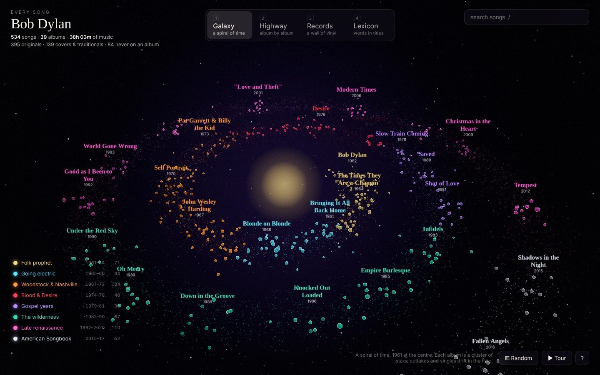
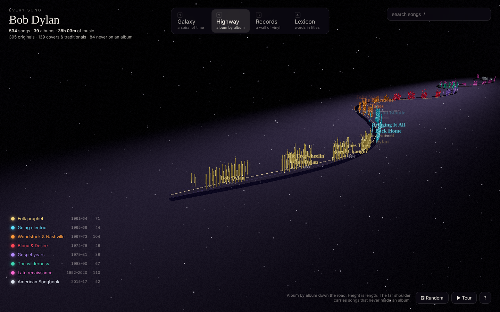
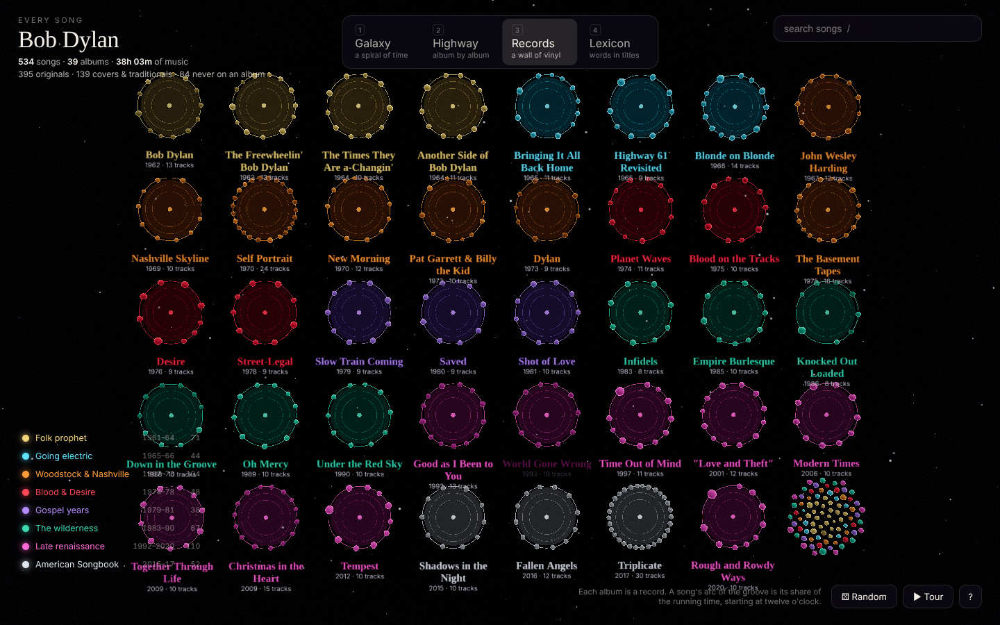
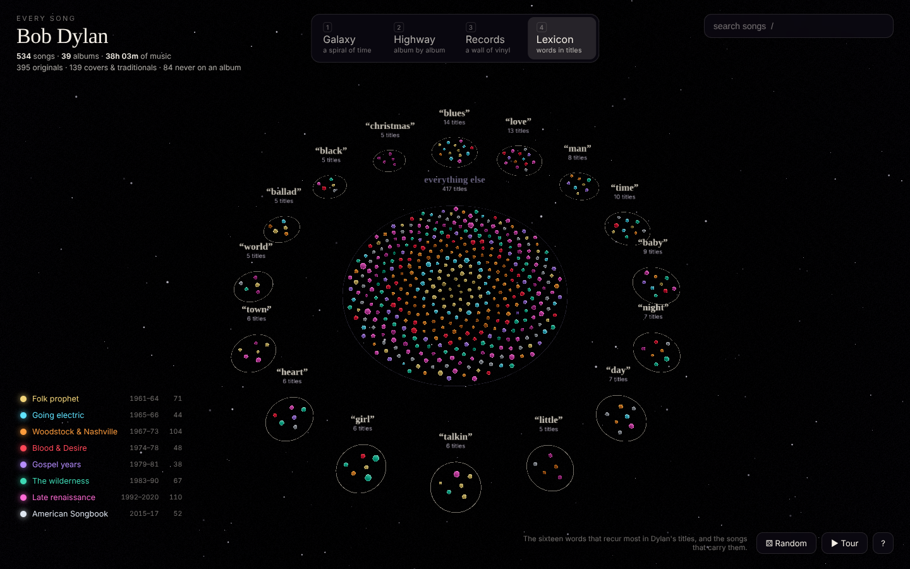
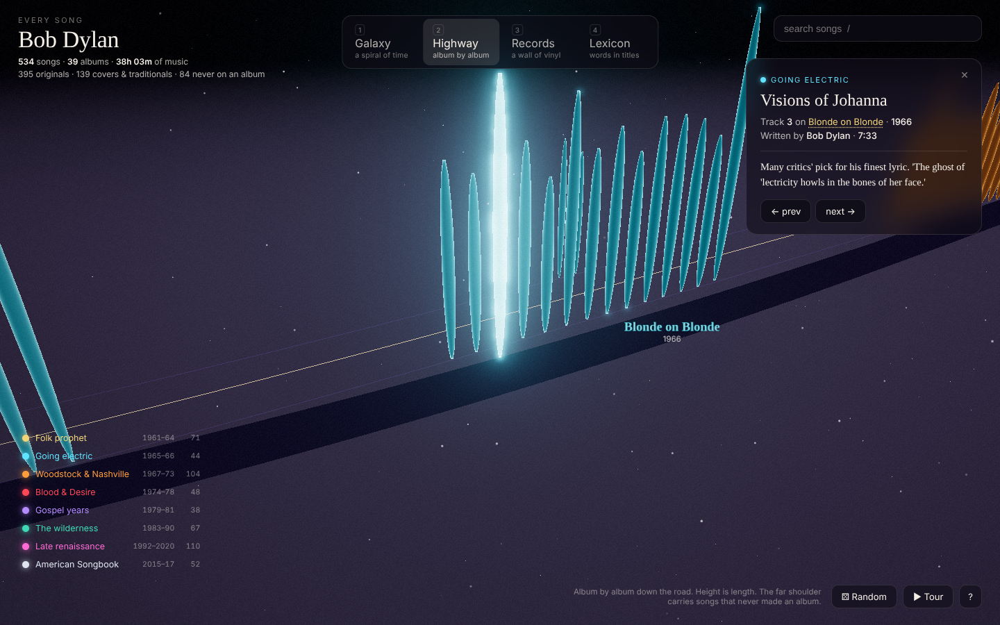

# Bob Dylan · Every Song

Every song Bob Dylan released between 1961 and 2020, as an explorable three.js universe.

534 songs. 39 studio albums (including *The Basement Tapes*) plus 84 originals that never made an album: singles, B-sides, soundtrack songs and Bootleg Series outtakes. 38 hours of music.

Every mark is one song. **Colour** is the era. **Size** is the song's length. Dimmer marks are covers and traditionals; the brightest are Dylan originals. The same 535 marks morph between four layouts:

| | |
|---|---|
|  |  |
| **Galaxy** — a spiral of time, 1961 at the centre. Each album is a cluster of stars on the arm; non-album songs drift in the halo. | **Highway** — Highway 61, album by album. Each song stands on the roadside; height is its length. Singles and outtakes line the far shoulder at the year they were recorded. |
|  |  |
| **Records** — a wall of vinyl. Each album is a record; a song's arc of the groove is its share of the running time, starting at twelve o'clock. | **Lexicon** — the sixteen words Dylan put in titles most often, with the songs that carry them. |



Click any song for its story: album, track, length, who wrote it, and a note for the ones with a tale to tell. Click an album label for the album and its tracklist. Search, filter by era, take the tour, or roll the dice.

## Run it

```sh
pnpm install
pnpm dev        # http://localhost:5173
pnpm build      # static site in dist/
pnpm check      # validate the catalogue data
pnpm shots      # headless screenshots of every layout (needs Chromium)
```

## Keys

| Key | |
|---|---|
| `1` `2` `3` `4` | Galaxy · Highway · Records · Lexicon |
| `/` | search |
| `←` `→` | previous / next song |
| `↑` `↓` | previous / next album |
| `T` | start or stop the tour |
| `R` | a song at random |
| `Esc` | clear selection and filters |
| `?` | help |

The URL hash remembers the layout and the selected song, so any view can be shared: `#highway/blonde-3` is *Visions of Johanna* on the highway.

## How it is built

- **three.js** with a single `InstancedMesh` for all 534 songs and a small custom shader (per-instance colour, rim light, filter dimming and highlight), so every layout change is a staggered CPU morph of 534 transforms.
- **Layouts** are pure functions in `src/layouts.js` that return positions, scales, labels, a camera, a static guide group (the road, the rings, the galactic dust) and focus vantages for songs and albums.
- **Labels** are canvas sprites with screen-constant size, word wrapping and greedy overlap culling each frame, so the galaxy never becomes a wall of text.
- **Post-processing**: Unreal bloom, ACES tone mapping, then a grade pass for vignette and grain.
- **Data** lives in `data/*.json` as plain album and track records and is validated by `scripts/check-data.mjs`. Eras and their palette are in `src/eras.js`; the eight hues were checked with a colour-vision validator so every chronologically adjacent pair stays distinct under simulated colour-blindness.

### Notes on the data

The catalogue covers the 39 official studio albums from *Bob Dylan* (1962) to *Rough and Rowdy Ways* (2020). *The Basement Tapes* appears at 1967, when it was recorded, and only Dylan's songs from it are included; The Band's own tracks are omitted. *Shot of Love* includes "The Groom's Still Waiting at the Altar", added to the album in 1985. Live albums, compilations and *Shadow Kingdom* are not included because they re-record songs already in the catalogue.

The 84 non-album songs are Dylan originals (and a few co-writes) chosen from singles and the Bootleg Series. The year is when the song was recorded; the source is its first official release. Track lengths are the standard album timings; a few seconds either way should be expected.
