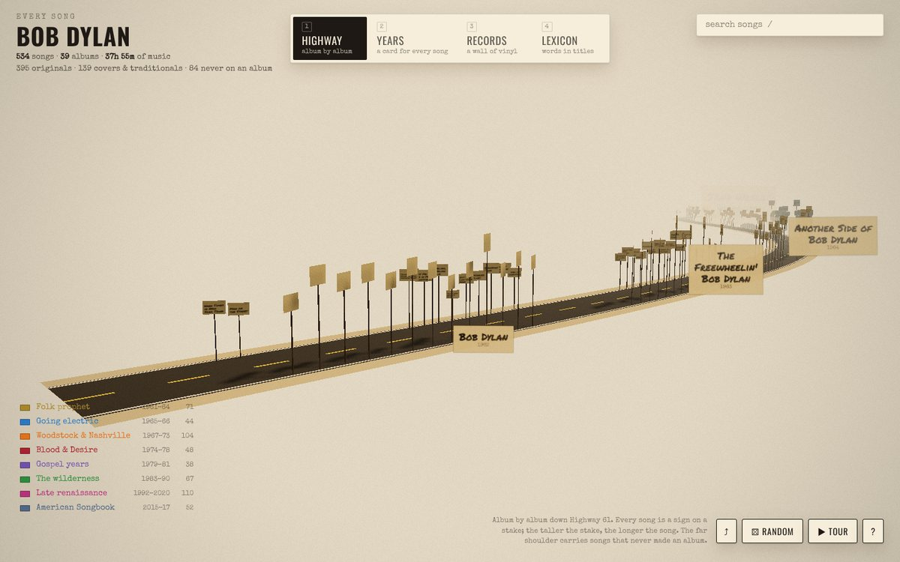
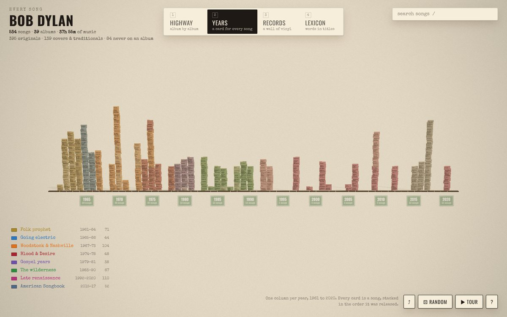
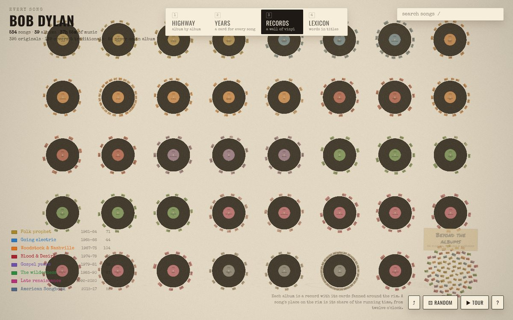
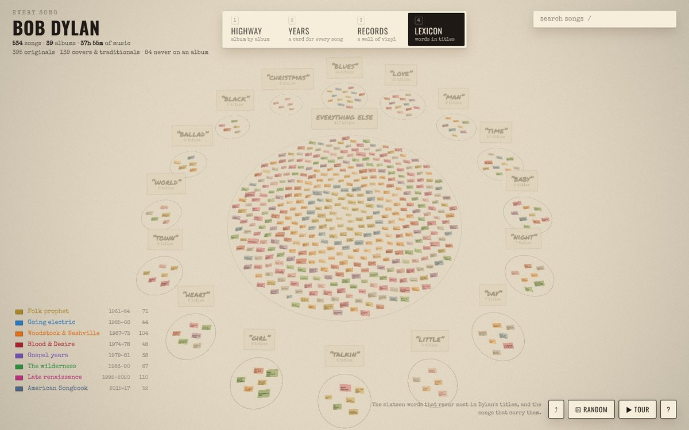
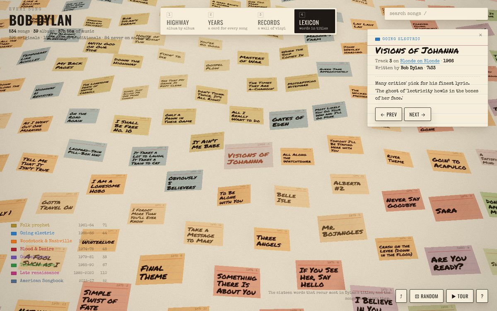
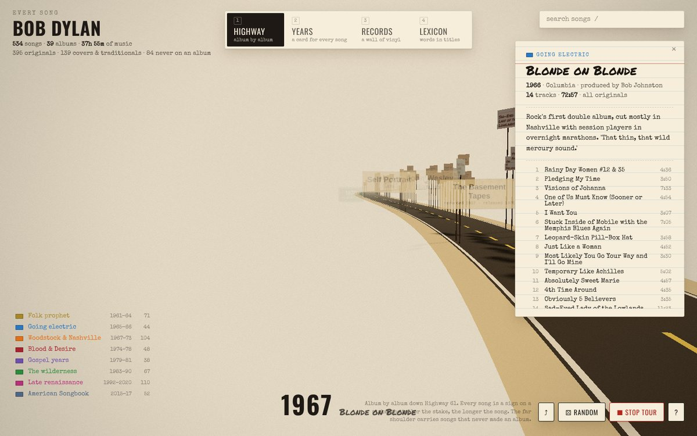

# Bob Dylan · Every Song

Every song Bob Dylan released between 1961 and 2020, hand-lettered on index cards and laid out in three.js.

534 songs. 39 studio albums (including *The Basement Tapes*) plus 84 originals that never made an album: singles, B-sides, soundtrack songs and Bootleg Series outtakes. 38 hours of music.

The look comes from Dylan's own material world: the cue cards of the *Subterranean Homesick Blues* clip, typewritten lyric sheets, cardboard signs in marker, black vinyl with paper labels, a two-lane blacktop with a yellow line, and the warm grain of a Kodachrome print. Every card is one song, with its title in marker. The card's colour is the era. Its size is the song's length. Black marker means a Dylan original; pencil grey means a cover or a traditional. The same 534 cards morph between four layouts:

| | |
|---|---|
|  |  |
| **Highway** — Highway 61, album by album. Each song is a sign on a stake by the road; the taller the stake, the longer the song. Singles and outtakes line the far shoulder at the year they were recorded. The tour here is a drive down the road with a year readout. | **Years** — one column of cards per year, 1961 to 2020, stacked in release order. |
|  |  |
| **Records** — a wall of vinyl. Each album is a record with its cards fanned around the rim; a song's place on the rim is its share of the running time, from twelve o'clock. | **Lexicon** — the sixteen words Dylan put in titles most often, with the cards that carry them laid out on the table. |





Click any card for its story: album, track, length, who wrote it, and a note for the ones with a tale to tell. Click an album sign or a record label for the album and its tracklist. Search, filter by era, take the tour, or roll the dice.

## Run it

```sh
pnpm install
pnpm dev        # http://localhost:5173
pnpm build      # static site in dist/
pnpm check      # validate the catalogue data
pnpm shots      # headless screenshots of every layout (needs Chromium)
```

## Keys

| Key | |
|---|---|
| `1` `2` `3` `4` | Highway · Years · Records · Lexicon |
| `/` | search |
| `←` `→` | previous / next song |
| `↑` `↓` | previous / next album |
| `T` | start or stop the tour (a drive, on the Highway) |
| `R` | a song at random |
| `Esc` | clear selection and filters |
| `?` | help |

The URL hash remembers the layout and the selected song, so any view can be shared: `#highway/blonde-3` is *Visions of Johanna* on the highway.

## How it is built

- **three.js** with a single `InstancedMesh` of card planes for all 534 songs. A 4096-pixel canvas atlas holds every title, lettered in Permanent Marker on era-tinted stock; each instance carries its atlas offset, era tint and a two-value state (filter dimming, highlight) into a `MeshStandardMaterial` patched with `onBeforeCompile`. A second instanced mesh draws the stakes on the highway.
- **Light and shadow**: a warm directional key with a shadow map that follows the camera target, a hemisphere fill, and a shadow-only ground so cards and signs sit on something. No bloom; the final pass adds a Kodachrome lift, vignette and grain.
- **Layouts** are pure functions in `src/layouts.js` that return positions, scales, quaternions and stake heights per song, plus signs, a camera, a static guide group (asphalt and paint, the year rail, vinyl and labels, ink rings) and focus vantages. Cards slerp between orientations as they travel.
- **Signs** are canvas sprites (kraft board with marker, or green highway signs for years) with screen-constant size, word wrapping and greedy overlap culling each frame.
- **Data** lives in `data/*.json` as plain album and track records and is validated by `scripts/check-data.mjs`. Eras and their palette are in `src/eras.js`; the eight hues were checked with a colour-vision validator against the paper surface so every chronologically adjacent pair stays distinct.
- **Type**: Oswald for the woodtype headings, Special Elite for the typewritten data, Permanent Marker for the cards and signs, all from Google Fonts with system fallbacks.

### Notes on the data

The catalogue covers the 39 official studio albums from *Bob Dylan* (1962) to *Rough and Rowdy Ways* (2020). *The Basement Tapes* appears at 1967, when it was recorded, and only Dylan's songs from it are included; The Band's own tracks are omitted. *Shot of Love* includes "The Groom's Still Waiting at the Altar", added to the album in 1985. Live albums, compilations and *Shadow Kingdom* are not included because they re-record songs already in the catalogue.

The 84 non-album songs are Dylan originals (and a few co-writes) chosen from singles and the Bootleg Series. The year is when the song was recorded; the source is its first official release. Track lengths are the standard album timings; a few seconds either way should be expected.
