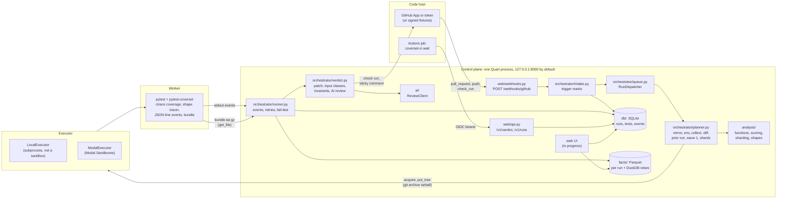

# coverset · Architecture

coverset is a control plane for pytest. It hears that a pull request was opened, runs the PR's tests in workers before any CI runner has booted, puts the tests most likely to fail first, and reports two kinds of coverage. One is per-test line and branch coverage. The other is input-class coverage: which kinds of argument value each function's tests passed in, and which they never did.

This page is the map. Each part has its own page:

| Page | Covers |
|---|---|
| [docs/instrumentation.md](docs/instrumentation.md) | the pytest plugin inside the worker: per-test coverage, the shape tracer, events, the bundle |
| [docs/data-model.md](docs/data-model.md) | the control-plane tables, the Parquet facts, the coverage rules |
| [docs/input-classes.md](docs/input-classes.md) | the input-class catalogue and worked examples from the demo |
| [docs/invariants.md](docs/invariants.md) | `invariants.yaml`, statuses and evaluation |
| [docs/orchestrator.md](docs/orchestrator.md) | queue, planner, runner, retries, fail-fast, the executor contract |
| [docs/github.md](docs/github.md) | the GitHub App, token mode, webhooks, `coverset-ci wait` |
| [docs/ai-review.md](docs/ai-review.md) | the advisory AI review |
| [docs/security.md](docs/security.md) | the threat model and the hardening checklist |
| [docs/extending.md](docs/extending.md) | adding an executor, a forge, a language, a review client, input classes |
| [docs/modal.md](docs/modal.md) | the Modal executor: images, trusted snapshots, the warm pool, the reaper, cost guards |
| [docs/ui.md](docs/ui.md) | the web UI (being written alongside this page) |

Status words used throughout: **verified** means read in the committed code on branch `boyd/testing` and covered by a test; **in progress** means another agent is building it on the same branch right now; **designed, not built** means the plan describes it and no code exists.

## What coverset is, and what it is not

coverset is:

- a webhook receiver and run queue (`src/coverset/forge/`, `src/coverset/orchestrator/`);
- a test planner that orders tests by risk and splits them into shards (`src/coverset/analysis/`);
- a pytest plugin that records per-test coverage and argument shapes inside the worker (`packages/pytest-coverset/`);
- a facts store of immutable Parquet files queried with DuckDB (`src/coverset/facts/`);
- a reporter that posts a check run and one sticky comment on the pull request (`src/coverset/forge/`).

coverset is not a GitHub Actions replacement. It runs one thing: the repository's pytest suite. It does not run build steps, linters, deployments or arbitrary workflow YAML. Actions keeps doing all of that. A CI job that wants coverset's answer runs the thin `coverset-ci wait` step (`packages/pytest-coverset/src/pytest_coverset/ci.py`), which waits for the verdict and replays the results in pytest's format. See [docs/github.md](docs/github.md#the-thin-actions-step-coverset-ci-wait).

coverset is also not a type checker and not a fuzzer. Argument shapes are sampled observations of what tests actually passed in. A hollow square in the shape grid means "never observed", not "buggy".

## The system

Source reaches a worker only as a `git archive` tarball written with `Worker.put_tree`. The control plane keeps a bare mirror per repository under `<data_dir>/mirrors/<repo_id>.git` (`src/coverset/orchestrator/repos.py`). Workers never run git against a remote and never receive forge credentials.

## How a run works

The full walk-through, with every event kind, is in [docs/orchestrator.md](docs/orchestrator.md). This is the short form. Each step names the `runs.timeline` key it sets (ISO 8601 UTC strings).

| # | Step | Code | Timeline key |
|---|---|---|---|
| 1 | GitHub posts a `pull_request` webhook. The signature is checked over the raw body before anything is parsed or stored. | `web/webhooks.py`, `forge/signing.py` | `webhook_received` |
| 2 | Intake upserts the repository and PR, decides trust, and inserts a `runs` row: `queued`, `paused`, or `awaiting_approval` for untrusted PRs. The answer is HTTP 202. | `orchestrator/intake.py` | `queued` or `awaiting_approval` |
| 2a | Untrusted only: someone presses **Approve run**; coverset checks their permission, then queues the run with the network blocked. | `orchestrator/intake.py` | `approval_requested`, `approved`, `queued` |
| 3 | The dispatcher claims the run (an atomic `UPDATE ... WHERE status = 'queued'`) under `COVERSET_MAX_CONCURRENT_RUNS`, setting `runs.claimed_by` (`<role>@<host>:<pid>:<nonce>`) and `runs.heartbeat_at`, which is refreshed every 10 s while the run executes. Policy checks run: untrusted runs never use the LocalExecutor, local webhook runs need `COVERSET_LOCAL_ALLOW_WEBHOOK_RUNS`, and Modal runs stop at the daily budget (an admitted Modal run reserves its predicted cost). | `orchestrator/queue.py`, `orchestrator/runner.py`, `orchestrator/budget.py` | none |
| 3a | A PR run with a forge gets its `coverset` check created `in_progress` before planning; its id goes into `runs.check_run_id`, and the verdict later completes that same check. | `orchestrator/runner.py` (`_start_check`), `forge/verdict.py` (`start_check`) | none |
| 4 | Planning: refresh the mirror, export the head, build or find the environment, pick the newest ready trusted snapshot (Modal) or the environment image, acquire workers (pooled ones first on Modal), `put_tree` the source into each. | `orchestrator/planner.py`, `executors/` | `sandbox_ready` |
| 5 | Worker 0 collects. The diff `base...head` is classified into changed functions. The prior run is chosen. Every test is scored, wave 1 is computed, and the tests are dealt into shards. | `analysis/diff.py`, `analysis/prior.py`, `analysis/scoring.py`, `analysis/cover.py`, `analysis/sharding.py` | none |
| 6 | Each shard runs `python -m pytest @run/shard.args` with the plugin. Events stream back on stdout. | `orchestrator/runner.py`, `pytest_coverset/plugin.py` | `first_test`, `wave1_finished` |
| 7 | The first failure of a non-quarantined test starts one retry. A second failure confirms it; the early verdict is posted at once. | `orchestrator/runner.py` | `first_failure`, `verdict` |
| 8 | Bundles are pulled before workers are released, then extracted, converted and ingested into Parquet. A shard whose coverage came from a tracer other than coverage.py's C tracer gets a `log` event (`warning: tracer_mismatch`, also recorded in its `ingest_log`). The run is finalised. | `orchestrator/bundles.py`, `orchestrator/runner.py` (`tracer_warning`), `facts/` | none |
| 9 | The report adds patch coverage, input-class coverage, invariants and the advisory AI review. The verdict is stored, posted, and closed with a `done` event that carries the exit code. | `orchestrator/verdict.py`, `forge/verdict.py` | `verdict` (if not set at step 7), `finished` |
| 10 | Afterwards a PR run applies the per-PR retention rule (outside `COVERSET_ENV=test`), and a trusted baseline of the default branch that completed with verdict `success` or `failure` on an executor with filesystem snapshots (Modal) schedules a re-snapshot of its head, if it is still the branch tip, and then refills that repo's warm pool when `serve` maintains one. | `orchestrator/runner.py` (`_expire_pr_runs`, `resnapshot`), `orchestrator/pool.py` | none |

Three run columns sit beside the timeline. `rank_coverset` is the first confirmed failure's position in the priority order the planner wrote. `rank_executed` is how many tests had reported a result when it was confirmed (shards run concurrently, so it can differ from `rank_coverset`). `rank_file_order` is its position in plain collection order. `t_first_failure_file_order_est` is an estimate of when file-order CI would have reached it: `(sandbox_ready - t0) + Σ p50` of the tests before it in file order, where `t0` is `webhook_received`, else `queued` (`orchestrator/verdict.py`, `file_order_estimate`). `runs.ci_first_contact_at` records the first `/v1/verdict` answer for the run (`web/api.py`).

Exit codes (`orchestrator/runner.py`, `exit_code_for`): the `done` event carries 0 for `success`, 1 for `failure`, 5 when no tests were collected, and 2 for everything else (`error`, `cancelled` and `abandoned` runs, and `neutral` conclusions such as an incomplete run or "budget exhausted"). `coverset-ci wait` exits 1 for any `failure`, otherwise with the server's code, and never turns a non-`success` conclusion into 0 (`pytest_coverset/ci.py`).

Background work while `serve` runs (`app.py`): the run dispatcher; the retention pass once at start-up and then every 24 h (`schedule_gc`, the same pass as `coverset gc`); and, when `COVERSET_EXECUTOR=modal`, the reaper every 60 s and the warm-pool maintainer every 30 s (`schedule_executor_upkeep`). At boot, `queued` runs left by a previous process are abandoned (or kept queued with `COVERSET_REQUEUE_ON_BOOT=true`), and a `running` run is taken over only when nothing executes it any more: an earlier `serve` on this host claimed it, its claiming process on this host is gone, nobody claimed it, or its heartbeat is older than 5 minutes; a live `coverset run` keeps its runs. With the Modal upkeep running, shutdown cancels re-snapshots in flight, drains the pool and closes the executors.

## Glossary

These terms are used the same way in code, UI and docs.

| Term | Meaning | Where it lives |
|---|---|---|
| **shape** | The recorded features of one argument value: type, None-ness, sign, length bucket, string kind, element summary. Written as a canonical shape key such as `str\|ascii\|kind:email/plain\|len:11-100`. | `pytest_coverset/features.py` (`shape_key`) |
| **input class** | A named block of a parameter's input space, written `<param>:<class>`, for example `email:multi-label-domain` or `weights:zero-element`. | `analysis/shapes.py` (`InputClass`) |
| **input-class coverage** | Observed ÷ expected input classes over a function's parameters (each-choice coverage). | `analysis/shapes.py` (`Catalogue.function_input_cov`) |
| **shape grid** | The per-function picture of parameters × input classes. A filled square is a class some test exercised; a hollow dashed square is one no test ever passed in. | data from `Catalogue.function_input_cov`; rendering in progress (`docs/ui.md`) |
| **flow ribbon** | The test files → in-repo callers → parameters picture, drawn from each observation's caller. | data in `call_shapes.caller_kind/caller_key`; rendering in progress |
| **data-flow overlay** | Shape grids, flow ribbons, inlay chips in the source view and the treemap's Gap mode, together. | treemap aggregates in `facts/queries.py` (`treemap`); rendering in progress |
| **invariant** | A user-declared behavioural rule in `invariants.yaml` with the statuses `satisfied`, `violated`, `untested`, `stale`, `needs_review`. | `analysis/invariants.py` |
| **wave 1** (the change-covering set) | The greedy set cover of tests over the PR's changed function bodies, plus tests in changed files and tests with no coverage history. Wave 1 runs first on every shard. | `analysis/cover.py` (`change_covering_set`), `analysis/sharding.py` |

## Components

| Module | Responsibility | Key public API | Tests |
|---|---|---|---|
| `packages/pytest-coverset/src/pytest_coverset/plugin.py`, `coverage_ctx.py` | Inert unless `--coverset-out`; one coverage context per test; STOP file and SIGTERM handling; writes the bundle | `--coverset-*` options, `CoverageContext` | `packages/pytest-coverset/tests/test_plugin.py`, `test_events.py`, `test_robustness.py`, `test_teardown.py` |
| `pytest_coverset/shapes.py`, `features.py`, `redact.py` | `sys.monitoring` shape tracer, shape keys, redacted example values | `ShapeTracer`, `TargetSpec`, `shape_key`, `example_repr` | `test_shapes.py`, `test_features.py`, `test_robustness.py` |
| `pytest_coverset/ordering.py`, `events.py`, `bundle.py`, `outcomes.py`, `paths.py` | Priority order, framed stdout events, bundle files, result folding, one path normaliser | `priority_order`, `EventWriter`, `parse_event_line`, `make_tarball`, `fold_reports`, `norm_path` | `test_ordering.py`, `test_events.py`, `test_plugin.py` |
| `pytest_coverset/ci.py`, `ci_http.py`, `junit.py` | `coverset-ci wait` (stdlib only) | `main`, `exit_code_for` | `packages/pytest-coverset/tests/test_ci.py`, `tests/forge/test_forge_ci_wait.py` |
| `src/coverset/config.py`, `logging.py` | Every `COVERSET_*` setting; secret redaction | `Settings`, `get_settings`, `redact`, `RedactingFilter`, `configure_logging` | `tests/test_config.py`, `tests/test_redaction.py` |
| `src/coverset/app.py`, `cli.py`, `commands/` | App factory, security headers, background upkeep (gc, reaper, warm pool), the `coverset` CLI (including `invariants scan`) | `create_app`, `schedule_gc`, `schedule_executor_upkeep`, `cli`, `register_commands`, `scan_invariants` | `tests/test_app.py`, `tests/orchestrator/test_commands.py`, `tests/orchestrator/test_pool_upkeep.py`, `tests/orchestrator/test_invariants_scan.py` |
| `src/coverset/db/` | SQLAlchemy models, SQLite pragmas, Alembic migrations | the models in `db/models.py`, `Database`, `init_db` | `tests/test_models.py` |
| `src/coverset/facts/` | Untrusted-bundle reading, per-shard Parquet ingest, run aggregates, DuckDB queries, retention | `read_python_bundle`, `extract_bundle`, `BundleLimits`, `FactsStore`, `ingest_shard`, `finalize_run`, `patch_coverage`, `tests_covering`, `treemap`, `shapes_for_function`, `ParquetPriorRun`, `expire_runs` | `tests/facts/` |
| `src/coverset/lang/` | Language-neutral contracts and the Python adapter | `LanguageAdapter`, `NeutralBundle`, `PriorRun`, `PythonAdapter`, `read_tool_config` | `tests/analysis/test_analysis_python_adapter.py` |
| `src/coverset/analysis/` | Diff to changed functions, prior run, impact, scoring, wave 1, sharding, patch coverage, input classes, invariants | `run_git_diff`, `changed_functions`, `index_functions`, `select_prior_run`, `score_tests`, `change_covering_set`, `plan_shards`, `patch_report`, `Catalogue`, `load_invariants`, `evaluate` | `tests/analysis/` |
| `src/coverset/orchestrator/` | Intake, queue, planning, execution, verdicts, bundles, history, mirrors, budget, pool, reaper | `intake`, `RunDispatcher`, `plan_run`, `execute_run`, `build_report`, `build_summary`, `PoolMaintainer`, `reap_forever` | `tests/orchestrator/`, `tests/forge/test_forge_intake.py`, `tests/e2e/test_demo_local.py` |
| `src/coverset/executors/base.py`, `local.py`, `env_export.py` | The executor contract, the local subprocess executor, environment hashing and the plugin wheel | `Executor`, `Worker`, `LocalExecutor`, `sanitize_env`, `build_env_spec`, `get_executor` | `tests/executors/` |
| `src/coverset/executors/modal_.py`, `modal_images.py` | Modal Sandboxes: env images, trusted snapshots, the warm pool, reaping, budget guard | `ModalExecutor`, `SandboxSlots` | `tests/executors/test_modal_executor.py` (fake `modal` module), `test_modal_live.py`; see [docs/modal.md](docs/modal.md) |
| `src/coverset/forge/` | Forge contract, GitHub App and token adapters, fake forge, signatures, OIDC, sticky comment, App manifest, composite action | `Forge`, `GitHubForge`, `FakeForge`, `verify_signature`, `verify_actions_oidc`, `post_verdict` | `tests/forge/` |
| `src/coverset/ai/` | Redacted review bundles, fake and Anthropic reviewers, findings | `ReviewClient`, `get_review_client`, `build_review_bundle`, `review_changes` | `tests/ai/` |
| `src/coverset/web/` (committed part) | Access guard, `/v1` API, webhook route, `/setup` | `register_blueprints`, `access_guard`, `authorize_repo` | `tests/test_auth.py`, `tests/forge/test_forge_api.py`, `test_forge_api_hardening.py`, `test_forge_webhooks.py`, `test_forge_setup.py` |
| `src/coverset/web/` (UI pages) | Runs, PR, source view, shape grid, treemap, outbox | in progress | see [docs/ui.md](docs/ui.md) |
| `src/coverset/demo/`, `scripts/` | Deterministic demo repository, demo flow, fixture and benchmark generators | `seed_demo_repo`, `run_demo` | `tests/test_seed_demo.py`, `tests/e2e/test_demo_local.py`, `tests/bench/test_gen_bench_suite.py` |

## Trust boundaries

coverset runs code it does not trust and reads data that code wrote. The rule is simple: anything a pull request can influence is data, never instructions, and never a source of credentials.

| Input | Who controls it | How coverset treats it |
|---|---|---|
| PR source and its tests | the PR author | Runs only inside a worker. Untrusted PRs wait for approval, then run with the network blocked and never on the LocalExecutor. |
| Worker stdout and events | the PR's code (it shares a process with the plugin) | Lines need the exact per-exec nonce prefix to count as events, but the nonce is not a security boundary. Every field is validated; `results.jsonl` in the bundle is reconciled; the pytest exit code is cross-checked against the outcomes. |
| `bundle.tar.gz` | the PR's code | Extracted and converted under hard limits (`facts/untrusted.py`, `facts/convert.py`): no links, capped sizes, paths checked against the head tree. |
| Webhook payloads | anyone, until the HMAC verifies | Nothing is parsed or stored before the signature check. After it, repositories are identified by `repository.id`, SHAs must be 40 hex characters, and `clone_url` is never read. |
| `[tool.coverset]`, `invariants.yaml`, `.python-version`, `uv.lock` | the PR author | Parsed strictly: no symlinks, size caps, safe YAML, `check` expressions never evaluated (`lang/python.py`, `analysis/invariants.py`). |
| AI review output | the model, which reads PR text | Schema-validated, redacted, advisory: it never changes pass or fail. |
| `/v1` callers | CI jobs and strangers | Admin, a GitHub Actions OIDC token bound to the repository, or anonymous with a reduced, rate-limited view (`web/api.py`). |

What never enters a worker: forge credentials (the App private key, installation tokens, `COVERSET_GITHUB_TOKEN`), the webhook secret, the admin token, `ANTHROPIC_API_KEY`, Modal tokens, the control database and the git mirror. The LocalExecutor builds each child environment from scratch (`executors/local.py`, `LocalWorker.child_env`) and `sanitize_env` drops denied names and prefixes (`executors/base.py`). Mirror tokens travel only as `git -c http.extraHeader=...` on the control plane (`orchestrator/repos.py`). The Modal executor creates sandboxes with `secrets=[]` and `include_oidc_identity_token=False` (`executors/modal_.py`, `sandbox_options`; see [docs/modal.md](docs/modal.md)).

One control plane is one trust domain. Every repository shares its database, facts directory, credentials and admin token. The full checklist is [docs/security.md](docs/security.md).

## Extension seams

Each seam is a `typing.Protocol`. The how-to is [docs/extending.md](docs/extending.md).

| Seam | Protocol | Implementations today |
|---|---|---|
| Where tests run | `coverset.executors.base.Executor` and `coverset.executors.base.Worker`; optional `PoolingExecutor` and `ReapingExecutor` | `LocalExecutor`, `ModalExecutor` |
| Code host | `coverset.forge.base.Forge` | `GitHubForge` (App and token modes), `FakeForge` |
| Language | `coverset.lang.base.LanguageAdapter`, with `NeutralBundle` as the bundle contract and `PriorRun` for prior facts | `PythonAdapter` |
| Reviewer | `coverset.ai.client.ReviewClient` | `FakeReviewClient`, `AnthropicReviewClient` (unit-tested against a stubbed SDK only) |
| Run queue | `coverset.orchestrator.RunQueue` | `RunDispatcher` |

## Designed, not built

| Item | Where the seam is |
|---|---|
| Postgres for the control database | `COVERSET_DATABASE_URL` takes any SQLAlchemy async URL; only SQLite is exercised, and the migrations are written with `render_as_batch` for SQLite. |
| DuckLake, content-addressed per-(test, blob) bitsets, Postgres with `pg_roaringbitmap` for facts | Everything reads facts through `FactsStore` and `facts/queries.py`; see [docs/data-model.md](docs/data-model.md#scale-out-path). |
| Modal Functions with memory snapshots as an executor | A second `Executor` implementation beside the Sandbox-based `ModalExecutor`. |
| Daytona, E2B and Docker executors | `Executor` and `Worker` in `executors/base.py`, registered in `executors.get_executor`. |
| GitLab and Bitbucket | `Forge` in `forge/base.py`, route names in `forge/registry.py`, and the `ForgeKind` literal in `db/models.py` (today `github`, `fake`, `local`). |
| TypeScript adapter | `LanguageAdapter` and `NeutralBundle`; the route is in [docs/extending.md](docs/extending.md#adding-a-language). |
| Runtime invariant checks | `verify.kind: runtime` is accepted and reported `untested` by `analysis/invariants.evaluate`; the design uses the shape tracer's local `PY_START`/`PY_RETURN` events ([docs/invariants.md](docs/invariants.md#runtime-checks-designed-not-built)). |
| LightGBM ranking stage | `analysis/scoring.score_tests` returns `ScoredTest`; `TestHistory` is where the extra features would come from. |
| Result reuse and test skipping | The planner classifies `trivial`, `renamed` and `moved` changes and the patch report marks their rows inherited, but every collected test still runs. Skipping would sit in `planner._analyse` before sharding. |
| Treemap minimap | UI. |
| `merge_group` (merge queues) | Not in `forge/github_events.ALLOWED_EVENTS`; see [docs/github.md](docs/github.md#future-work-merge-queues). |
| Check-run buttons beyond `rerun-failed`, `rerun-all` and `approve-run` | `CheckAction` and `ACTION_IDENTIFIERS` in `forge/base.py`, dispatched in `intake._action_button`. |

## Numbers

Performance figures (time to first test, sandbox start-up, fan-out, overhead, facts-store latency, cost) live in [docs/benchmarks.md](docs/benchmarks.md), with the raw values in [docs/numbers.json](docs/numbers.json). This page repeats none of them.
