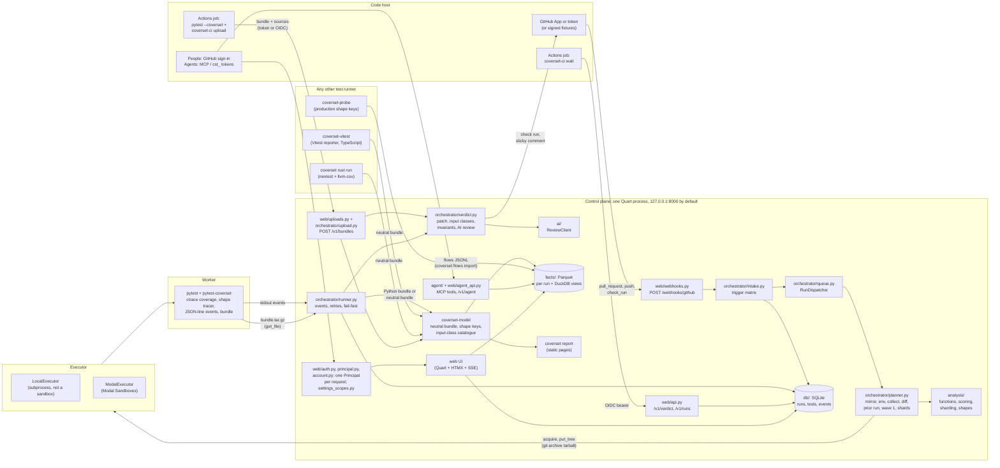

# coverset · Architecture

coverset is a control plane for pytest. It hears that a pull request was opened, runs the PR's tests in workers before any CI runner has booted, puts the tests most likely to fail first, and reports two kinds of coverage. One is per-test line and branch coverage. The other is input-class coverage: which kinds of argument value each function's tests passed in, and which they never did.

This page is the map. Each part has its own page:

| Page | Covers |
|---|---|
| [docs/instrumentation.md](docs/instrumentation.md) | the pytest plugin inside the worker: per-test coverage, the shape tracer, events, the bundle |
| [docs/data-model.md](docs/data-model.md) | the control-plane tables, the Parquet facts, the coverage rules |
| [docs/input-classes.md](docs/input-classes.md) | the input-class catalogue and worked examples from the demo |
| [docs/invariants.md](docs/invariants.md) | `invariants.yaml`, statuses and evaluation |
| [docs/orchestrator.md](docs/orchestrator.md) | queue, planner, runner, retries, fail-fast, the executor contract |
| [docs/github.md](docs/github.md) | the GitHub App, token mode, webhooks, `coverset-ci wait` |
| [docs/ai-review.md](docs/ai-review.md) | the advisory AI review |
| [docs/security.md](docs/security.md) | the threat model and the hardening checklist |
| [docs/extending.md](docs/extending.md) | adding an executor, a forge, a language, a review client, input classes |
| [docs/modal.md](docs/modal.md) | the Modal executor: images, trusted snapshots, the warm pool, the reaper, cost guards |
| [docs/ui.md](docs/ui.md) | the web UI: pages, the data-flow overlay, the test page, keys |
| [docs/neutral-bundle.md](docs/neutral-bundle.md) | the language-neutral bundle any test runner can write: files, shape keys, type descriptors, limits |
| [docs/report.md](docs/report.md) | `coverset report`, the static report of one run, and its `--compare` mode |
| [docs/typescript.md](docs/typescript.md) | `coverset-vitest`: the TypeScript reporter that writes the neutral bundle |
| [docs/getting-started.md](docs/getting-started.md) | onboarding a repository: `coverset doctor`, upload mode vs managed runs, the `[tool.coverset]` reference, environment sources, installing the project |
| [docs/dev.md](docs/dev.md) | the developer loop: `coverset dev`, data directories, local sign-in, running without GitHub, tests, conventions |
| [docs/deploy.md](docs/deploy.md) | hosting: Modal, Fly, a VM with Docker and Caddy; proxies, cookies, HSTS, backups, secret rotation, `coverset deploy check` |
| [docs/auth.md](docs/auth.md) | GitHub sign-in, sessions, roles, repository access, API tokens, the audit log |
| [docs/settings.md](docs/settings.md) | scoped settings (instance, org, repo, user): keys, precedence, who may edit, how policy reaches intake, planner and verdict, token pages |
| [docs/upload.md](docs/upload.md) | upload mode: `coverset-ci upload`, `POST /v1/bundles`, shards per commit, what is computed with and without a mirror |
| [docs/economy.md](docs/economy.md) | the test economy: weight, value, leverage, redundancy candidates, the minimal covering set, families, handlers, stale tests, the PR test tax |
| [docs/mcp.md](docs/mcp.md) | the MCP server and the `/v1/agent` API: tools, prompts, playbooks, trust notes |
| [docs/production-flows.md](docs/production-flows.md) | production input shapes: the probe, privacy, archetypes, gaps, what is built and what is designed |
| [docs/rust.md](docs/rust.md) | `coverset rust run`: per-test Rust coverage via cargo-nextest and LLVM, the capture format, the cost model, limitations, the shape-tracer design |

Status words used throughout: **verified** means read in the committed code on branch `boyd/testing` and covered by a test; **designed, not built** means the plan describes it and no code exists.

## What coverset is, and what it is not

coverset is:

- a webhook receiver and run queue (`src/coverset/forge/`, `src/coverset/orchestrator/`);
- a test planner that orders tests by risk and splits them into shards (`src/coverset/analysis/`);
- a pytest plugin that records per-test coverage and argument shapes inside the worker (`packages/pytest-coverset/`);
- a facts store of immutable Parquet files queried with DuckDB (`src/coverset/facts/`);
- a language-neutral model of semantic coverage, with an on-disk bundle format any test runner can produce and a validator for it (`packages/coverset-model/`);
- a reporter that posts a check run and one sticky comment on the pull request (`src/coverset/forge/`);
- a static report of one run for local use, built from the same renderers as the pages (`src/coverset/report/`);
- an upload intake, so a repository's own CI job can send the same bundle instead of coverset running the tests (`src/coverset/web/uploads.py`, `src/coverset/orchestrator/upload.py`);
- a test economy that prices every test by what it alone covers and flags a PR's test tax (`src/coverset/analysis/economy.py`, `facts/economy.py`, `report/economy.py`);
- an identity and access layer: GitHub sign-in, server-side sessions, API tokens, per-repository permissions mirrored from GitHub, an audit log, and settings at instance, organization, repository and user scope (`src/coverset/web/principal.py`, `account.py`, `tokens.py`, `audit.py`, `src/coverset/settings_scopes.py`);
- an MCP server and an HTTP API for AI agents over the same facts (`src/coverset/agent/`, `web/agent_api.py`);
- a Rust driver that records per-test coverage with cargo-nextest and LLVM into the neutral bundle (`src/coverset/lang/rust.py`, `rust_llvm.py`);
- a production probe that exports k-anonymous shape keys from a live service, with an importer, a gap report and archetype clustering (`packages/coverset-probe/`, `src/coverset/facts/flows.py`, `analysis/archetypes.py`).

coverset is not a GitHub Actions replacement. It runs one thing: the repository's pytest suite. It does not run build steps, linters, deployments or arbitrary workflow YAML. Actions keeps doing all of that. A CI job that wants coverset's answer runs the thin `coverset-ci wait` step (`packages/pytest-coverset/src/pytest_coverset/ci.py`), which waits for the verdict and replays the results in pytest's format. See [docs/github.md](docs/github.md#the-thin-actions-step-coverset-ci-wait).

coverset is also not a type checker and not a fuzzer. Argument shapes are sampled observations of what tests actually passed in. A hollow square in the shape grid means "never observed", not "buggy".

## The system

Source reaches a worker only as a `git archive` tarball written with `Worker.put_tree`. The control plane keeps a bare mirror per repository under `<data_dir>/mirrors/<repo_id>.git` (`src/coverset/orchestrator/repos.py`). Workers never run git against a remote and never receive forge credentials.

## How a run works

The full walk-through, with every event kind, is in [docs/orchestrator.md](docs/orchestrator.md). This is the short form. Each step names the `runs.timeline` key it sets (ISO 8601 UTC strings).

| # | Step | Code | Timeline key |
|---|---|---|---|
| 1 | GitHub posts a `pull_request` webhook. The signature is checked over the raw body before anything is parsed or stored. | `web/webhooks.py`, `forge/signing.py` | `webhook_received` |
| 2 | Intake upserts the repository and PR, decides trust, and inserts a `runs` row: `queued`, `paused`, or `awaiting_approval` for untrusted PRs. The answer is HTTP 202. | `orchestrator/intake.py` | `queued` or `awaiting_approval` |
| 2a | Untrusted only: someone presses **Approve run** (or a signed-in person with write on the repository does); coverset checks their permission, then queues the run with the network blocked. | `orchestrator/intake.py`, `web/api.py` | `approval_requested`, `approved`, `queued` |
| 2b | Upload mode instead of 3 to 8: a CI job posts its bundle to `POST /v1/bundles`, authenticated as the repository (a `cst_` token with the `upload` scope, an Actions OIDC token, or the admin token). One run per (repo, commit) with trigger `upload` and one shard per label, idempotent on (repo, sha, label, sha256). A background pass diffs against the mirror (fetched with forge credentials) or the uploaded sources, ingests every shard, and continues at step 9. The dispatcher never claims upload runs. | `web/uploads.py`, `orchestrator/upload.py`, `facts/sources.py` | `queued`, `finished` |
| 3 | The dispatcher claims the run (an atomic `UPDATE ... WHERE status = 'queued'`) under `COVERSET_MAX_CONCURRENT_RUNS`, setting `runs.claimed_by` (`<role>@<host>:<pid>:<nonce>`) and `runs.heartbeat_at`, which is refreshed every 10 s while the run executes. Policy checks run: untrusted runs never use the LocalExecutor, local webhook runs need `COVERSET_LOCAL_ALLOW_WEBHOOK_RUNS`, and a Modal run is admitted only if today's spend (runs plus non-run `executor_spend`) plus its reservation fits the daily budget (after planning: workers x run timeout, capped by `COVERSET_MAX_RUN_COST_USD`, which also stops the run live). The untrusted-PR policy and the draft rule come from the scoped settings (repo > org > instance > `COVERSET_*`), which repository writers and admins set and the PR author cannot. | `orchestrator/queue.py`, `orchestrator/runner.py`, `orchestrator/budget.py`, `settings_scopes.py` | none |
| 3a | A PR run with a forge gets its `coverset` check created `in_progress` before planning; its id goes into `runs.check_run_id`, and the verdict later completes that same check. | `orchestrator/runner.py` (`_start_check`), `forge/verdict.py` (`start_check`) | none |
| 4 | Planning: refresh the mirror, export the head, build or find the environment (from `uv.lock`, `poetry.lock`, `Pipfile.lock`, requirement files, `[project]` metadata or `setup.cfg`/`setup.py`, pinned by `uv pip compile` when there is no lock; `lang/python_env.py`), pick the newest ready trusted snapshot (Modal) or the environment image, acquire workers (pooled ones first on Modal), `put_tree` the source into each. Projects that need installing (`install = wheel`) are installed when the trusted snapshot is built. Shard caps, the target shard length and fail-fast come from the scoped policy, which outranks `[tool.coverset]` because that file comes from the PR head. | `orchestrator/planner.py`, `lang/python_env.py`, `executors/`, `settings_scopes.py` | `sandbox_ready` |
| 5 | Worker 0 collects (with `--continue-on-collection-errors`: a test module that fails to import becomes a confirmed failure of the run, the other tests still run). The diff `base...head` is classified into changed functions. The prior run is chosen. Every test is scored, wave 1 is computed, and the tests are dealt into shards. | `orchestrator/planner.py` (`_collect`), `analysis/diff.py`, `analysis/prior.py`, `analysis/scoring.py`, `analysis/cover.py`, `analysis/sharding.py` | none |
| 6 | Each shard runs `python -m pytest @run/shard.args` with the plugin. Events stream back on stdout. | `orchestrator/runner.py`, `pytest_coverset/plugin.py` | `first_test`, `wave1_finished` |
| 7 | The first failure of a non-quarantined test starts one retry. A second failure confirms it; the early verdict is posted at once. | `orchestrator/runner.py` | `first_failure`, `verdict` |
| 8 | Bundles are pulled before workers are released, then extracted, converted and ingested into Parquet. A shard whose coverage came from a tracer other than coverage.py's C tracer, or whose C tracer was replaced mid-run (the plugin's `tracer_lost_at`), gets a `log` event (`warning: tracer_mismatch`, also recorded in its `ingest_log`). The run is finalised. | `orchestrator/bundles.py`, `orchestrator/runner.py` (`tracer_warning`), `facts/` | none |
| 9 | The report adds patch coverage, input-class coverage, invariants, the advisory AI review and, for a PR run with a finalized base, the test tax (added test statements per newly covered line and class, re-flagged against `policy.test_tax_threshold` and stored in `runs.summary_json["test_tax"]`). The verdict is stored, posted (the comment and check run carry the tax line), and closed with a `done` event that carries the exit code. The finalize step also writes the per-run summaries the pages read and the test-economy tables. | `orchestrator/verdict.py`, `forge/verdict.py`, `forge/comment.py`, `facts/aggregates.py`, `facts/economy.py` | `verdict` (if not set at step 7), `finished` |
| 10 | Afterwards a PR run applies the per-PR retention rule (outside `COVERSET_ENV=test`), and a trusted baseline of the default branch that completed with verdict `success` or `failure` on an executor with filesystem snapshots (Modal) schedules a re-snapshot of its head, if it is still the branch tip, and then refills that repo's warm pool when `serve` maintains one. The same kind of baseline on any executor, if it is still the tip, also gets `coverset invariants scan` in the background (`COVERSET_SCAN_AFTER_BASELINE`, default true): review-kind invariants get a fresh advisory review. | `orchestrator/runner.py` (`_expire_pr_runs`, `resnapshot`, `scan_after_baseline`), `orchestrator/pool.py`, `commands/invariants.py` | none |

Three run columns sit beside the timeline. `rank_coverset` is the first confirmed failure's position in the priority order the planner wrote. `rank_executed` is the position at which its first attempt actually reported: how many first-attempt results, across all shards, had arrived when it did (shards run concurrently and the plugin keeps a module's tests together, so it can differ from `rank_coverset`). `rank_file_order` is its position in plain collection order. `t_first_failure_file_order_est` is an estimate of when file-order CI would have reached it, labelled "estimated from the first test" everywhere it is shown: `(first_test - t0) + Σ p50` of the tests before it in file order (unknown p50s count as the median, or 0.05 s when no test has been timed), where `t0` is `webhook_received`, else `queued`; everything before the first test (environment, collection, planning) happens in either order (`orchestrator/verdict.py`, `file_order_estimate`). `runs.ci_first_contact_at` records the first `/v1/verdict` answer for the run (`web/api.py`).

Exit codes (`orchestrator/runner.py`, `exit_code_for`): the `done` event carries 0 for `success`, 1 for `failure` (collection errors included), 5 when no tests were collected, and 2 for everything else (`error`, `cancelled` and `abandoned` runs, and `neutral` conclusions such as an incomplete run or "budget exhausted"). `coverset-ci wait` exits 1 at the first `failure` verdict (the early one included); after any other verdict it reads on to the `done` event and exits with its code, and it never turns a non-`success` conclusion into 0 (`pytest_coverset/ci.py`).

Background work while `serve` runs (`app.py`): the run dispatcher; the retention pass once at start-up and then every 24 h (`schedule_gc`, the same pass as `coverset gc`); and, when `COVERSET_EXECUTOR=modal`, the reaper every 60 s and the warm-pool maintainer every 30 s (`schedule_executor_upkeep`). At boot, `queued` runs left by a previous process are abandoned (or kept queued with `COVERSET_REQUEUE_ON_BOOT=true`), upload runs (trigger `upload`) are skipped entirely (the dispatcher never executes them), and a `running` run is taken over only when nothing executes it any more: an earlier `serve` on this host claimed it, its claiming process on this host is gone, nobody claimed it, or its heartbeat is older than 5 minutes; a live `coverset run` keeps its runs. With the Modal upkeep running, shutdown cancels re-snapshots in flight, drains the pool and closes the executors.

## Glossary

These terms are used the same way in code, UI and docs.

| Term | Meaning | Where it lives |
|---|---|---|
| **shape** | The recorded features of one argument value: type, None-ness, sign, length bucket, string kind, element summary. Written as a canonical shape key such as `str\|ascii\|kind:email/plain\|len:11-100`. | `pytest_coverset/features.py` (`shape_key`) |
| **input class** | A named block of a parameter's input space, written `<param>:<class>`, for example `email:multi-label-domain` or `weights:zero-element`. | `analysis/shapes.py` (`InputClass`) |
| **input-class coverage** | Observed ÷ expected input classes over a function's parameters (each-choice coverage). | `analysis/shapes.py` (`Catalogue.function_input_cov`) |
| **shape grid** | The per-function picture of parameters × input classes. A filled square is a class some test exercised; a hollow dashed square is one no test ever passed in. | data from `Catalogue.function_input_cov`; rendered by `web/render/shapegrid.py` (see [docs/ui.md](docs/ui.md)) |
| **flow ribbon** | The test files → in-repo callers → parameters picture, drawn from each observation's caller. | data in `call_shapes.caller_kind/caller_key`; rendered by `web/render/ribbon.py` |
| **data-flow overlay** | Shape grids, flow ribbons, inlay chips in the source view and the treemap's Gap mode, together. | treemap aggregates in `facts/queries.py` (`treemap`); rendered by `web/render/treemap.py`, the inlay chips of `web/render/source.py` and `web/render/shapegrid.py` |
| **invariant** | A user-declared behavioural rule in `invariants.yaml` with the statuses `satisfied`, `violated`, `untested`, `stale`, `needs_review`. | `analysis/invariants.py` |
| **wave 1** (the change-covering set) | The greedy set cover of tests over the PR's changed function bodies, plus tests in changed files and tests with no coverage history. Wave 1 runs first on every shard. | `analysis/cover.py` (`change_covering_set`), `analysis/sharding.py` |
| **neutral bundle** | What a test run leaves behind for coverset in a form that depends on no language or framework: tests, static facts, per-test coverage, arcs, function regions, shapes and links, as JSON lines with a manifest. `pytest-coverset` writes it with `--coverset-neutral`; a reporter for another language writes the same files. | spec in [docs/neutral-bundle.md](docs/neutral-bundle.md); reader, writer and validator in `coverset_model.io`; `coverset bundle validate\|info\|convert` |
| **type descriptor** | The declared type of a parameter as a small JSON tree (`int`, `union`, `literal`, `enum`, `list` of ...) that any language can produce; the catalogue derives expected input classes from it. Python annotations are converted by `coverset_model.python_types`. | `coverset_model.types` |
| **data-flow lens** | The source view (or a report file page) with every line one test did not run dimmed: what that test actually touched. | `web/files.py` (`?test=`), `report.js` |
| **Changes page** | The report page (`changes.html`, from `coverset report --compare BASE`) listing what a run gained or lost against a base run: totals, files, functions whose body is unchanged but whose coverage changed, functions whose body changed, and tests that appeared, disappeared or changed outcome. | `report/compare.py` (`compare`); see [docs/report.md](docs/report.md) |
| **principal** | Who a request is: the admin token or open mode, a signed-in user, a `cst_` API token, an Actions OIDC caller bound to one repository, or public. Every repository view calls `require_repo(rid, "read"\|"write")`, which answers 404 for a repository the principal cannot see. | `web/principal.py`; resolved by `web/auth.py` |
| **scoped setting** | One key at one scope. View keys resolve user > repo > org > instance > default; policy keys repo > org > instance > `COVERSET_*` > default, and users cannot set policy. | `settings_scopes.py` (`CATALOGUE`, `resolve`, `effective_policy`, `view_prefs`) |
| **test weight, value, leverage** | A test's weight is its statements, asserts, parametrize cases and helper statements; its value the lines, arcs and input classes it covers, and the unique part of that; leverage is unique facts (lines 1, arcs 1, classes 3) per statement. | `analysis/economy.py`, `facts/economy.py` |
| **redundancy candidate** | A test whose covered lines, arcs and shape observations equal another test's (an equivalence group) or are a subset of a faster test's (dominated). Assertions may still differ, so it is always a candidate. | `analysis/economy.py` |
| **minimal covering set** | The greedy set cover over all facts, with duration as the weight, that keeps every covered line, arc and input class; the tests outside it come with a `--deselect` file. | `analysis/economy.py`, `analysis/cover.py`, `agent/cover.py` |
| **test tax** | Added test statements per newly covered production line and input class on a PR run, flagged above `policy.test_tax_threshold`. | `analysis/economy.py`, `report/economy.py` (`tax_line`), `forge/comment.py` (`TestTaxLine`) |
| **archetype** | A cluster of production calls of one function that share input classes, built from a probe window; each is covered by tests exactly, by a superset, partially, or not at all. | `analysis/archetypes.py`; see [docs/production-flows.md](docs/production-flows.md) |

## Components

| Module | Responsibility | Key public API | Tests |
|---|---|---|---|
| `packages/pytest-coverset/src/pytest_coverset/plugin.py`, `coverage_ctx.py`, `local.py` | Inert unless `--coverset-out`, `--coverset` or `COVERSET=1`; one coverage context per test; STOP file and SIGTERM handling; writes the bundle. `local.py` is the local switch: `<rootdir>/.coverset`, sources from `[tool.coverset]`, the output directory's symlink and `.gitignore` rules, the one summary line (no runner events in a local run) | `--coverset-*` options, `CoverageContext`, `sources_from_pyproject`, `prepare_out_dir`, `summary_line` | `packages/pytest-coverset/tests/test_plugin.py`, `test_events.py`, `test_robustness.py`, `test_teardown.py`, `test_local.py` |
| `pytest_coverset/shapes.py`, `features.py`, `redact.py` | `sys.monitoring` shape tracer, shape keys, redacted example values | `ShapeTracer`, `TargetSpec`, `shape_key`, `example_repr` | `test_shapes.py`, `test_features.py`, `test_robustness.py` |
| `pytest_coverset/ordering.py`, `events.py`, `bundle.py`, `outcomes.py`, `paths.py` | Priority order, framed stdout events, bundle files, result folding, one path normaliser | `priority_order`, `EventWriter`, `parse_event_line`, `make_tarball`, `fold_reports`, `norm_path` | `test_ordering.py`, `test_events.py`, `test_plugin.py` |
| `pytest_coverset/ci.py`, `ci_http.py`, `junit.py` | `coverset-ci wait` (stdlib only) | `main`, `exit_code_for` | `packages/pytest-coverset/tests/test_ci.py`, `tests/forge/test_forge_ci_wait.py` |
| `src/coverset/config.py`, `logging.py` | Every `COVERSET_*` setting; secret redaction | `Settings`, `get_settings`, `redact`, `RedactingFilter`, `configure_logging` | `tests/test_config.py`, `tests/test_redaction.py` |
| `src/coverset/app.py`, `cli.py`, `commands/` | App factory, security headers, background upkeep (gc, reaper, warm pool), the `coverset` CLI (`run`, `demo`, `serve`, `report`, `bundle validate\|info\|convert`, `facts tables\|explain\|test\|line\|export`, `invariants scan`, ...) | `create_app`, `schedule_gc`, `schedule_executor_upkeep`, `cli`, `register_commands`, `scan_invariants` | `tests/test_app.py`, `tests/orchestrator/test_commands.py`, `tests/orchestrator/test_pool_upkeep.py`, `tests/orchestrator/test_invariants_scan.py` |
| `src/coverset/db/` | SQLAlchemy models, SQLite pragmas, Alembic migrations | the models in `db/models.py`, `Database`, `init_db` | `tests/test_models.py` |
| `src/coverset/facts/` | Untrusted-bundle reading, per-shard Parquet ingest, run aggregates, DuckDB queries, retention | `read_python_bundle`, `extract_bundle`, `BundleLimits`, `FactsStore`, `ingest_shard`, `finalize_run`, `patch_coverage`, `tests_covering`, `treemap`, `shapes_for_function`, `ParquetPriorRun`, `expire_runs` | `tests/facts/` |
| `packages/coverset-model/src/coverset_model/` | The language-neutral model: the NeutralBundle dataclasses, the shape-key grammar, the input-class catalogue over type descriptors, the on-disk bundle's reader, writer, validator and JSON Schemas with hard limits | `NeutralBundle`, `parse`/`validate` (shape keys), `Catalogue`, `function_catalogue_from_types`, `descriptor`, `read_bundle`, `write_bundle`, `validate`, `SCHEMAS` | `packages/coverset-model/tests/`, `tests/model/`, `tests/plugin_conformance/` |
| `src/coverset/lang/` | Language-neutral contracts, the Python adapter and the neutral adapter (any language whose bundle ships function regions) | `LanguageAdapter`, `PriorRun`, `PythonAdapter`, `NeutralAdapter`, `read_any_bundle`, `read_tool_config` | `tests/analysis/test_analysis_python_adapter.py`, `tests/facts/test_facts_neutral.py`, `tests/e2e/test_neutral_ingest.py` |
| `src/coverset/analysis/` | Diff to changed functions, prior run, impact, scoring, wave 1, sharding, patch coverage, input classes, invariants | `run_git_diff`, `changed_functions`, `index_functions`, `select_prior_run`, `score_tests`, `change_covering_set`, `plan_shards`, `patch_report`, `Catalogue`, `load_invariants`, `evaluate` | `tests/analysis/` |
| `src/coverset/orchestrator/` | Intake, queue, planning, execution, verdicts, bundles, history, mirrors, budget, pool, reaper | `intake`, `RunDispatcher`, `plan_run`, `execute_run`, `build_report`, `build_summary`, `PoolMaintainer`, `reap_forever` | `tests/orchestrator/`, `tests/forge/test_forge_intake.py`, `tests/e2e/test_demo_local.py` |
| `src/coverset/executors/base.py`, `local.py`, `env_export.py` | The executor contract, the local subprocess executor, environment hashing and the plugin wheel | `Executor`, `Worker`, `LocalExecutor`, `sanitize_env`, `build_env_spec`, `get_executor` | `tests/executors/` |
| `src/coverset/executors/modal_.py`, `modal_images.py` | Modal Sandboxes: env images, trusted snapshots, the warm pool, reaping, budget guard | `ModalExecutor`, `SandboxSlots` (one semaphore per process) | `tests/executors/test_modal_executor.py` (fake `modal` module), `test_modal_live.py`; see [docs/modal.md](docs/modal.md) |
| `src/coverset/forge/` | Forge contract, GitHub App and token adapters, fake forge, signatures, OIDC, sticky comment, App manifest, composite action | `Forge`, `GitHubForge`, `FakeForge`, `verify_signature`, `verify_actions_oidc`, `post_verdict` | `tests/forge/` |
| `src/coverset/ai/` | Redacted review bundles, fake and Anthropic reviewers, findings | `ReviewClient`, `get_review_client`, `build_review_bundle`, `review_changes` | `tests/ai/` |
| `src/coverset/web/auth.py`, `principal.py`, `account.py`, `tokens.py`, `audit.py`, `forge/oauth.py`, `commands/users.py` | The access guard resolves one `Principal` per request (admin token or open mode, user session, `cst_` token, Actions OIDC, public); GitHub sign-in through the App's client id with token refresh; server-side sessions; repository access mirrored from GitHub (`repo_access`) at sign-in, every 10 min and on demand; instance admins from `COVERSET_ADMINS`; API tokens with scopes; the audit log and `/audit`; `coverset users` | `Principal`, `require_repo`, `require_instance_admin`, `visible_repo_ids`, `current_principal`, `access_guard`, `tokens.generate`/`verify`, `record_audit`, `GitHubOAuth` | `tests/test_auth.py`, `tests/web/test_account.py`, `tests/web/test_rbac.py`, `tests/test_tokens.py`, `tests/web/test_web_auth.py`; see [docs/auth.md](docs/auth.md) |
| `src/coverset/settings_scopes.py`, `web/settings_pages.py`, `commands/settings_cmd.py` | The scoped-settings catalogue (4 view keys, 8 policy keys), validation, resolution with precedence, a per-process cache with a 30 s TTL invalidated on write, `Policy` for the orchestrator, `view_prefs` for the templates, the settings and token pages, `coverset settings` | `CATALOGUE`, `resolve`, `resolve_all`, `effective_policy`, `view_prefs`, `apply_changes`, `forget_scope` | `tests/test_settings_scopes.py`, `tests/web/test_settings_pages.py`; see [docs/settings.md](docs/settings.md) |
| `src/coverset/web/api.py`, `webhooks.py`, `setup.py` | `/v1` API (`/v1/verdict`, `/v1/runs`, `/v1/bundles/<id>`), the webhook route, `/setup` (the App manifest registers the sign-in callback and stores the client secret) | `authorize_repo` | `tests/forge/test_forge_api.py`, `test_forge_api_hardening.py`, `test_forge_webhooks.py`, `test_forge_setup.py` |
| `src/coverset/web/uploads.py`, `orchestrator/upload.py`, `facts/sources.py`, `pytest_coverset/ci_upload.py`, `forge/gha/upload/action.yml` | Upload mode: `POST /v1/bundles` (token, OIDC or admin; OIDC auto-registers repositories of allowed owners), one run per commit with a shard per label, idempotent, a background pass reusing `ingest_one`, `finalize_run`, `build_report`, `build_summary` and `post_summary`; the uploaded-source store with the `read_source` fallback; the stdlib client and the composite action | `register_upload`, `UploadWorker`, `process_run`, `store_sources`, `run_upload` | `tests/web/test_uploads.py`, `tests/e2e/test_upload_e2e.py`, `packages/pytest-coverset/tests/test_ci_upload.py`; see [docs/upload.md](docs/upload.md) |
| `src/coverset/analysis/economy.py`, `facts/economy.py`, `report/economy.py`, `web/economy.py`, `commands/economy.py` | The test economy: weights from the test files' AST, value and unique value per test, signatures, equivalence and dominance, the minimal covering set, families, assertion-free tests, direct vs indirect coverage, unexercised handlers, stale tests, the PR test tax; the four Parquet tables written at finalize; the one view model behind the pages, the PR card, the comment line, the report page and `coverset tests` | `analyse`, `EconomyInputs`, `write_economy`, `run_economy`, `EconomyView`, `view_from_store`, `tax_line` | `tests/analysis/test_economy.py`, `tests/facts/test_economy_facts.py`, `tests/web/test_economy_pages.py`, `tests/report/test_report_economy.py`, `tests/test_economy_cli.py`; see [docs/economy.md](docs/economy.md) |
| `src/coverset/agent/`, `web/agent_api.py`, `commands/mcp.py` | The MCP server (stdio, on the `mcp` package) and `/v1/agent/<tool>`: 15 tools over a local `.coverset` directory, a facts-store run or a remote instance; three playbook prompts; docs as resources | `AgentService`, `LocalBackend`, `StoreBackend`, `RemoteService`, `build_server` | `tests/agent/`, `tests/web/test_agent_api.py`; see [docs/mcp.md](docs/mcp.md) |
| `src/coverset/lang/python_env.py`, `commands/doctor.py` | Environment sources and lock conversions, the compile cache, install plans, local packages, the import fallback hook; `coverset doctor` (diagnose a repository, the exact commands, a throwaway collection, suggested `[tool.coverset]`) | `detect_env_source`, `resolve_environment`, `resolve_install`, `install_needed`, `snapshot_install_commands`, `diagnose` | `tests/executors/test_env_sources.py`, `tests/executors/test_local_executor_install.py`, `tests/test_doctor.py`; see [docs/getting-started.md](docs/getting-started.md) |
| `src/coverset/lang/rust.py`, `rust_llvm.py`, `commands/rust.py` | `RustAdapter` (a `NeutralAdapter` that also indexes Rust sources, so `changed_functions` works from code) and the driver: one process per test under cargo-nextest or libtest with `-C instrument-coverage`, per-test `.profraw` files, `llvm-cov` exports, the neutral bundle | `RustAdapter`, `run_rust`, `convert_capture`, `write_neutral` | `tests/lang/`, `tests/e2e/test_rust_adapter.py` (skipped without the toolchain); see [docs/rust.md](docs/rust.md) |
| `packages/coverset-probe/`, `src/coverset/facts/flows.py`, `analysis/archetypes.py`, `commands/flows.py` | The production probe (sampling, adaptive caps, a hard budget, k-anonymity, secret-name exclusion, JSONL/HTTP/OpenTelemetry exporters, WSGI/ASGI middleware), the importer into `repo=<id>/prod/` windows, the gap report and archetype clustering | `coverset_probe.start`/`stop`, `import_payloads`, `production_gaps`, `find_archetypes`, `match_tests` | `packages/coverset-probe/tests/`, `tests/facts/test_flows.py`, `tests/analysis/test_archetypes.py`, `tests/test_flows_cli.py`; see [docs/production-flows.md](docs/production-flows.md) |
| `src/coverset/facts/cache.py`, `facts/aggregates.py`, `web/loaders.py`, `app.py` (`install_response_caching`) | Run stamps and a leased DuckDB connection cache, memoised queries, per-run summaries written at finalize (`func_body`, `tree_leaf`, `line_hits`), indexed run facts and source-text caches, content-hashed static assets with gzip; the optional compact bitset layout `test_file_bits` behind `COVERSET_FACTS_COMPACT=1` | `FactsStore.lease`, `run_stamp`, `compute_summaries`, `write_summaries`, `cached_run_facts`, `source_cache` | `tests/facts/test_cache.py`, `tests/facts/test_compact_layout.py`, `tests/web/test_static_caching.py`, `tests/bench/test_page_latency.py`; see [docs/benchmarks.md](docs/benchmarks.md) |
| `src/coverset/web/proxy.py`, `commands/deploy_cmd.py`, `deploy/`, `Dockerfile` | Proxy headers from the nearest hop only (`COVERSET_TRUST_PROXY`), the secret-key override, HSTS, `coverset deploy check`, the image, compose with Caddy, Fly, AWS and the Modal web deployment | `ProxyHeadersMiddleware`, `deploy_check` | `tests/test_deploy.py`; see [docs/deploy.md](docs/deploy.md) |
| `src/coverset/commands/dev.py`, `Makefile` | `coverset dev` (seed if empty, serve with code and template reload), `coverset serve --reload`, `coverset demo --fresh`, the dev-only local sign-in, the task file | `dev_command` | `tests/test_dev_command.py`, `tests/web/test_dev_login.py`; see [docs/dev.md](docs/dev.md) |
| `src/coverset/web/` (UI pages) | Runs, PR, source view with the data-flow lens, function pages, treemap, the test page with its flow chart, outbox | `web/testpage.py`, `web/render/flow.py`, verified (`tests/web/`) | see [docs/ui.md](docs/ui.md) |
| `src/coverset/report/` | `coverset report`: the static pages of one run (a plugin output directory, a CI bundle, a neutral bundle or a facts-store run) built from the pages' renderers; sources only from a trusted root | `build_report`, `load_bundle`, `load_run`, `PageNames` | `tests/report/`; see [docs/report.md](docs/report.md) |
| `src/coverset/report/compare.py` | `coverset report --compare`: the **Changes page** (`changes.html`), the index tile, the "since base" gutter marks and the function pages' one-line summaries: what a run gained or lost against a base run, files and functions matched by path and `(path, qualname, ordinal)`, never by line | `compare`, `Comparison`, `FileDelta`, `FnDelta`, `TestDelta` | `tests/report/test_report_compare.py`; see [docs/report.md](docs/report.md) |
| `src/coverset/web/repos.py` (`repo_overview`), `facts/queries.py` (`baseline_trend`, `function_history`, `class_changes`, `top_gaps`), `web/render/sparkline.py` | The repository overview and history: the repo page's overview, the dashboard's trend column, the function page's history strip, baseline trends and top gaps from the facts store, inline SVG sparklines | `repo_overview`, `baseline_trend`, `function_history`, `class_changes`, `top_gaps`, `render_sparkline`, `SparkSeries` | `tests/web/test_web_trend.py`, `tests/facts/test_facts_history.py`; see [docs/ui.md](docs/ui.md) |
| `packages/coverset-vitest/` | The Vitest reporter (TypeScript, Istanbul provider): per-test coverage, function regions and argument shapes written as the neutral bundle | `coversetReporter`, `coversetPlugin`, `coversetSetup`, `shapeKey`, `exampleRepr` | `packages/coverset-vitest/test/*.test.ts`, `tests/e2e/test_vitest_reporter.py`; see [docs/typescript.md](docs/typescript.md) |
| `src/coverset/demo/`, `scripts/` | Deterministic demo repository, demo flow, fixture and benchmark generators | `seed_demo_repo`, `run_demo` | `tests/test_seed_demo.py`, `tests/e2e/test_demo_local.py`, `tests/bench/test_gen_bench_suite.py` |

## Trust boundaries

coverset runs code it does not trust and reads data that code wrote. The rule is simple: anything a pull request can influence is data, never instructions, and never a source of credentials.

| Input | Who controls it | How coverset treats it |
|---|---|---|
| PR source and its tests | the PR author | Runs only inside a worker. Untrusted PRs wait for approval, then run with the network blocked and never on the LocalExecutor. |
| Worker stdout and events | the PR's code (it shares a process with the plugin) | Lines need the exact per-exec nonce prefix to count as events, but the nonce is not a security boundary. Every field is validated; `results.jsonl` in the bundle is reconciled; the pytest exit code is cross-checked against the outcomes. |
| `bundle.tar.gz`, or a neutral bundle | the PR's code | Extracted and read under hard limits (`facts/untrusted.py`, `facts/convert.py`, `coverset_model.io`): no links, capped sizes, rows, cells and read time, paths checked against the head tree; a Python job never takes a bundle's language or shipped regions. |
| A bundle given to `coverset report` | whoever produced it | Never chooses where sources are read from: only `--repo-root` (git-tracked files) or the current git checkout when it tracks the measured files; every string is escaped and bidirectional controls are shown as markers. |
| Webhook payloads | anyone, until the HMAC verifies | Nothing is parsed or stored before the signature check. After it, repositories are identified by `repository.id`, SHAs must be 40 hex characters, and `clone_url` is never read. |
| `[tool.coverset]`, `invariants.yaml`, `.python-version`, `uv.lock` | the PR author | Parsed strictly: no symlinks, size caps, safe YAML, `check` expressions never evaluated (`lang/python.py`, `analysis/invariants.py`). |
| AI review output | the model, which reads PR text | Schema-validated, redacted, advisory: it never changes pass or fail. |
| `/v1` callers | CI jobs and strangers | Admin, a `cst_` token with read on the repository, a GitHub Actions OIDC token bound to the repository, or anonymous with a reduced, rate-limited view (`web/api.py`). |
| A signed-in person | GitHub, through their own token | Sees only the `repo_access` rows recomputed from GitHub with their own token (read, write or admin), and a 404 for anything else; instance admins see everything. Sessions are server-side rows; the admin token's cookie is not. |
| Uploaded bundles (`POST /v1/bundles`) | the repository's CI, which runs PR code | Authenticated as the repository (token, OIDC or admin), then read under the strict untrusted-bundle limits; results are self-reported; sources are stored only for paths the bundle lists, written once per commit; `pull_request_target` uploads are recorded untrusted. |
| `/v1/agent` and MCP callers | people and agents with a read-capable token | Principals through the access guard, `require_repo(read)` per repository, 404 for unseen repositories, 120 requests per minute per principal; results are data (repository-controlled strings) and examples are redacted. |
| Scoped policy | repository writers and instance admins | Outranks `[tool.coverset]` for untrusted-PR handling, drafts, AI review, fail-fast and shard caps, because that file comes from the PR head; never set by the PR author. |
| Requirement files, `poetry.lock`, `Pipfile.lock`, `setup.cfg`, `setup.py`, pytest config | the PR author | Read statically (`setup.py` through `ast`, never executed); direct URL, VCS, path and index references are never resolved on the control plane; the resolver runs offline first and online only against the operator's configured index with `--no-build`. |
| The dev-only sign-in | nobody in production | Exists only with `COVERSET_ENV=dev`, a loopback bind, the fake forge and `COVERSET_DEV_LOGIN=true`; every condition is tested. |

What never enters a worker: forge credentials (the App private key, installation tokens, `COVERSET_GITHUB_TOKEN`), the webhook secret, the admin token, `ANTHROPIC_API_KEY`, Modal tokens, the control database and the git mirror. The LocalExecutor builds each child environment from scratch (`executors/local.py`, `LocalWorker.child_env`) and `sanitize_env` drops denied names and prefixes (`executors/base.py`). Mirror tokens travel only as `git -c http.extraHeader=...` on the control plane (`orchestrator/repos.py`). The Modal executor creates sandboxes with `secrets=[]` and `include_oidc_identity_token=False` (`executors/modal_.py`, `sandbox_options`; see [docs/modal.md](docs/modal.md)).

One control plane is one trust domain. Repositories are hidden per person by GitHub's own permissions, but every repository shares the database, facts directory, credentials and admin token, and instance admins see everything. Web queries open DuckDB connections scoped to one repository's files; only the CLI's unscoped `FactsStore.connect()` sees the whole facts root. The full checklist is [docs/security.md](docs/security.md).

## Extension seams

Each seam is a `typing.Protocol`. The how-to is [docs/extending.md](docs/extending.md).

| Seam | Protocol | Implementations today |
|---|---|---|
| Where tests run | `coverset.executors.base.Executor` and `coverset.executors.base.Worker`; optional `PoolingExecutor` and `ReapingExecutor` | `LocalExecutor`, `ModalExecutor` |
| Code host | `coverset.forge.base.Forge` | `GitHubForge` (App and token modes), `FakeForge` |
| Language | `coverset.lang.base.LanguageAdapter`, with `NeutralBundle` as the in-memory contract, the neutral bundle as the on-disk one and `PriorRun` for prior facts | `PythonAdapter`; `RustAdapter` (a `NeutralAdapter` that also indexes Rust sources); `NeutralAdapter` for any language whose bundle ships function regions |
| Identity provider | `forge/oauth.py` (the GitHub calls behind sign-in take an httpx transport) and the session helper in `web/account.py` | GitHub through the App's client id; the dev-only local sign-in |
| Agent surface | `coverset.agent.service.AgentService` over a backend (`LocalBackend`, `StoreBackend`, `RemoteService`) | the MCP server and `/v1/agent` |
| Environment source | `lang/python_env.py` (`detect_env_source`, `resolve_environment`) | `uv.lock`, `poetry.lock`, `Pipfile.lock`, requirement files, `[project]`, `setup.cfg`/`setup.py` |
| Reviewer | `coverset.ai.client.ReviewClient` | `FakeReviewClient`, `AnthropicReviewClient` (unit-tested against a stubbed SDK only) |
| Run queue | `coverset.orchestrator.RunQueue` | `RunDispatcher` |

## Designed, not built

| Item | Where the seam is |
|---|---|
| Postgres for the control database | `COVERSET_DATABASE_URL` takes any SQLAlchemy async URL; only SQLite is exercised, and the migrations are written with `render_as_batch` for SQLite. |
| DuckLake, content-addressed per-(test, blob) bitsets, Postgres with `pg_roaringbitmap` for facts | Everything reads facts through `FactsStore` and `facts/queries.py`; see [docs/data-model.md](docs/data-model.md#scale-out-path). |
| Modal Functions with memory snapshots as an executor | A second `Executor` implementation beside the Sandbox-based `ModalExecutor`. |
| Daytona, E2B and Docker executors | `Executor` and `Worker` in `executors/base.py`, registered in `executors.get_executor`. |
| GitLab and Bitbucket | `Forge` in `forge/base.py`, route names in `forge/registry.py`, and the `ForgeKind` literal in `db/models.py` (today `github`, `fake`, `local`). |
| A Jest reporter, and V8 coverage for Vitest | `packages/coverset-vitest` is a real Vitest reporter (Istanbul provider) that writes the neutral bundle ([docs/typescript.md](docs/typescript.md)); a Jest port would change the counter diffing and the reporter hooks ([docs/extending.md](docs/extending.md#adding-a-language)). |
| Runtime invariant checks | `verify.kind: runtime` is accepted and reported `untested` by `analysis/invariants.evaluate`; the design uses the shape tracer's local `PY_START`/`PY_RETURN` events ([docs/invariants.md](docs/invariants.md#runtime-checks-designed-not-built)). |
| LightGBM ranking stage | `analysis/scoring.score_tests` returns `ScoredTest`; `TestHistory` is where the extra features would come from. |
| Result reuse and test skipping | The planner classifies `trivial`, `renamed` and `moved` changes and the patch report marks their rows inherited, but every collected test still runs. Skipping would sit in `planner._analyse` before sharding. |
| Treemap minimap | UI. |
| `merge_group` (merge queues) | Not in `forge/github_events.ALLOWED_EVENTS`; see [docs/github.md](docs/github.md#future-work-merge-queues). |
| Check-run buttons beyond `rerun-failed`, `rerun-all` and `approve-run` | `CheckAction` and `ACTION_IDENTIFIERS` in `forge/base.py`, dispatched in `intake._action_button`. |
| `POST /v1/flows`, OpenTelemetry span attributes, the Sentry and Datadog integrations, the production toggle on the shape grid, a Flows page, production MCP tools | The probe's `HttpExporter` already speaks the wire format (gzipped JSON, bearer token); the importer is `facts/flows.py`; see [docs/production-flows.md](docs/production-flows.md). |
| Rust argument shapes (`#[coverset::trace]`), per-test branches, managed Rust runs | `lang/rust.py` (`env_spec` raises a clear error for managed runs); the shape-tracer design is in [docs/rust.md](docs/rust.md). |
| The compact bitset layout as the default | `test_file_bits` is written beside `test_lines` behind `COVERSET_FACTS_COMPACT=1`; the migration steps are in [docs/data-model.md](docs/data-model.md). |
| Google OAuth or another identity provider | GitHub is the only identity provider; the seam is `forge/oauth.py`. |
| Git LFS objects in mirrors | `orchestrator/repos.py` exports commits with `git archive` from a bare mirror, so LFS-tracked files arrive as pointers; `coverset doctor` reports them. |
| A per-repository "upload only" setting | A repository with the App installed gets managed runs as well as uploads for the same commit; the flag would live in `settings_scopes.py` and `orchestrator/intake.py`. |
| Test weights for TypeScript and Rust tests, cross-run redundancy signatures | `analysis/economy.py` weighs pytest test ids only and compares signatures within one run. |

## Numbers

Performance figures (time to first test, sandbox start-up, fan-out, overhead, facts-store latency, page latency on a real 470-file, 5,099-test repository, ingest at 20 million cells, cost) live in [docs/benchmarks.md](docs/benchmarks.md), with the raw values in [docs/numbers.json](docs/numbers.json). This page repeats none of them.
