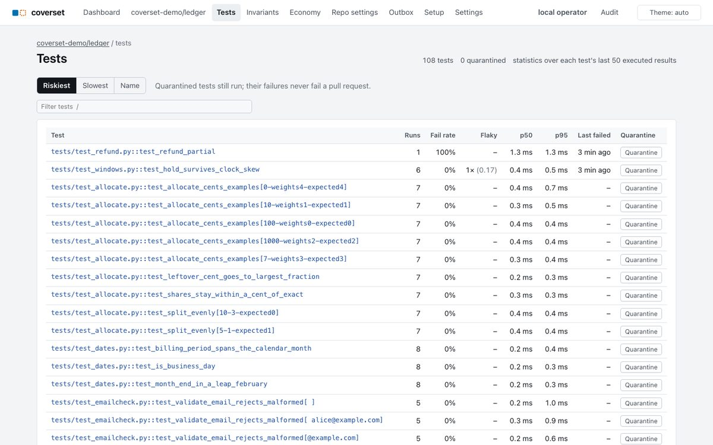

# coverset · The Inputs Your Tests Never Tried

Anticipatory CI for agent-written Python: tests start when the PR opens, the likeliest failures run first, and every function shows which kinds of input its tests never passed in.

A 2026 ICSME study of 4,882 agent-authored PRs (arXiv 2607.18057) found existing tests execute 27.0% of changed Python lines, and in 64.8% of the PRs no changed line is executed by any existing test.

<!-- numbers:start -->
97 tests in the demo app, 1,200 in a synthetic benchmark suite. A replayed `check_run.rerequested` webhook for the refunds PR reaches its first test 5.54 s later on a pooled Modal sandbox; a fresh sandbox restored from the trusted snapshot takes 1.02 s, one from the env image 1.16 s, and building that image cold 70.8 s. On the refunds PR the failing test runs 1st of 100 instead of 66th in file order. Its failed result arrives 5.98 s after the webhook and a retry confirms it at 7.33 s, when the verdict is posted; file order would reach it after an estimated 7.9 s on the same sandbox (estimated from the first test: the time to the first test result plus the median durations of the tests before it). Running it first reports the failure 1.9 s before file order would even reach it; the demo suite's tests take only 3.5 s in all, so that is most of what ordering can save here. Fan-out is where larger suites save time: the benchmark suite takes 181.1 s in one sandbox, 19.6 s across 16 and 13.2 s across 32, about $0.036 per 16-shard run. Per-test coverage plus argument shapes cost 1.14× plain pytest. The three functions below are at 100% line and branch coverage, and their tests never exercise 16 of 34 input classes.

Medians of 5 runs on 2026-10-11 (the cold image build and the snapshot build are single runs), modal 1.6.1, Modal region us-central on the Starter plan, up to 2 CPU per sandbox; raw data in docs/benchmarks.md. The overhead is the median of 5 local runs of the demo suite; the input classes are demo data from 5 local runs.
<!-- numbers:end -->

**Blue** lines ran, **vermilion** lines never ran (heavier edge), **dotted yellow** lines took one branch. In the shape grid a **filled square** is an input class some test exercised and a **hollow dashed square** is one no test ever passed in.

What is here, in one list: a control plane that runs a PR's tests on Modal sandboxes before CI boots and posts one sticky comment and a check run; an **upload mode** that takes the same bundle from your existing CI job instead (`coverset-ci upload`); per-test line and branch coverage plus the **data-flow overlay** of argument shapes; a **test economy** that measures what each test buys (leverage, duplicates, a minimal covering set, the PR's test tax); **GitHub sign-in** with per-repository access and an audit log; settings at instance, organization, repository and user scope; an **MCP server** for AI agents; a static **report** for local use; the same model for TypeScript (Vitest) and Rust (nextest); a production **probe** that reports which input classes production sees that no test does; and state that lives in **Postgres and an S3-compatible bucket**, so the server is stateless and can run as replicas (local files stand in for the bucket on a laptop). [docs/getting-started.md](docs/getting-started.md) is the on-ramp; [docs/dev.md](docs/dev.md) the developer loop; [docs/deploy.md](docs/deploy.md) the hosting guide.


**The PR page.** PR #2 passes every test, and the page still says what is missing: two input classes of the changed `check_if_new_user_signup_allowed` that no test passed in, and an invariant with no linked test.

| | |
|---|---|
|  |  |
| **Live run.** The refunds PR, replayed at a quarter speed and frozen just after the verdict: FAIL is posted while three shards are still running. | **Why this order.** The failing test ran 1st; file order would have run it 66th. Each row shows the risk signals behind its score. |
|  |  |
| **Shape grid and flow ribbon.** `validate_email` at 100% lines and branches, with `multi-label-domain` and `idn` never passed in, and which tests and callers feed its parameter. | **Source view.** Chips under `def parse_duration` count the calls per input class; the dashed ones are classes no test tried. The popover lists the tests that ran line 18, in run order. |
|  |  |
| **Coverage map, Gap mode.** Tile area is statements; the stronger a tile's colour, the more of its lines ran under tests that never tried whole kinds of input. Hatched tiles were never called; dashed tiles are module-level code, drawn reduced because imports and `def` lines run on import. The layout is ordered, so it holds still between commits. | **PR comment.** The one sticky comment coverset posts, as the fake forge recorded it: verdict, patch coverage, changed functions, invariants, and the test-tax line. |
|  |  |
| **Test page.** The refunds PR's failing test: its result and retry, the invariant it violates, its last runs, and its data flow from the test through `refund` into `allocate_cents` and each parameter. Every nodeid on the pages links here, and from here each file opens with the lines this test did not run dimmed. | **Local report.** The same facts as static pages from one `pytest` run, with no server: totals, the Gap treemap, the file table, a page per file, function and test. Built by `coverset report`; see below. |
|  |  |
| **Repository overview.** The default branch over its last six baselines: statements, lines run, branches, functions called and input classes observed as tiles, a sparkline each for line % and input-class %, what changed since the previous baseline, a Gap-map thumbnail that opens the coverage map, and the functions with the most input classes no test passed in. | **Changes since a base.** `coverset report --compare`: PR #1 against the main baseline shows exactly its effect: three refund tests added, one failing, one new function, five input classes gained (one on `allocate_cents`, four on the new `refund`), nothing lost. |
|  |  |
| **Test economy.** What each test buys: statements and asserts against the lines, arcs and input classes only it covers, the tests whose data flows another test already exercises (candidates, never verdicts), the greedy minimal set that keeps every fact covered, parametrize families with many cases and few distinct flows, and the exception handlers no test ever entered. The static report has the same page (`docs/report-economy.jpg`), with the `--deselect` file for the tests the minimal set drops. | **Tests page.** Every test with its fail rate, flakiness, durations and quarantine switch, 500 rows a page, and a filter box that `/` focuses. Outbox and Setup in the header appear only for instance admins. |

Screenshots: demo data from <!-- n:demo_runs -->8<!-- /n --> local runs (`coverset demo --executor local`: six `main` commits and two PRs), taken on <!-- n:screenshot_date -->2026-10-11<!-- /n --> with `scripts/screenshots.py`. Dark versions are next to them as `docs/*-dark.jpg`. The AI review in them comes from fixtures.

## Core features

Six capabilities, with where each one stands. **Implemented** means on the pages, in the comment or on the CLI today with tests; **partial** means a real subset is live and the rest is named; **planned** means designed and not built.

| # | Capability | Status | What exists today | What is missing |
|---|---|---|---|---|
| 1 | **Change risk and confidence.** Every PR run says what changed, which tests exercise it, and whether the changed behaviour was actually tested. | Partial | Patch coverage, changed functions with no covering test, input classes the tests never passed in, a per-test risk score from failure history, flakiness and the change's footprint in the prior run, all in the comment, the check run and the PR page. | No commit-level pass probability, on purpose: the score is a heuristic with no calibration yet. Every run stores its planned order, executed order, first-failure rank and outcome, so the next step is an empirical curve per repository ("87% of first failures surfaced within 30 s over the last 50 runs"), not a number dressed as a probability. No static dependency graph in the score. |
| 2 | **Predictive ordering and selection.** The tests most likely to fail run first; a useful signal arrives long before the suite ends. | Partial | Risk-ordered tests, the change-covering set first on every shard, priority-snake sharding, fail-fast with one retry, the early verdict, the "why this order" panel, the measured time to first failure against the file-order estimate. | No test selection (every collected test runs, by design, until the ordering is calibrated) and no confidence-against-elapsed-time curve with a residual risk when stopping early; both come from the same calibration data as row 1. |
| 3 | **Semantic coverage and test quality.** Line and branch coverage can be 100% and still verify nothing; show what is not meaningfully verified. | Implemented, minus mutation | Changed-code coverage; input-class coverage from argument shapes (the data-flow overlay) with Hypothesis strategies for every class no test passed in; user-declared invariants verified by tests, properties or review; the test economy: leverage, duplicated flows, the minimal covering set, assertion-free tests, exception handlers nothing entered, the PR's test tax. | Mutation testing. Full mutation is too slow to be a default; the plan is extreme mutation on a PR's changed functions only (replace a body with a trivial return and ask whether any covering test fails), as the validator in row 4. |
| 4 | **Agent-native test generation.** Agents ask what remains untested and get actionable work; the platform checks the tests they write. | Partial | The MCP server and `/v1/agent`: missing input classes with redacted example inputs and strategies, covering tests, the minimal set, redundant candidates, the test tax, search, and three playbooks (review a PR's tests, bootstrap tests for a function, shrink a suite). | Independent validation of new tests. Today the test tax, assertion-free and duplicate-flow checks catch only the crude cases; extreme mutation on changed functions (row 3) is the planned check against superficial tests. |
| 5 | **Integration verification for parallel agents.** Verify combinations of concurrent changes, not only each PR alone. | Planned | Per-run changed-function indexes and covering tests for every open PR, which is the data an overlap matrix needs; untrusted-PR gating. | The overlap matrix between open PRs (same changed functions, same covering tests) to prioritise which pairs deserve a combined run, and combined runs on merge-queue events (`merge_group`). Combinations are prioritised by overlap, never enumerated. |
| 6 | **Test suite observability.** Runtime, flakiness, coverage regressions, redundancy, cost and trends over time. | Mostly implemented | Per-test history (fail rate, flakiness, p50 and p95), quarantine, baseline trends for line and input-class coverage, function history, the repository overview, run timelines with cost, redundant tests and the test tax, all from one Parquet facts store per run. | Failures grouped by root cause (a failure signature is stored per result; there is no page for it), cost per verified change as a named metric, and cross-repository trends. |

The next build is the **verification record** ([docs/verification-records.md](docs/verification-records.md)): one test's evidence over the function bodies it executed, at content hashes, under an environment hash. Diffs invalidate records exactly, valid records carry forward (the one sound basis for skipping tests), verification progress becomes a measurement instead of a prediction, and post-merge verification of the default branch replaces pairwise PR combinations. Rows 1, 2 and 5 above are restated in those terms once it lands.

What this means for a reader of the comment on a PR today: "PASS with gaps" is a verified statement about coverage of the change and of its input space; it is not a prediction that the suite would pass, and the pages never claim one.

## Three functions at 100% coverage

Each of these functions is at 100% line and branch coverage on `main`. Each table is the output of `coverset shapes <function> --markdown` on the default branch, which pools the last five baseline runs of the demo (demo data from <!-- n:shapes_runs -->5<!-- /n --> local runs). [docs/input-classes.md](docs/input-classes.md) explains how the expected classes are derived.

`uv run coverset shapes validate_email --markdown`. No test passes an address on a company subdomain. On `main`, `validate_email("bob@eng.acme.com")` raises `ValueError`; PR #2 widens the pattern so such addresses are accepted, every test still passes, and `email:multi-label-domain` is still never exercised.

<!-- shapes:validate_email:start -->
| Input class | Observed | Example or suggested Hypothesis strategy |
|---|---|---|
| `email:empty` | yes | `''` |
| `email:whitespace` | yes | `' '` |
| `email:ascii` | yes | `'alice'` |
| `email:unicode` | yes | `'Zoë Smith <z***@example.com>'` |
| `email:ws-edge` | yes | `' d***@acme.com'` |
| `email:plain` | yes | `'d***@acme.com'` |
| `email:multi-label-domain` | **no** | `st.sampled_from(["bob@eng.acme.com", "ops@mail.eu.example.org"])` |
| `email:plus-tag` | yes | `'B***@Example.ORG'` |
| `email:uppercase` | yes | `'E***@Globex.IO'` |
| `email:idn` | **no** | `st.just("bob@bücher.de")` |

8 of 10 input classes observed (80%).
<!-- shapes:validate_email:end -->

`uv run coverset shapes parse_duration --markdown`. No test passes a unit longer than one letter. `parse_duration("100ms")` returns 6000 seconds: the regex reads `100m` and drops the `s`. The decimal, signed and trailing-garbage classes also return a wrong number without raising.

<!-- shapes:parse_duration:start -->
| Input class | Observed | Example or suggested Hypothesis strategy |
|---|---|---|
| `text:empty` | yes | `''` |
| `text:whitespace` | **no** | `st.sampled_from([" ", "\t", "\n "])` |
| `text:ascii` | yes | `'h'` |
| `text:unicode` | **no** | `st.text(st.characters(min_codepoint=128), min_size=1)` |
| `text:ws-edge` | **no** | `st.text(min_size=1).map(lambda s: f" {s} ")` |
| `text:single-unit` | yes | `'0d'` |
| `text:multi-unit` | yes | `'1h30m'` |
| `text:multi-letter-unit` | **no** | `st.sampled_from(["100ms", "2min", "3hr"])` |
| `text:decimal` | **no** | `st.just("1.5h")` |
| `text:signed` | **no** | `st.sampled_from(["-5m", "+5m"])` |
| `text:trailing-garbage` | **no** | `st.just("5m!")` |

4 of 11 input classes observed (36.4%).
<!-- shapes:parse_duration:end -->

`uv run coverset shapes allocate_cents --markdown`. No `main` run passes a negative total. `allocate_cents(-100, [1, 2])` returns `[-32, -66]`, which sums to -98: `int()` truncates towards zero and the negative remainder slice adds cents instead of removing them. That is the bug PR #1 ships in `refund()`. Weights that sum to zero raise `ZeroDivisionError`, and a NaN weight raises `ValueError`.

<!-- shapes:allocate_cents:start -->
| Input class | Observed | Example or suggested Hypothesis strategy |
|---|---|---|
| `total_cents:negative` | **no** | `st.integers(max_value=-1)` |
| `total_cents:zero` | yes | `0` |
| `total_cents:positive` | yes | `5` |
| `weights:empty` | **no** | `st.just([])` |
| `weights:single` | yes | (no example recorded) |
| `weights:multiple` | yes | (no example recorded) |
| `weights:zero-element` | **no** | `st.lists(st.floats(0, 100), min_size=1).map(lambda xs: xs + [0])` |
| `weights:negative-element` | **no** | `st.lists(st.floats(0, 100), min_size=1).map(lambda xs: xs + [-1])` |
| `weights:all-zero` | **no** | `st.lists(st.just(0), min_size=1)` |
| `weights:sum-zero` | **no** | `st.lists(st.floats(0, 100), min_size=1, max_size=16).map(lambda xs: xs + [-x for x in xs])` |
| `weights:nan-element` | **no** | `st.lists(st.floats(0, 100), min_size=1).map(lambda xs: xs + [float("nan")])` |
| `weights:unsorted` | yes | (no example recorded) |
| `weights:duplicates` | yes | (no example recorded) |

6 of 13 input classes observed (46.2%).
<!-- shapes:allocate_cents:end -->

## Local report

`coverset report` writes one test run as a folder of static pages, the rich equivalent of `coverage html`: lines and branches, the tests behind every line, a data-flow lens that dims what one test did not run, a page per test with the input classes it passed in, and every function's shape grid with Hypothesis strategies for the classes no test passed in. No server and no database: open `index.html` from disk.

```sh
pytest --coverset                     # the bundle goes to .coverset/, sources from [tool.coverset] (or --coverset-out=DIR --coverset-source=PKG)
coverset report .coverset --open      # from a git checkout that tracks the measured files; also --run <run id> from the facts store
coverset report .coverset --compare ../before/.coverset   # plus a Changes page: what this run gained or lost against a base
coverset report bundle.tar.gz --repo-root ~/src/myrepo   # a CI bundle or a neutral bundle: sources only with --repo-root
```


With `--compare BASE` (or `--compare-run RUN_ID` from the facts store) the report also says what this run gained or lost against a base: a Changes page with the totals as base → now, lines newly uncovered or covered per file, input classes lost or gained per function, and tests added, removed, failing or slower, honest about runs that ran different test sets. One run (or one pair) only: no history and no PR diff, which the live pages have. Keys, the lens, the comparison rules and the trust model are in [docs/report.md](docs/report.md).

## Test economy

A colleague watched an agent add ninety-five lines of test scripting to check that one environment variable parses `true`, `1` and `TRUE`. coverset puts a number on that. For every test it records its **weight** (statements, asserts, parametrize cases, helper statements it calls) and its **value** (the lines, arcs and input classes it covers, and the part of that no other test covers), so each test has a **leverage** (unique facts per statement) and a cost per unique fact. Tests whose lines, arcs and shape observations are identical, or a subset of a faster test's, are listed as **redundancy candidates** (their assertions may still differ, and every surface says so). A greedy set cover over all facts gives the **minimal covering set** and a `--deselect` file for the rest. Parametrize **families** show cases against distinct data flows (twelve cases, three flows). Per function, coverset also reports **assertion-free** tests, functions that are only reached through other functions (never called by a test directly), **exception handlers no test entered**, and **stale** tests whose covered functions all changed since the test did. On a PR run the **test tax** is the added test statements per newly covered production line and class, flagged above `policy.test_tax_threshold` (8 by default) in the sticky comment, the check run and a card on the PR page: "95 test statements for 3 newly covered lines (threshold 8) · 2 new tests duplicate existing flows".

```sh
pytest --coverset && coverset tests economy .coverset          # leverage table, sorted
coverset tests redundant .coverset                               # identical and dominated flows
coverset tests minimal .coverset --write deselect.txt && pytest @deselect.txt   # the minimal set (pytest 8.2+)
coverset tests tax .coverset --compare base/.coverset --base-ref origin/main --check   # a CI gate
```

Every surface reads one view model (`src/coverset/report/economy.py`), so the Economy page (`/repos/<id>/economy`, key `g e`), the PR card, the comment line, the static report, the CLI and the MCP tools cannot disagree. Definitions, weights and caveats: [docs/economy.md](docs/economy.md).

## One model for every language

Everything downstream of a test run (the facts store, the input-class catalogue, the pages, the comment, the report) reads one language-neutral model, `coverset-model`, a package with no dependencies. Its on-disk form is the **neutral bundle** ([docs/neutral-bundle.md](docs/neutral-bundle.md)): `manifest.json`, then `tests`, `files`, `coverage`, `arcs`, `functions`, `shapes` and `links` as JSON lines, with shape keys from one value vocabulary (`int|neg`, `str|kind:email/multi-label-domain`, `list|elem:int|order:unsorted`) and declared types as small **type descriptors** (`{"kind": "union", "arms": [...]}`, `{"kind": "enum", "members": [...]}`) that any language can produce. `pytest-coverset --coverset-neutral` writes it for Python, `coverset bundle validate` checks a bundle against the specification and its JSON Schemas, `coverset bundle convert` turns a plugin bundle into one, and a synthetic TypeScript bundle (`fixtures/bundles/neutral-ts`, the shape a Vitest or Jest reporter would emit) validates, ingests into the facts store with no Python-specific code path, and renders in the report and the live pages, whose function page and PR cards build its input classes from the type descriptors stored at ingest (`tests/web/test_web_neutral.py`). `coverset-vitest` (`packages/coverset-vitest`) writes the same bundle from a real Vitest run: per-test lines from Istanbul's counters, regions and declared types from the TypeScript checker, and argument shapes from a small instrumentation plugin that moves no line and changes no Istanbul statement, branch or function count; it also wraps Vitest's Istanbul instrumenter so that runtime stack traces and failure signatures name the original lines with the plugin as without it, and instrumented code runs unchanged where no recorder is installed (a `globalSetup`, a script). `examples/ts-app`'s `npm test` produces one that validates with no problem, ingests, and shows `email:multi-label-domain` and `totalCents:negative` as never exercised (`tests/e2e/test_vitest_reporter.py`; [docs/typescript.md](docs/typescript.md)).

**Rust.** `coverset rust run --crate PATH` runs a crate's tests one process per test (cargo-nextest when installed, else libtest) with LLVM source-based coverage (`rustup component add llvm-tools-preview`), writes a neutral bundle (`language: rust`) to `PATH/.coverset/neutral` and prints the `coverset report` command. You get per-test lines, outcomes, panic messages, function regions and declared types; there are no branches (stable rustc records none) and no argument shapes yet (the `#[coverset::trace]` design is in [docs/rust.md](docs/rust.md)). `examples/rust-app` is the crate the fixture comes from.

**Running in parallel.** Four ways, one bundle: coverset shards across sandboxes (the runner never passes `-n`); upload mode takes one `coverset-ci upload --label <job>` per CI job and merges them per commit; `pytest --coverset -n 8` runs xdist workers on one machine, each writing its own bundle under `.coverset/workers/<gw>/`, merged by the controller into one that equals a serial run; and Vitest spreads files over workers with no pool setting needed (concurrent tests within a file get a superset of lines and a warning; `--maxConcurrency=1` makes them exact). On a 5,426-test application suite, `-n 8` took 145 s against 486 s serial on this machine. [docs/instrumentation.md](docs/instrumentation.md#running-in-parallel) has the layer-by-layer overhead and the roadmap.

## Run it

```sh
uv sync
uv run coverset demo                      # seed the demo repo into the local Postgres, run its history and both PRs, serve on http://127.0.0.1:8000
uv run coverset demo --executor modal     # the same on Modal Sandboxes (needs `modal setup`; spends a few cents)
uv run coverset modal reap --all          # terminate the coverset sandboxes of this installation (this database)
uv run coverset modal reap --all --any-instance   # terminate coverset sandboxes from any installation
uv run pytest                             # unit, web and end-to-end tests (local executor)
uv run python scripts/screenshots.py      # the README screenshots (needs `uv run playwright install chromium-headless-shell`)
uv run python scripts/bench_modal.py      # the Modal benchmarks behind docs/numbers.json (prints its cost estimate first)
uv run python scripts/check_readme.py     # the numbers above against docs/numbers.json (--fix rewrites them)
uv run coverset report --run <run id>     # the static report of a run in the facts store (or of a .coverset directory)
uv run coverset report --run <PR run id> --compare-run <baseline run id>   # the same plus a Changes page against a baseline
uv run coverset bundle validate fixtures/bundles/neutral-ts/bundle   # the TypeScript fixture against the neutral bundle spec
(cd examples/ts-app && npm install && npm test)   # a real Vitest run that writes a neutral bundle to .coverset/neutral
```

`coverset demo` seeds a deterministic git repository (`data/demo.git`: six commits on `main` and two PR branches), runs the six baselines and both PRs, replays `fixtures/webhooks/pr_opened.json` through the webhook route, and serves the UI. PR #1 ("Support partial refunds") fails on `tests/test_refund.py::test_refund_partial`; PR #2 ("Allow signups from company subdomains") passes with gaps. The demo also builds PR #2's static report under `<data dir>/report` and prints its path (`--no-report` skips it). `--no-serve` stops after the runs. `COVERSET_DATA_DIR` moves everything the demo writes.

On Modal the demo builds the environment image (cached after the first build), runs every shard in a sandbox, and builds one trusted snapshot of `main` at the end of seeding. While it serves, the warm-pool maintainer keeps up to `COVERSET_POOL_SIZE` (4) idle sandboxes for the demo repository until `COVERSET_POOL_TTL_S` (600 s) after its last run, at about $0.03 per sandbox-hour; stopping the server drains the pool. `coverset modal reap --all` cleans up after an interrupted run.

## Develop it

Postgres is the one development requirement (`brew install postgresql@14 && brew services start postgresql@14`; 14 or newer). The default database URL is `postgresql+asyncpg://localhost/coverset`, created on first use; files stand in for the bucket until you point `COVERSET_BLOB_URL` at one.

```sh
uv run coverset dev                       # create the database if needed, seed the demo if it is empty, serve with code and template reload, open the browser
uv run coverset demo --fresh --no-serve   # drop and rebuild the demo
make check                                # ruff, format check and the quick tests; `make test` is the whole suite, `make help` lists the rest
make services && make dev-hosted          # Postgres 17 + MinIO in Docker (deploy/dev-compose.yml) and the app pointed at them: the hosted shape on a laptop
make test-pg                              # the whole suite against the compose stack; the default runs it on the local server with one database per test
uv run coverset dev --tunnel              # the ngrok recipe for a public demo from this machine (a public URL needs an admin token)
```

With `COVERSET_DEV_LOGIN=true` in open mode (a loopback bind, no admin token, `COVERSET_ENV=dev`, the fake forge), the login page offers "Sign in as a local user" (a login, a role, and per-repository permissions) so the pages can be clicked through as a member without a GitHub App; such sessions and tokens are refused on any request where one of those conditions no longer holds. `coverset dev` prints whether the sign-in is on. [docs/dev.md](docs/dev.md) is the developer guide.

## Deploy it

The hosted shape is a stateless app in front of **Postgres** (`COVERSET_DATABASE_URL`) and **an S3-compatible bucket** (`COVERSET_BLOB_URL`: S3, R2, Tigris, MinIO), with a disposable local cache (`COVERSET_CACHE_DIR`) for Parquet files and git mirrors. The GitHub App that `/setup` creates is stored in Postgres too, encrypted under `COVERSET_SECRET_KEY` (at least 32 characters; required for `/setup`; rotate it with `coverset secrets rekey --old-key ...`), and the reaper's sandbox tag is a database row, so a new container loses nothing and needs no restart after `/setup`. Several replicas may share one database: a leader lease on a Postgres advisory lock makes exactly one of them run the dispatcher, the retention pass, the reaper and the warm pool. [docs/deploy.md](docs/deploy.md) has the requirements table, the recipes, migrations on deploy, secrets, backups, scaling, cost and troubleshooting; [docs/postgres.md](docs/postgres.md) and [docs/object-store.md](docs/object-store.md) the two stores.

```sh
uv run modal deploy --strategy recreate -e coverset deploy/modal/coverset_web.py   # Modal: one always-on container; the Secret holds the two URLs, the bucket credentials and the admin token
fly launch --no-deploy && fly deploy        # Fly.io: deploy/fly/fly.toml with Neon or Fly Postgres and a Tigris bucket
docker compose -f deploy/compose.yml up -d   # one VM: coverset, Postgres 17 and Caddy for HTTPS (--profile hosted adds MinIO for the blobs); deploy/aws/ has App Runner, ECS Fargate + RDS + S3 (IAM policy included) and Lightsail
uv run python scripts/smoke_hosted.py       # against real URLs: migrate, seed, serve, fetch pages, upload a bundle, check the bucket and the rows; PASS/FAIL table
uv run coverset deploy check                # PASS / WARN / FAIL rows: database, object store, cache, state, proxy, GitHub, ...
```

Behind Fly, Caddy or a load balancer set `COVERSET_TRUST_PROXY=true`, which trusts only the nearest hop. On Modal, streaming responses are not cut at the 150 s request limit (measured: SSE streams of 210 s and 330 s completed), and a redeploy must use `--strategy recreate`. Conditional writes (`If-Match`) on the bucket are what keeps the per-repository id dictionary safe between replicas; S3, MinIO and R2 support them.

## Who sees what

Sign in with GitHub through the App's own client id (the manifest flow registers the callback) or with the admin token. A signed-in person sees exactly the repositories GitHub lets them see, with GitHub's permission collapsed to read, write or admin, recomputed at sign-in, every ten minutes and on demand; everything else answers 404. Logins listed in `COVERSET_ADMINS` are instance admins, as the admin token always is; `coverset users promote|demote|disable` manages the rest. API tokens (`cst_...`, shown once, sha256 stored) carry scopes: `read` for the pages and the agent API, `write` for approvals and quarantine, `upload` for `POST /v1/bundles`, bound to one repository or acting as their user. Every state-changing request and every credential event lands in the audit log at `/audit`. Settings inherit by scope: view preferences user > repo > org > instance; policy (untrusted-PR handling, drafts, AI review, fail-fast, shard caps, the test-tax threshold) repo > org > instance > `COVERSET_*`, set by repository writers and admins, never by the PR author. [docs/auth.md](docs/auth.md), [docs/settings.md](docs/settings.md), [docs/security.md](docs/security.md).

## Use it on your repo

0. Run `coverset doctor --repo PATH` (add `--write-config` for a suggested `[tool.coverset]`). It prints the environment source, the packages, test paths, install mode and the exact pytest commands coverset would run, collects in a throwaway worker, and lists findings with fixes. Repositories no longer need a `uv.lock`: environments come from `uv.lock`, `poetry.lock`, `Pipfile.lock`, requirement files, `[project]` metadata or `setup.cfg`/`setup.py` literals, pinned by `uv pip compile` (network once per set of inputs); nothing from the repository is executed on the control plane. [docs/getting-started.md](docs/getting-started.md) has the decision between the two routes below and the full `[tool.coverset]` reference (`source`, `source_root`, `testpaths`, `python`, `requirements`, `install`, `pytest_args`, `invariants`).

1. Add `[tool.coverset]` to the repository's `pyproject.toml`. Every key has a default; these are the ones the demo sets:

   ```toml
   [tool.coverset]
   source = ["ledger"]          # packages to measure and trace
   source_root = "src"
   testpaths = ["tests"]
   python = "3.13"              # 3.12 or later
   invariants = "invariants.yaml"
   ```

   Locally, `pytest --coverset` then `coverset report .coverset --open` gives you the pages for one run before any of the rest exists. The plugin prints the test run and one closing line that names the bundle and the report command; the JSON event lines exist only for the orchestrator. If the sources measured no file (a misspelt `[tool.coverset] source`), that line ends with a warning.

2. Run `coverset serve` where GitHub can reach it (see **Deploy it**), with an admin token (`COVERSET_ADMIN_TOKEN`), `COVERSET_SECRET_KEY`, `COVERSET_PUBLIC_URL` and `COVERSET_ADMINS=<your login>`. Then either create and install the GitHub App from `/setup` (check runs, buttons, the sticky comment, sign-in; stored encrypted in the database and live in every replica within seconds), or set `COVERSET_GITHUB_TOKEN` (at least 16 characters), `COVERSET_ALLOWED_OWNERS` and `COVERSET_GITHUB_WEBHOOK_SECRET` and add a repository webhook (a commit status and the sticky comment). An App stored by `/setup` accepts only its own owner unless `COVERSET_ALLOWED_OWNERS` says otherwise; an App configured through `COVERSET_GITHUB_APP_*` in the environment needs `COVERSET_ALLOWED_OWNERS` and makes `/setup` read-only. See [docs/github.md](docs/github.md).

   **Route A, upload mode (ten minutes, no runners):** keep your CI, add `permissions: {contents: read, id-token: write}`, check out the PR head (`ref: ${{ github.event.pull_request.head.sha || github.sha }}`), then `pip install <pinned pytest-coverset>`, `python -m pytest --coverset` and `coverset-ci upload --server $URL --with-sources` (with `if: always()`), or the composite action `src/coverset/forge/gha/upload`. The first OIDC upload registers the repository when its owner is in `COVERSET_ALLOWED_OWNERS`; a repository token from `coverset users tokens create --repo OWNER/NAME --scopes upload` works where there is no OIDC. Patch coverage needs coverset to fetch the repository (the App installed, or `COVERSET_GITHUB_TOKEN`); without that the run still gets totals, gaps and invariants, with the reason "no diff available". Upload mode has no anticipatory ordering, no retries and no warm starts, and results arrive after CI finishes. [docs/upload.md](docs/upload.md).

   **Route B, managed runs:** steps 3 and 4.
3. Pick the executor: `COVERSET_EXECUTOR=modal` after `modal setup`, with `COVERSET_MODAL_DAILY_BUDGET_USD` as the daily cap, `COVERSET_MAX_RUN_COST_USD` (1.00) as the per-run cap, also enforced while the run executes, and `COVERSET_MAX_IMAGE_BUILDS_PER_DAY` (20). An untrusted PR whose lockfile has no image yet waits for approval, and its environment is never built from direct URL or VCS references. The local executor runs webhook-triggered runs only with `COVERSET_LOCAL_ALLOW_WEBHOOK_RUNS=true` and never runs untrusted PRs. `coverset warm --repo <name>` builds the environment (and on Modal a trusted snapshot) ahead of the first PR.
4. In CI, replace the `pytest` step with the composite action in `src/coverset/forge/gha/`, which runs `coverset-ci wait`: it proves the repository with the job's OIDC token, waits for coverset's verdict, prints the results in pytest's format and exits with pytest's codes.
5. Declare invariants in `invariants.yaml` and link tests to them with `@pytest.mark.invariant("<id>")` ([docs/invariants.md](docs/invariants.md)). `coverset invariants scan` reviews the review-kind invariants at the latest trusted baseline of the default branch through the configured review client (the offline fake unless `COVERSET_AI=anthropic` and the repository's `policy.ai_review` setting is on) and records their statuses. It also runs automatically after every trusted, completed baseline of the default branch's tip (`COVERSET_SCAN_AFTER_BASELINE=false` turns that off).

## Keys

Keys work on every page and in the static report; `?` lists the ones for the current page.

| Key | Action |
|---|---|
| `j` / `k` | Next / previous line that never ran or took only one branch |
| `n` / `N` | Next / previous function with an input class no test passed in |
| `t` | Tests that ran the current line |
| `i` | Show or hide the current function's shape grid; `.` hides the inlay chips |
| `h` | Highlight every measured line, or only what never ran or took one branch (`?highlight=missing`; `view.highlight` in the settings) |
| `[` / `]` | Previous / next file |
| `m` / `M` | Cycle the map's mode (gap, lines, input classes) / its module weight (thin, full, hidden) |
| `g` then `o` `t` `m` `e` `i` | Go to the overview, tests, map, economy, invariants; `r` goes to the latest run |
| `/` | Focus the filter box (tests, files) |
| `?` | Keys help; Escape closes |

Keys are ignored while typing in a form field and with Ctrl, Alt or Cmd held. The header's theme button cycles auto, light and dark. A view choice comes from, in order, the query string, a scoped setting someone chose, the browser's own memory, then the default; the server renders the chosen mode, so nothing flashes.

## For AI agents

`coverset mcp serve` exposes the facts to an agent over MCP, and `/v1/agent/<tool>` serves the same fifteen tools over HTTP with a read-scope token: run summaries, patch coverage against a base, a function's input classes with the Hypothesis (or fast-check) strategies for the missing ones, covering tests, redacted example inputs per class, the minimal test set and the redundancy candidates, the PR's test tax, search, and a plain-words explanation of any shape key. Three prompts are playbooks: `review-tests-for-pr` (shrink a PR that tests everything to death at the expense of reviewability), `bootstrap-tests-for-function` (write tests from the classes nothing exercises, with de-identified examples), `shrink-test-suite` (the set-cover problem, with candidates labelled as such). `pytest --coverset`, then `coverset mcp install-claude-code` prints the `.mcp.json` entry; nothing is written. On a real 5,081-test Flask suite the set cover keeps 1,703 tests (175 s) and drops 3,377 (279 s) without losing a covered line, inferred arc or observed input class, which is a candidate result, not a verdict. [docs/mcp.md](docs/mcp.md).

## Production flows

`coverset-probe` (`packages/coverset-probe`, depends only on `coverset-model`) runs the shape tracer inside a live Python service: `coverset_probe.start(modules=[...], sample_rate=0.01, k_anonymity=5, export=JsonlExporter(path))` plus a WSGI or ASGI middleware that reads the W3C `traceparent` header so a request's calls form one flow. It exports categorical shape keys only, never values, reprs or raw trace ids; rows are k-anonymous and windowed; hot functions are shed under a hard budget and the probe switches itself off above 2% of a core (about 0.1 µs per call of an allow-listed function, 3 to 5 µs per recorded call). `coverset flows import FILE.jsonl --repo NAME` lands a window, `coverset flows gaps` lists the input classes production passes in that no test does, ranked by call volume with Hypothesis strategies, and `coverset flows archetypes` clusters production calls into archetypal patterns and marks each as covered exactly, by a superset, partially, or not at all. On the demo, `validate_email`'s `email:multi-label-domain` (14% of production calls in the fixture) is the first gap. `POST /v1/flows`, the OpenTelemetry span attributes, the Sentry and Datadog integrations, the UI and the MCP tools are designed, not built: [docs/production-flows.md](docs/production-flows.md).

## How a run works

1. **Webhook.** GitHub posts a `pull_request` event. coverset checks the HMAC signature over the raw body before parsing anything, deduplicates on the delivery id and answers 202 (`timeline.webhook_received`).
2. **Queued.** Intake records the PR and inserts a `queued` run, or `awaiting_approval` for an untrusted PR. The dispatcher claims it atomically and applies policy: no untrusted run on the local executor, and a Modal run is admitted only if today's spend plus its reservation fits the daily budget, and is capped per run. A PR run's `coverset` check is created `in_progress`.
3. **Workers.** The planner refreshes the bare mirror, exports the head with `git archive`, finds or builds the environment image, and takes the newest trusted snapshot. On Modal it claims pooled sandboxes first, then creates fresh ones from the snapshot. `put_tree` writes the source into each worker (`timeline.sandbox_ready`).
4. **Collect and diff.** Worker 0 runs `pytest --collect-only`. The diff `base...head` is classified into changed functions, and the prior run is chosen: the PR's previous head, else the merge-base, else the latest baseline.
5. **Wave 1 and scores.** Every test gets a score from its failure history, flakiness, the changed code it covers and whether it is new. Wave 1, the greedy set cover of tests over the changed function bodies, runs first on every shard.
6. **Shards.** The number of shards follows the summed median durations. Wave-1 tests are dealt first, one to each least-loaded shard, then the rest in priority order, each to the least-loaded shard. Each worker runs `python -m pytest @run/shard.args` with the pytest-coverset plugin: one coverage context per test with the C tracer, plus the shape tracer on `sys.monitoring`.
7. **Streamed events.** Results stream back as nonce-prefixed JSON lines on stdout (`timeline.first_test`, `timeline.wave1_finished`).
8. **Retry once, fail fast.** A test's first failure starts one retry. A second failure confirms it and the verdict is posted at once (`timeline.first_failure`, `timeline.verdict`); the run records `rank_coverset` (its planned position), `rank_executed` (results reported before it) and `rank_file_order`. By default the other shards run on so coverage and shapes land.
9. **Bundles and ingest.** Each shard's `bundle.tar.gz` is pulled before its worker is released, extracted under size limits, converted, and written as immutable Parquet files that DuckDB queries.
10. **Verdict.** The report adds patch coverage, input-class coverage of the changed functions and invariant targets, invariant statuses and the advisory AI review. The verdict is stored, the check run and one sticky comment are posted, and a `done` event closes the run with exit code 0 (success), 1 (failure), 5 (no tests collected) or 2 (anything else: error, cancelled, abandoned, neutral).
11. **Afterwards.** A PR run applies the per-PR retention rule. A trusted baseline of the default branch's tip on Modal rebuilds the trusted snapshot and refills the warm pool.

`coverset-ci wait` in the CI job exits with the same codes, plus 3 when the server cannot be reached. The full walk-through is [docs/orchestrator.md](docs/orchestrator.md).

## How it is built

- **Control plane**: Python 3.13, Quart 0.23.1 on Hypercorn 0.18.0, SQLAlchemy 2.1.4 with asyncpg on Postgres 14 or newer and Alembic 1.20.0, click for the CLI, pydantic-settings for every `COVERSET_*` setting; a leader lease on an advisory lock for the background work when replicas share a database.
- **Facts and files**: PyArrow 26.0.0 Parquet files per run and shard in an S3-compatible bucket through boto3 (or a local directory), a per-run manifest written last so a reader never sees a half-written run, compare-and-swap on the per-repository id dictionary, a disposable local cache that DuckDB 1.5.6 reads in memory, so readers never lock writers (`storage/`, `facts/`).
- **Model** (`packages/coverset-model`, no dependencies, Python 3.12+): the neutral bundle (reader, writer, validator, JSON Schemas), the shape-key grammar and the input-class catalogue over language-neutral type descriptors; the control plane and the plugin's conformance tests build on it.
- **Worker plugin** (`packages/pytest-coverset`, Python 3.12+): coverage.py 7.16.2 with the ctrace core and one dynamic context per test, a `sys.monitoring` shape tracer on its own tool id, framed stdout events, `--coverset-neutral` for the neutral bundle, and `coverset-ci`, which needs only the standard library.
- **Executors**: Modal 1.6.1 Sandboxes (env images, trusted filesystem snapshots, a warm pool, a reaper, cost guards) and a local subprocess executor.
- **Forge**: githubkit 0.16.1 and PyJWT 2.15.1 for the GitHub App, token mode, webhooks, Actions OIDC and GitHub sign-in (`forge/oauth.py`); a fake forge records every call for the demo and the tests.
- **Access and settings**: one `Principal` per request (`web/principal.py`: `require_repo`, `visible_repo_ids`, `require_instance_admin`), server-side sessions, `cst_` API tokens (`web/tokens.py`), the audit log (`web/audit.py`), and scoped settings with a catalogue, validation, resolution and a per-process cache (`settings_scopes.py`).
- **Environments**: `lang/python_env.py` turns `uv.lock`, `poetry.lock`, `Pipfile.lock`, requirement files, `[project]` metadata or `setup.cfg`/`setup.py` into pinned requirements (`uv pip compile`, cached by input digest) and decides whether the project must be installed at snapshot time.
- **Test economy**: `analysis/economy.py` (pure functions over a bundle and sources), `facts/economy.py` (the tables written at finalize) and `report/economy.py` (the one view model).
- **Agents**: `agent/` (the MCP server on the `mcp` package, the agent tools over a local bundle or the facts store, set cover) and `web/agent_api.py`.
- **Probe**: `packages/coverset-probe` (Python 3.12+, no dependencies beyond `coverset-model`; not a workspace member).
- **Performance**: `facts/cache.py` (run stamps, leased DuckDB connections, memoised queries), `facts/aggregates.py` (per-run summaries at finalize), `web/loaders.py` (indexed run facts, source-text and Pygments caches), content-hashed static assets with gzip, and an optional compact bitset layout (`COVERSET_FACTS_COMPACT=1`).
- **Analysis**: unidiff 1.0.1 and the `ast` module for changed functions, greedy set cover for wave 1, priority-snake sharding, and the Python side of the catalogue (annotations and Enums to type descriptors).
- **AI review**: a `ReviewClient` interface with a fixture-backed fake and an Anthropic client (`anthropic>=1.13,<2`, structured outputs, prompt caching).
- **UI**: server-rendered Jinja pages with htmx 2.0.11, its SSE extension and idiomorph (vendored, SRI-checked), Pygments 2.21.0 for the source view, SVG built in Python for the shape grid, flow ribbon, test flow, Gantt chart and treemap. No build step and no inline scripts. `coverset report` builds its static pages from the same renderers.
- **Tests**: pytest 9.1.1, pytest-asyncio, Hypothesis 6.168.5, Playwright 1.63.0 for the screenshots.

```
coverset/
  src/coverset/
    forge/          GitHub App and token adapters, webhooks, OIDC, GitHub sign-in, the fake forge, the Actions steps (wait, upload)
    agent/          the MCP server and the agent tools
    orchestrator/   intake, queue, planner, runner, verdict, bundles, pool, reaper, budget
    analysis/       diff to functions, prior run, scoring, wave 1, sharding, input classes, invariants
    facts/          untrusted-bundle reading, Parquet ingest, the manifest and the cache, DuckDB queries, retention
    storage/        the BlobStore contract: local files and any S3-compatible bucket
    executors/      the executor contract, LocalExecutor, ModalExecutor
    lang/           the language-adapter contract, the Python adapter and its environment sources, the Rust driver, NeutralAdapter
    ai/             review bundles, fake and Anthropic clients
    web/            pages, SSE, the /v1 API, sign-in, settings, uploads, the economy pages, templates, static files, SVG renderers
    report/         the static report (coverset report)
    db/             SQLAlchemy models, the Postgres engine, the leader lease, the Alembic migrations
    demo/           the seeded demo repository and the demo flow
    commands/       the coverset CLI (run, demo, dev, serve, report, doctor, deploy check, users, settings, tests, mcp, rust, flows, ...)
    settings_scopes.py   scoped settings: the catalogue, resolution, the policy the orchestrator reads
  packages/coverset-model/    the neutral bundle, shape keys and the input-class catalogue (no dependencies)
  packages/pytest-coverset/   the worker plugin and coverset-ci
  packages/coverset-vitest/   the Vitest reporter (TypeScript) that writes the neutral bundle
  packages/coverset-probe/    the production probe (the shape tracer for long-running processes)
  deploy/                     the dev services (Postgres + MinIO), compose + Caddy, Fly, AWS, the Modal web deployment
  examples/demo-app/          the ledger package the demo runs
  examples/bench-suite/       the synthetic 1,200-test benchmark suite
  examples/ts-app/            a TypeScript library and its Vitest suite, measured by coverset-vitest
  examples/rust-app/          a Rust crate and its tests, measured by coverset rust run
  fixtures/                   signed webhook payloads, review fixtures, bundles (TypeScript and Rust), repository layouts, production flows
  scripts/                    screenshots, README check, benchmarks, fixtures, demo seeding
  docs/                       the pages below, numbers.json and the screenshots
```

[ARCHITECTURE.md](ARCHITECTURE.md) is the map: components, trust boundaries, extension seams, and what is designed but not built. Then [getting started](docs/getting-started.md), [the developer loop](docs/dev.md), [deploying](docs/deploy.md), [Postgres](docs/postgres.md), [the object store](docs/object-store.md), [sign-in and access](docs/auth.md), [settings](docs/settings.md), [upload mode](docs/upload.md), [test economy](docs/economy.md), [AI agents and MCP](docs/mcp.md), [production flows](docs/production-flows.md), [Rust](docs/rust.md), [instrumentation](docs/instrumentation.md), [data model](docs/data-model.md), [input classes](docs/input-classes.md), [invariants](docs/invariants.md), [orchestrator](docs/orchestrator.md), [Modal](docs/modal.md), [GitHub](docs/github.md), [AI review](docs/ai-review.md), [web UI](docs/ui.md), [security](docs/security.md), [extending](docs/extending.md), [benchmarks](docs/benchmarks.md), [the neutral bundle](docs/neutral-bundle.md), [TypeScript](docs/typescript.md) and [the static report](docs/report.md).

## Caveats

- The GitHub integration is verified only against recorded, signed webhook fixtures and a fake forge, and GitHub sign-in against a stubbed GitHub. No real GitHub App, repository or Actions job was used. The Modal web deployment was tested live (health, sign-in, a replayed webhook, a 97-test run in Modal sandboxes, SSE past 150 s), the Fly and AWS paths were not.
- The AI review in the screenshots comes from `FakeReviewClient` fixtures. `AnthropicReviewClient` is unit-tested against a stubbed SDK and has never been called live. The review is advisory and never changes pass or fail.
- Instrumented repositories need Python 3.12 or later, because the shape tracer uses `sys.monitoring`. Per-test contexts need coverage.py's ctrace core, the slowest configuration it supports. On the demo suite the plugin costs <!-- n:overhead_x -->1.14<!-- /n -->× plain pytest; that suite's wall time is mostly interpreter start-up and imports, so suites with tight loops pay more.
- A hollow square means "never observed", not "buggy". Shapes are sampled: the tracer caps the calls it records per function, except in the PR's changed files and invariant targets.
- The LocalExecutor is not a sandbox. It runs tests as your user, with your network, and refuses untrusted PRs.
- One control plane is one trust domain. Repositories are hidden per person by GitHub's own permissions, but every repository shares the database, facts, credentials and admin token, and instance admins see everything.
- Upload-mode results are self-reported by the repository's CI job, which runs the PR's code; coverset authenticates the repository, reads the bundle under the untrusted-bundle limits and stores sources only for the paths the bundle lists, but it cannot vouch for what the job measured.
- Test-economy figures are candidates, not verdicts: identical lines, arcs and shape observations do not mean identical assertions, and signatures compare within one run. Test weights are Python-only (a Vitest or Rust test has value and redundancy but no weight).
- The Rust path records lines, outcomes, regions and declared types; no branches (stable rustc records none) and no argument shapes. The probe is not on PyPI and is installed from this repository.
- coverset keeps the data directory (the local blob store: uploaded sources and upload archives; unpacked uploads under `runs/`) and the cache directory (git mirrors, fetched sources, the facts cache) at mode 0700; keep `.env` private too (`chmod 600 .env`).
- An untrusted PR's verdict is self-reported by the PR's own code, which shares a process with the plugin. Approval, a blocked network and validation of every event limit what it can do, not what it can claim about its own tests.
- Facts are Parquet files in a bucket (or a directory) read through a local cache; DuckLake and roaring-bitmap facts stay documented as the scale-out path, not built. Losing the cache costs one download per run that is opened again and one clone per repository mirror.
- Replicas: the leader lease covers the dispatcher and the upkeep, upload registration takes a per-commit lock, and the id dictionary uses conditional writes; the processing pass of an upload run is serialised per process only, and a run queued on a follower waits up to two seconds for the leader's poll.
- The benchmark numbers come from one Modal account on <!-- n:bench_date -->2026-10-11<!-- /n -->, on the Starter plan, which caps 100 concurrent containers. The cold path is a measured stand-in for a cold CI job: a fresh sandbox that installs dependencies and runs plain pytest. It is not GitHub Actions.
- The fail-fast benefit is shown on one measured PR, the refunds PR of the demo, whose tests take only seconds. The run's file-order estimate is estimated from the first test: the time until the first test result (environment, collection and planning, which happen in either order) plus the median durations of the tests before the failing one; it counts no retry.
- The bench suite is synthetic. Its `busy()` bodies calibrate under the tracer, so each test spends its drawn time whether or not coverage is on, and the fan-out numbers measure parallelism, not instrumentation overhead.
- Inherited means labelled, not copied. Trivial, renamed and moved functions are labelled inherited in the report, but their facts are not reused from the prior run and every collected test still runs.
- `verify.kind: runtime` invariants are accepted and validated but not executed; they are always reported `untested`.
- The TypeScript reporter supports Vitest with the Istanbul provider only, not V8 coverage or Jest ([docs/extending.md](docs/extending.md) lists what a Jest port would change). Async functions and generators are never recorded as callers, concurrent tests within one file get a superset of lines (and a warning), unannotated parameters have no type, and it costs about 0.4 s per run on the example (loading TypeScript and type-checking).
- Under xdist each worker samples shapes on its own, so a hot function can be sampled up to N times the per-session cap, and module-scoped fixture lines go to the test that set the fixture up on each worker (`--dist loadfile` avoids it).
- The sign-in session cookie for the admin token has no server-side row; rotating `COVERSET_ADMIN_TOKEN` or `COVERSET_SECRET_KEY` signs every admin cookie out, and `COVERSET_SECRET_KEY` also encrypts the stored GitHub App: run `COVERSET_SECRET_KEY=<new> coverset secrets rekey --old-key <old>` before rolling a new key out. The settings and login limiters are per process.
