# coverset · The Inputs Your Tests Never Tried

Anticipatory CI for agent-written Python: tests start when the PR opens, the likeliest failures run first, and every function shows which kinds of input its tests never passed in.

A 2026 ICSME study of 4,882 agent-authored PRs (arXiv 2607.18057) found existing tests execute 27.0% of changed Python lines, and in 64.8% of the PRs no changed line is executed by any existing test.

<!-- numbers:start -->
97 tests in the demo app, 1,200 in a synthetic benchmark suite. A replayed `check_run.rerequested` webhook for the refunds PR reaches its first test 5.54 s later on a pooled Modal sandbox; a fresh sandbox restored from the trusted snapshot takes 1.02 s, one from the env image 1.16 s, and building that image cold 70.8 s. On the refunds PR the failing test runs 1st of 100 instead of 66th in file order. Its failed result arrives 5.98 s after the webhook and a retry confirms it at 7.33 s, when the verdict is posted; file order would reach it after an estimated 7.9 s on the same sandbox (estimated from the first test: the time to the first test result plus the median durations of the tests before it). Running it first reports the failure 1.9 s before file order would even reach it; the demo suite's tests take only 3.5 s in all, so that is most of what ordering can save here. Fan-out is where larger suites save time: the benchmark suite takes 181.1 s in one sandbox, 19.6 s across 16 and 13.2 s across 32, about $0.036 per 16-shard run. Per-test coverage plus argument shapes cost 1.14× plain pytest. The three functions below are at 100% line and branch coverage, and their tests never exercise 16 of 34 input classes.

Medians of 5 runs on 2026-10-11 (the cold image build and the snapshot build are single runs), modal 1.6.1, Modal region us-central on the Starter plan, up to 2 CPU per sandbox; raw data in docs/benchmarks.md. The overhead is the median of 5 local runs of the demo suite; the input classes are demo data from 5 local runs.
<!-- numbers:end -->

**Blue** lines ran, **vermilion** lines never ran (heavier edge), **dotted yellow** lines took one branch. In the shape grid a **filled square** is an input class some test exercised and a **hollow dashed square** is one no test ever passed in.

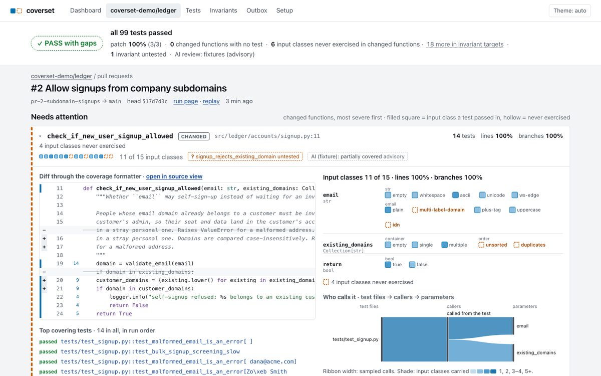

**The PR page.** PR #2 passes every test, and the page still says what is missing: two input classes of the changed `check_if_new_user_signup_allowed` that no test passed in, and an invariant with no linked test.

| | |
|---|---|
| 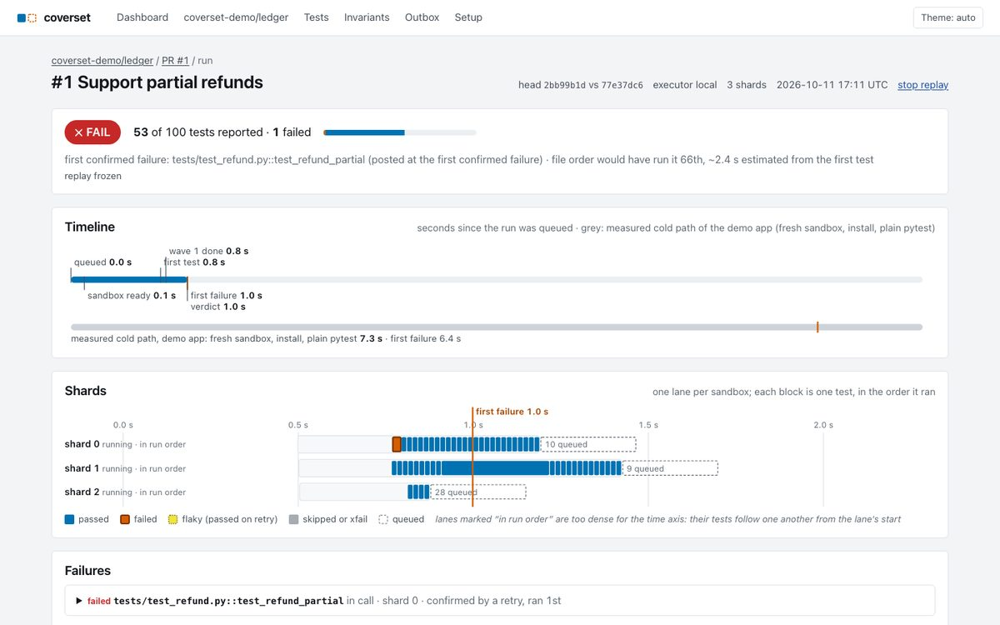 | 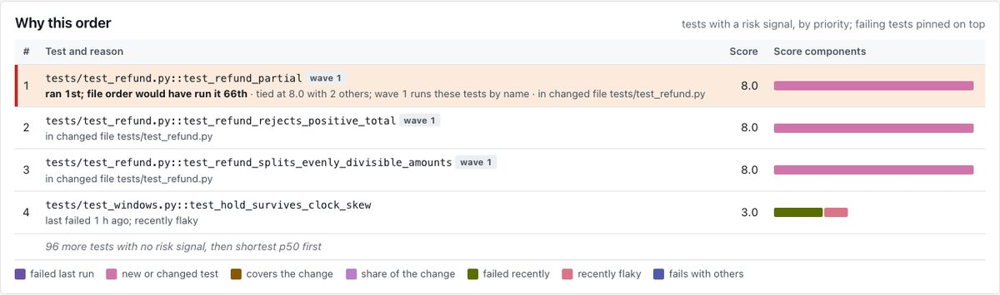 |
| **Live run.** The refunds PR, replayed at a quarter speed and frozen just after the verdict: FAIL is posted while three shards are still running. | **Why this order.** The failing test ran 1st; file order would have run it 66th. Each row shows the risk signals behind its score. |
| 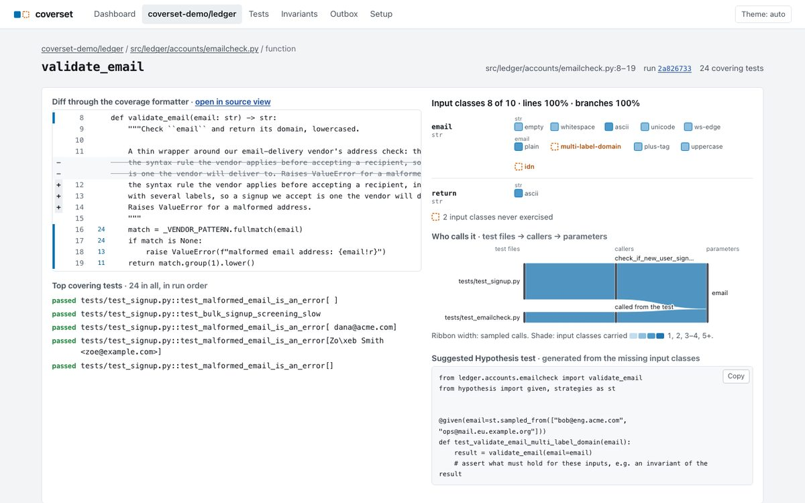 | 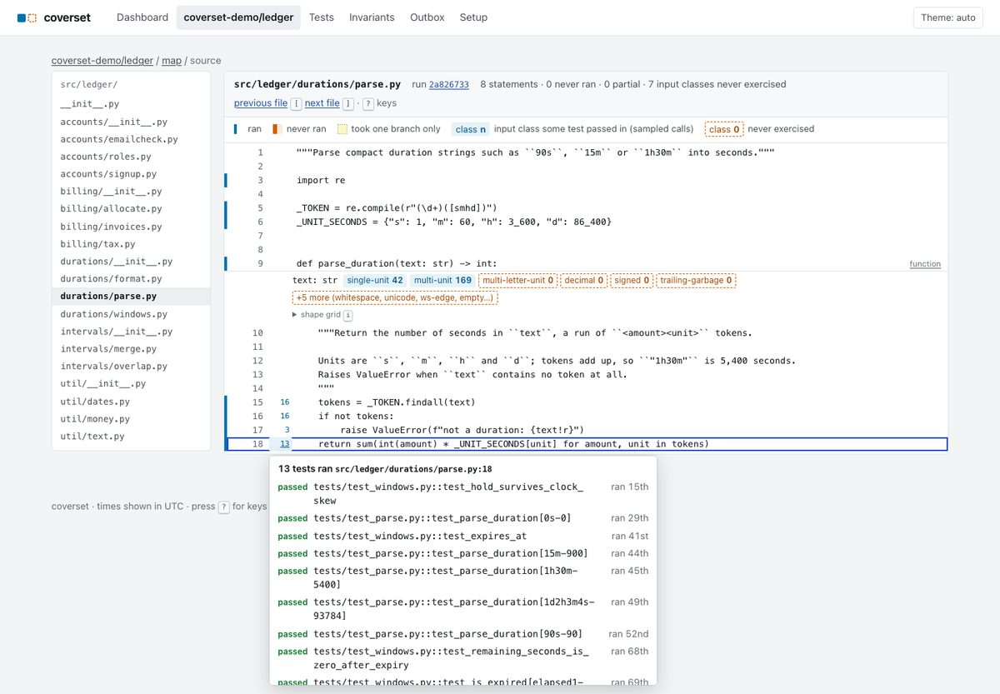 |
| **Shape grid and flow ribbon.** `validate_email` at 100% lines and branches, with `multi-label-domain` and `idn` never passed in, and which tests and callers feed its parameter. | **Source view.** Chips under `def parse_duration` count the calls per input class; the dashed ones are classes no test tried. The popover lists the tests that ran line 18, in run order. |
| 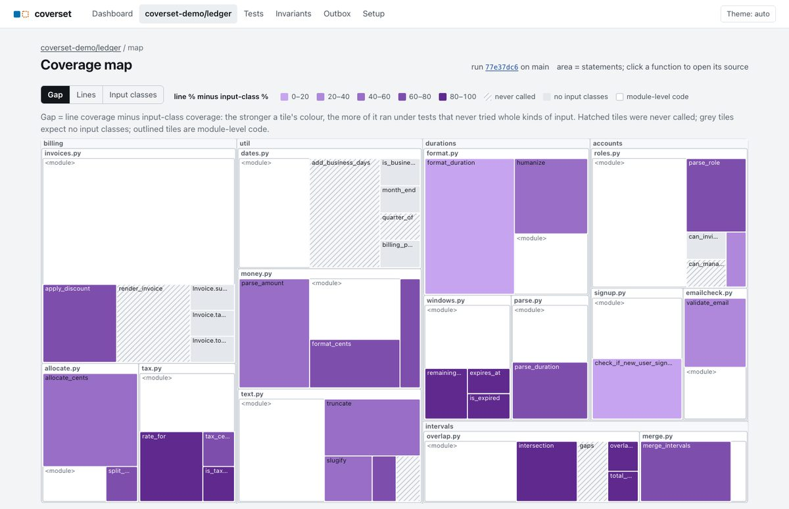 | 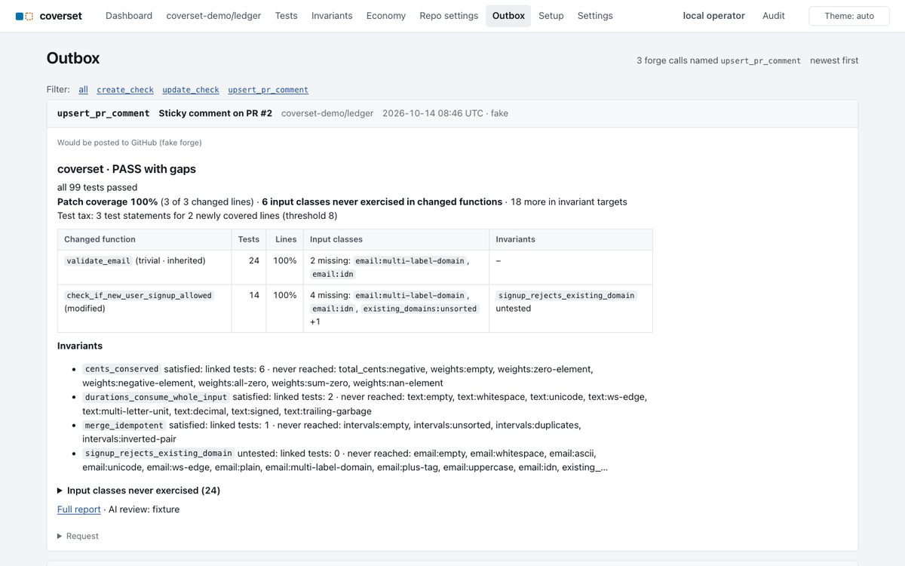 |
| **Coverage map, Gap mode.** Tile area is statements; the stronger a tile's colour, the more of its lines ran under tests that never tried whole kinds of input. Hatched tiles were never called. | **PR comment.** The one sticky comment coverset posts, as the fake forge recorded it: verdict, patch coverage, changed functions, invariants. |
| 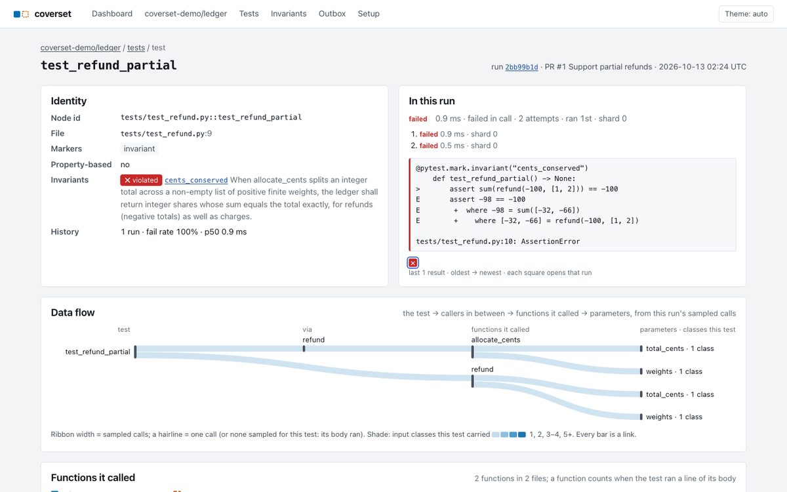 | 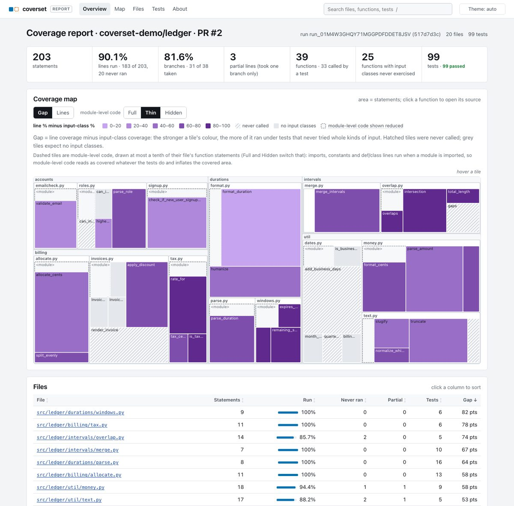 |
| **Test page.** The refunds PR's failing test: its result and retry, the invariant it violates, its last runs, and its data flow from the test through `refund` into `allocate_cents` and each parameter. Every nodeid on the pages links here, and from here each file opens with the lines this test did not run dimmed. | **Local report.** The same facts as static pages from one `pytest` run, with no server: totals, the Gap treemap, the file table, a page per file, function and test. Built by `coverset report`; see below. |
| 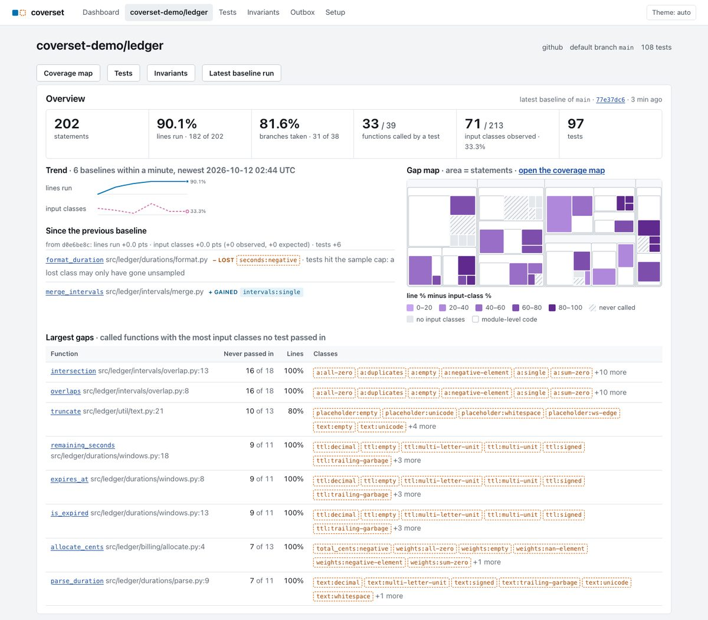 | 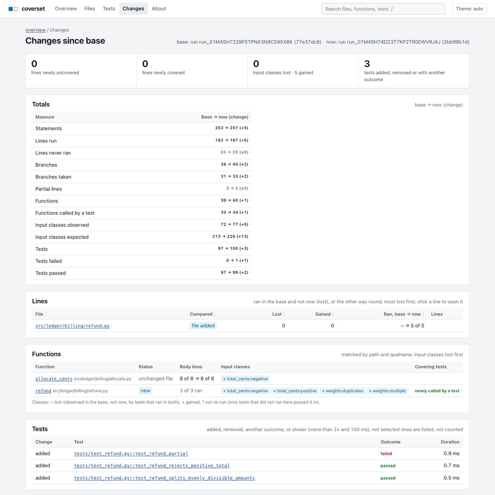 |
| **Repository overview.** The default branch over its last six baselines: statements, lines run, branches, functions called and input classes observed as tiles, a sparkline each for line % and input-class %, what changed since the previous baseline, a Gap-map thumbnail that opens the coverage map, and the functions with the most input classes no test passed in. | **Changes since a base.** `coverset report --compare`: PR #1 against the main baseline shows exactly its effect: three refund tests added, one failing, one new function, five input classes gained (one on `allocate_cents`, four on the new `refund`), nothing lost. |

Screenshots: demo data from <!-- n:demo_runs -->8<!-- /n --> local runs (`coverset demo --executor local`: six `main` commits and two PRs), taken on <!-- n:screenshot_date -->2026-10-11<!-- /n --> with `scripts/screenshots.py`. Dark versions are next to them as `docs/*-dark.jpg`. The AI review in them comes from fixtures.

## Three functions at 100% coverage

Each of these functions is at 100% line and branch coverage on `main`. Each table is the output of `coverset shapes <function> --markdown` on the default branch, which pools the last five baseline runs of the demo (demo data from <!-- n:shapes_runs -->5<!-- /n --> local runs). [docs/input-classes.md](docs/input-classes.md) explains how the expected classes are derived.

`uv run coverset shapes validate_email --markdown`. No test passes an address on a company subdomain. On `main`, `validate_email("bob@eng.acme.com")` raises `ValueError`; PR #2 widens the pattern so such addresses are accepted, every test still passes, and `email:multi-label-domain` is still never exercised.

<!-- shapes:validate_email:start -->
| Input class | Observed | Example or suggested Hypothesis strategy |
|---|---|---|
| `email:empty` | yes | `''` |
| `email:whitespace` | yes | `' '` |
| `email:ascii` | yes | `'alice'` |
| `email:unicode` | yes | `'Zoë Smith <z***@example.com>'` |
| `email:ws-edge` | yes | `' d***@acme.com'` |
| `email:plain` | yes | `'d***@acme.com'` |
| `email:multi-label-domain` | **no** | `st.sampled_from(["bob@eng.acme.com", "ops@mail.eu.example.org"])` |
| `email:plus-tag` | yes | `'B***@Example.ORG'` |
| `email:uppercase` | yes | `'E***@Globex.IO'` |
| `email:idn` | **no** | `st.just("bob@bücher.de")` |

8 of 10 input classes observed (80%).
<!-- shapes:validate_email:end -->

`uv run coverset shapes parse_duration --markdown`. No test passes a unit longer than one letter. `parse_duration("100ms")` returns 6000 seconds: the regex reads `100m` and drops the `s`. The decimal, signed and trailing-garbage classes also return a wrong number without raising.

<!-- shapes:parse_duration:start -->
| Input class | Observed | Example or suggested Hypothesis strategy |
|---|---|---|
| `text:empty` | yes | `''` |
| `text:whitespace` | **no** | `st.sampled_from([" ", "\t", "\n "])` |
| `text:ascii` | yes | `'h'` |
| `text:unicode` | **no** | `st.text(st.characters(min_codepoint=128), min_size=1)` |
| `text:ws-edge` | **no** | `st.text(min_size=1).map(lambda s: f" {s} ")` |
| `text:single-unit` | yes | `'0d'` |
| `text:multi-unit` | yes | `'1h30m'` |
| `text:multi-letter-unit` | **no** | `st.sampled_from(["100ms", "2min", "3hr"])` |
| `text:decimal` | **no** | `st.just("1.5h")` |
| `text:signed` | **no** | `st.sampled_from(["-5m", "+5m"])` |
| `text:trailing-garbage` | **no** | `st.just("5m!")` |

4 of 11 input classes observed (36.4%).
<!-- shapes:parse_duration:end -->

`uv run coverset shapes allocate_cents --markdown`. No `main` run passes a negative total. `allocate_cents(-100, [1, 2])` returns `[-32, -66]`, which sums to -98: `int()` truncates towards zero and the negative remainder slice adds cents instead of removing them. That is the bug PR #1 ships in `refund()`. Weights that sum to zero raise `ZeroDivisionError`, and a NaN weight raises `ValueError`.

<!-- shapes:allocate_cents:start -->
| Input class | Observed | Example or suggested Hypothesis strategy |
|---|---|---|
| `total_cents:negative` | **no** | `st.integers(max_value=-1)` |
| `total_cents:zero` | yes | `0` |
| `total_cents:positive` | yes | `5` |
| `weights:empty` | **no** | `st.just([])` |
| `weights:single` | yes | (no example recorded) |
| `weights:multiple` | yes | (no example recorded) |
| `weights:zero-element` | **no** | `st.lists(st.floats(0, 100), min_size=1).map(lambda xs: xs + [0])` |
| `weights:negative-element` | **no** | `st.lists(st.floats(0, 100), min_size=1).map(lambda xs: xs + [-1])` |
| `weights:all-zero` | **no** | `st.lists(st.just(0), min_size=1)` |
| `weights:sum-zero` | **no** | `st.lists(st.floats(0, 100), min_size=1, max_size=16).map(lambda xs: xs + [-x for x in xs])` |
| `weights:nan-element` | **no** | `st.lists(st.floats(0, 100), min_size=1).map(lambda xs: xs + [float("nan")])` |
| `weights:unsorted` | yes | (no example recorded) |
| `weights:duplicates` | yes | (no example recorded) |

6 of 13 input classes observed (46.2%).
<!-- shapes:allocate_cents:end -->

## Local report

`coverset report` writes one test run as a folder of static pages, the rich equivalent of `coverage html`: lines and branches, the tests behind every line, a data-flow lens that dims what one test did not run, a page per test with the input classes it passed in, and every function's shape grid with Hypothesis strategies for the classes no test passed in. No server and no database: open `index.html` from disk.

```sh
pytest --coverset                     # the bundle goes to .coverset/, sources from [tool.coverset] (or --coverset-out DIR --coverset-source PKG)
coverset report .coverset --open      # from a git checkout that tracks the measured files; also --run <run id> from the facts store
coverset report .coverset --compare ../before/.coverset   # plus a Changes page: what this run gained or lost against a base
coverset report bundle.tar.gz --repo-root ~/src/myrepo   # a CI bundle or a neutral bundle: sources only with --repo-root
```

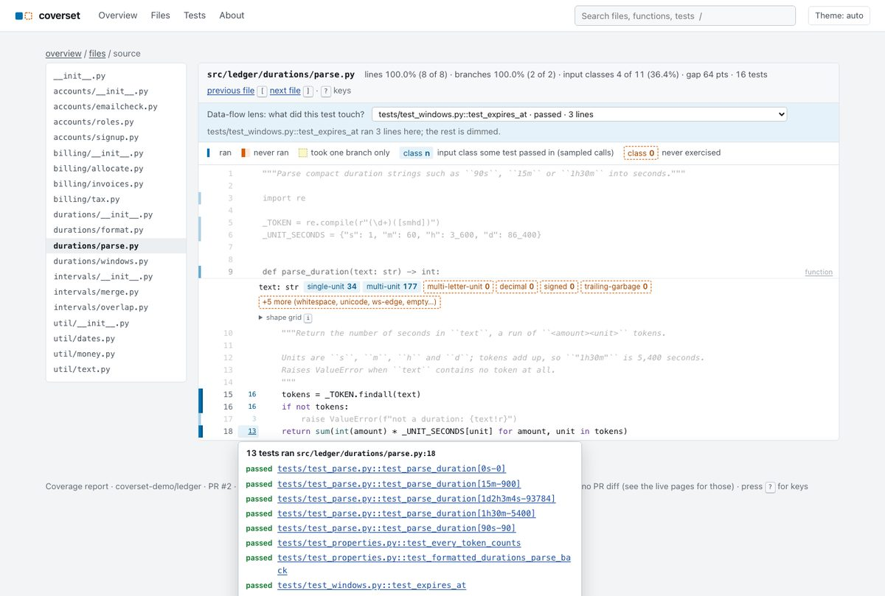

With `--compare BASE` (or `--compare-run RUN_ID` from the facts store) the report also says what this run gained or lost against a base: a Changes page with the totals as base → now, lines newly uncovered or covered per file, input classes lost or gained per function, and tests added, removed, failing or slower, honest about runs that ran different test sets. One run (or one pair) only: no history and no PR diff, which the live pages have. Keys, the lens, the comparison rules and the trust model are in [docs/report.md](docs/report.md).

## One model for every language

Everything downstream of a test run (the facts store, the input-class catalogue, the pages, the comment, the report) reads one language-neutral model, `coverset-model`, a package with no dependencies. Its on-disk form is the **neutral bundle** ([docs/neutral-bundle.md](docs/neutral-bundle.md)): `manifest.json`, then `tests`, `files`, `coverage`, `arcs`, `functions`, `shapes` and `links` as JSON lines, with shape keys from one value vocabulary (`int|neg`, `str|kind:email/multi-label-domain`, `list|elem:int|order:unsorted`) and declared types as small **type descriptors** (`{"kind": "union", "arms": [...]}`, `{"kind": "enum", "members": [...]}`) that any language can produce. `pytest-coverset --coverset-neutral` writes it for Python, `coverset bundle validate` checks a bundle against the specification and its JSON Schemas, `coverset bundle convert` turns a plugin bundle into one, and a synthetic TypeScript bundle (`fixtures/bundles/neutral-ts`, the shape a Vitest or Jest reporter would emit) validates, ingests into the facts store with no Python-specific code path, and renders in the report and the live pages, whose function page and PR cards build its input classes from the type descriptors stored at ingest (`tests/web/test_web_neutral.py`). `coverset-vitest` (`packages/coverset-vitest`) writes the same bundle from a real Vitest run: per-test lines from Istanbul's counters, regions and declared types from the TypeScript checker, and argument shapes from a small instrumentation plugin that moves no line and changes no Istanbul statement, branch or function count; it also wraps Vitest's Istanbul instrumenter so that runtime stack traces and failure signatures name the original lines with the plugin as without it, and instrumented code runs unchanged where no recorder is installed (a `globalSetup`, a script). `examples/ts-app`'s `npm test` produces one that validates with no problem, ingests, and shows `email:multi-label-domain` and `totalCents:negative` as never exercised (`tests/e2e/test_vitest_reporter.py`; [docs/typescript.md](docs/typescript.md)).

## Run it

```sh
uv sync
uv run coverset demo                      # seed the demo repo, run its history and both PRs, serve on http://127.0.0.1:8000
uv run coverset demo --executor modal     # the same on Modal Sandboxes (needs `modal setup`; spends a few cents)
uv run coverset modal reap --all          # terminate the coverset sandboxes of this data directory
uv run coverset modal reap --all --any-instance   # terminate coverset sandboxes from any data directory
uv run pytest                             # unit, web and end-to-end tests (local executor)
uv run python scripts/screenshots.py      # the README screenshots (needs `uv run playwright install chromium-headless-shell`)
uv run python scripts/bench_modal.py      # the Modal benchmarks behind docs/numbers.json (prints its cost estimate first)
uv run python scripts/check_readme.py     # the numbers above against docs/numbers.json (--fix rewrites them)
uv run coverset report --run <run id>     # the static report of a run in the facts store (or of a .coverset directory)
uv run coverset report --run <PR run id> --compare-run <baseline run id>   # the same plus a Changes page against a baseline
uv run coverset bundle validate fixtures/bundles/neutral-ts/bundle   # the TypeScript fixture against the neutral bundle spec
(cd examples/ts-app && npm install && npm test)   # a real Vitest run that writes a neutral bundle to .coverset/neutral
```

`coverset demo` seeds a deterministic git repository (`data/demo.git`: six commits on `main` and two PR branches), runs the six baselines and both PRs, replays `fixtures/webhooks/pr_opened.json` through the webhook route, and serves the UI. PR #1 ("Support partial refunds") fails on `tests/test_refund.py::test_refund_partial`; PR #2 ("Allow signups from company subdomains") passes with gaps. The demo also builds PR #2's static report under `<data dir>/report` and prints its path (`--no-report` skips it). `--no-serve` stops after the runs. `COVERSET_DATA_DIR` moves everything the demo writes.

On Modal the demo builds the environment image (cached after the first build), runs every shard in a sandbox, and builds one trusted snapshot of `main` at the end of seeding. While it serves, the warm-pool maintainer keeps up to `COVERSET_POOL_SIZE` (4) idle sandboxes for the demo repository until `COVERSET_POOL_TTL_S` (600 s) after its last run, at about $0.03 per sandbox-hour; stopping the server drains the pool. `coverset modal reap --all` cleans up after an interrupted run.

## Use it on your repo

1. Add `[tool.coverset]` to the repository's `pyproject.toml`. Every key has a default; these are the ones the demo sets:

   ```toml
   [tool.coverset]
   source = ["ledger"]          # packages to measure and trace
   source_root = "src"
   testpaths = ["tests"]
   python = "3.13"              # 3.12 or later
   invariants = "invariants.yaml"
   ```

   Locally, `pytest --coverset` then `coverset report .coverset --open` gives you the pages for one run before any of the rest exists. The plugin prints the test run and one closing line that names the bundle and the report command; the JSON event lines exist only for the orchestrator. If the sources measured no file (a misspelt `[tool.coverset] source`), that line ends with a warning.

2. Run `coverset serve` where GitHub can reach it, with an admin token (`COVERSET_ADMIN_TOKEN`) and `COVERSET_PUBLIC_URL`. Then either create and install the GitHub App from `/setup` (check runs, buttons, the sticky comment), or set `COVERSET_GITHUB_TOKEN` (at least 16 characters), `COVERSET_ALLOWED_OWNERS` and `COVERSET_GITHUB_WEBHOOK_SECRET` and add a repository webhook (a commit status and the sticky comment). App mode needs `COVERSET_ALLOWED_OWNERS` too. See [docs/github.md](docs/github.md).
3. Pick the executor: `COVERSET_EXECUTOR=modal` after `modal setup`, with `COVERSET_MODAL_DAILY_BUDGET_USD` as the daily cap, `COVERSET_MAX_RUN_COST_USD` (1.00) as the per-run cap, also enforced while the run executes, and `COVERSET_MAX_IMAGE_BUILDS_PER_DAY` (20). An untrusted PR whose lockfile has no image yet waits for approval, and its environment is never built from direct URL or VCS references. The local executor runs webhook-triggered runs only with `COVERSET_LOCAL_ALLOW_WEBHOOK_RUNS=true` and never runs untrusted PRs. `coverset warm --repo <name>` builds the environment (and on Modal a trusted snapshot) ahead of the first PR.
4. In CI, replace the `pytest` step with the composite action in `src/coverset/forge/gha/`, which runs `coverset-ci wait`: it proves the repository with the job's OIDC token, waits for coverset's verdict, prints the results in pytest's format and exits with pytest's codes.
5. Declare invariants in `invariants.yaml` and link tests to them with `@pytest.mark.invariant("<id>")` ([docs/invariants.md](docs/invariants.md)). `coverset invariants scan` reviews the review-kind invariants at the latest trusted baseline of the default branch through the configured review client (the offline fake unless `COVERSET_AI=anthropic` and the repo opted in) and records their statuses. It also runs automatically after every trusted, completed baseline of the default branch's tip (`COVERSET_SCAN_AFTER_BASELINE=false` turns that off).

## Keys

In the source view:

| Key | Action |
|---|---|
| `j` / `k` | Next / previous line that never ran or took only one branch |
| `n` / `N` | Next / previous function with an input class no test passed in |
| `t` | Tests that ran the current line |
| `i` | Show or hide the current function's shape grid |
| `[` / `]` | Previous / next file |
| `?` | Keys help |

Keys are ignored while typing in a form field and with Ctrl, Alt or Cmd held. The header's theme button cycles auto, light and dark.

## How a run works

1. **Webhook.** GitHub posts a `pull_request` event. coverset checks the HMAC signature over the raw body before parsing anything, deduplicates on the delivery id and answers 202 (`timeline.webhook_received`).
2. **Queued.** Intake records the PR and inserts a `queued` run, or `awaiting_approval` for an untrusted PR. The dispatcher claims it atomically and applies policy: no untrusted run on the local executor, and a Modal run is admitted only if today's spend plus its reservation fits the daily budget, and is capped per run. A PR run's `coverset` check is created `in_progress`.
3. **Workers.** The planner refreshes the bare mirror, exports the head with `git archive`, finds or builds the environment image, and takes the newest trusted snapshot. On Modal it claims pooled sandboxes first, then creates fresh ones from the snapshot. `put_tree` writes the source into each worker (`timeline.sandbox_ready`).
4. **Collect and diff.** Worker 0 runs `pytest --collect-only`. The diff `base...head` is classified into changed functions, and the prior run is chosen: the PR's previous head, else the merge-base, else the latest baseline.
5. **Wave 1 and scores.** Every test gets a score from its failure history, flakiness, the changed code it covers and whether it is new. Wave 1, the greedy set cover of tests over the changed function bodies, runs first on every shard.
6. **Shards.** The number of shards follows the summed median durations. Wave-1 tests are dealt first, one to each least-loaded shard, then the rest in priority order, each to the least-loaded shard. Each worker runs `python -m pytest @run/shard.args` with the pytest-coverset plugin: one coverage context per test with the C tracer, plus the shape tracer on `sys.monitoring`.
7. **Streamed events.** Results stream back as nonce-prefixed JSON lines on stdout (`timeline.first_test`, `timeline.wave1_finished`).
8. **Retry once, fail fast.** A test's first failure starts one retry. A second failure confirms it and the verdict is posted at once (`timeline.first_failure`, `timeline.verdict`); the run records `rank_coverset` (its planned position), `rank_executed` (results reported before it) and `rank_file_order`. By default the other shards run on so coverage and shapes land.
9. **Bundles and ingest.** Each shard's `bundle.tar.gz` is pulled before its worker is released, extracted under size limits, converted, and written as immutable Parquet files that DuckDB queries.
10. **Verdict.** The report adds patch coverage, input-class coverage of the changed functions and invariant targets, invariant statuses and the advisory AI review. The verdict is stored, the check run and one sticky comment are posted, and a `done` event closes the run with exit code 0 (success), 1 (failure), 5 (no tests collected) or 2 (anything else: error, cancelled, abandoned, neutral).
11. **Afterwards.** A PR run applies the per-PR retention rule. A trusted baseline of the default branch's tip on Modal rebuilds the trusted snapshot and refills the warm pool.

`coverset-ci wait` in the CI job exits with the same codes, plus 3 when the server cannot be reached. The full walk-through is [docs/orchestrator.md](docs/orchestrator.md).

## How it is built

- **Control plane**: Python 3.13, Quart 0.23.1 on Hypercorn 0.18.0, SQLAlchemy 2.1.4 with aiosqlite 0.22.1 and Alembic 1.20.0 (SQLite), click for the CLI, pydantic-settings for every `COVERSET_*` setting.
- **Facts**: PyArrow 26.0.0 Parquet files per run and shard, queried by in-memory DuckDB 1.5.6, so readers never lock writers.
- **Model** (`packages/coverset-model`, no dependencies, Python 3.12+): the neutral bundle (reader, writer, validator, JSON Schemas), the shape-key grammar and the input-class catalogue over language-neutral type descriptors; the control plane and the plugin's conformance tests build on it.
- **Worker plugin** (`packages/pytest-coverset`, Python 3.12+): coverage.py 7.16.2 with the ctrace core and one dynamic context per test, a `sys.monitoring` shape tracer on its own tool id, framed stdout events, `--coverset-neutral` for the neutral bundle, and `coverset-ci`, which needs only the standard library.
- **Executors**: Modal 1.6.1 Sandboxes (env images, trusted filesystem snapshots, a warm pool, a reaper, cost guards) and a local subprocess executor.
- **Forge**: githubkit 0.16.1 and PyJWT 2.15.1 for the GitHub App, token mode, webhooks and Actions OIDC; a fake forge records every call for the demo and the tests.
- **Analysis**: unidiff 1.0.1 and the `ast` module for changed functions, greedy set cover for wave 1, priority-snake sharding, and the Python side of the catalogue (annotations and Enums to type descriptors).
- **AI review**: a `ReviewClient` interface with a fixture-backed fake and an Anthropic client (`anthropic>=1.13,<2`, structured outputs, prompt caching).
- **UI**: server-rendered Jinja pages with htmx 2.0.11, its SSE extension and idiomorph (vendored, SRI-checked), Pygments 2.21.0 for the source view, SVG built in Python for the shape grid, flow ribbon, test flow, Gantt chart and treemap. No build step and no inline scripts. `coverset report` builds its static pages from the same renderers.
- **Tests**: pytest 9.1.1, pytest-asyncio, Hypothesis 6.168.5, Playwright 1.63.0 for the screenshots.

```
coverset/
  src/coverset/
    forge/          GitHub App and token adapters, webhooks, OIDC, the fake forge, the Actions step
    orchestrator/   intake, queue, planner, runner, verdict, bundles, pool, reaper, budget
    analysis/       diff to functions, prior run, scoring, wave 1, sharding, input classes, invariants
    facts/          untrusted-bundle reading, Parquet ingest, DuckDB queries, retention
    executors/      the executor contract, LocalExecutor, ModalExecutor
    lang/           the language-adapter contract, the Python adapter and NeutralAdapter (any language that ships a neutral bundle)
    ai/             review bundles, fake and Anthropic clients
    web/            pages, SSE, the /v1 API, templates, static files, SVG renderers
    report/         the static report (coverset report)
    db/             SQLAlchemy models and the Alembic migration
    demo/           the seeded demo repository and the demo flow
    commands/       the coverset CLI
  packages/coverset-model/    the neutral bundle, shape keys and the input-class catalogue (no dependencies)
  packages/pytest-coverset/   the worker plugin and coverset-ci
  packages/coverset-vitest/   the Vitest reporter (TypeScript) that writes the neutral bundle
  examples/demo-app/          the ledger package the demo runs
  examples/bench-suite/       the synthetic 1,200-test benchmark suite
  examples/ts-app/            a TypeScript library and its Vitest suite, measured by coverset-vitest
  fixtures/                   signed webhook payloads, review fixtures, bundles (a synthetic TypeScript one included)
  scripts/                    screenshots, README check, benchmarks, fixtures, demo seeding
  docs/                       the pages below, numbers.json and the screenshots
```

[ARCHITECTURE.md](ARCHITECTURE.md) is the map: components, trust boundaries, extension seams, and what is designed but not built. Then [instrumentation](docs/instrumentation.md), [data model](docs/data-model.md), [input classes](docs/input-classes.md), [invariants](docs/invariants.md), [orchestrator](docs/orchestrator.md), [Modal](docs/modal.md), [GitHub](docs/github.md), [AI review](docs/ai-review.md), [web UI](docs/ui.md), [security](docs/security.md), [extending](docs/extending.md), [benchmarks](docs/benchmarks.md), [the neutral bundle](docs/neutral-bundle.md) and [the static report](docs/report.md).

## Caveats

- The GitHub integration is verified only against recorded, signed webhook fixtures and a fake forge. No real GitHub App, repository or Actions job was used.
- The AI review in the screenshots comes from `FakeReviewClient` fixtures. `AnthropicReviewClient` is unit-tested against a stubbed SDK and has never been called live. The review is advisory and never changes pass or fail.
- Instrumented repositories need Python 3.12 or later, because the shape tracer uses `sys.monitoring`. Per-test contexts need coverage.py's ctrace core, the slowest configuration it supports. On the demo suite the plugin costs <!-- n:overhead_x -->1.14<!-- /n -->× plain pytest; that suite's wall time is mostly interpreter start-up and imports, so suites with tight loops pay more.
- A hollow square means "never observed", not "buggy". Shapes are sampled: the tracer caps the calls it records per function, except in the PR's changed files and invariant targets.
- The LocalExecutor is not a sandbox. It runs tests as your user, with your network, and refuses untrusted PRs.
- One control plane is one trust domain. Every repository it watches shares its database, facts, credentials and admin token.
- coverset keeps the data directory at mode 0700 and the database at 0600; keep `.env` private too (`chmod 600 .env`).
- An untrusted PR's verdict is self-reported by the PR's own code, which shares a process with the plugin. Approval, a blocked network and validation of every event limit what it can do, not what it can claim about its own tests.
- Storage is SQLite plus Parquet. Postgres, DuckLake and roaring-bitmap facts are documented as the scale-out path, not built.
- The benchmark numbers come from one Modal account on <!-- n:bench_date -->2026-10-11<!-- /n -->, on the Starter plan, which caps 100 concurrent containers. The cold path is a measured stand-in for a cold CI job: a fresh sandbox that installs dependencies and runs plain pytest. It is not GitHub Actions.
- The fail-fast benefit is shown on one measured PR, the refunds PR of the demo, whose tests take only seconds. The run's file-order estimate is estimated from the first test: the time until the first test result (environment, collection and planning, which happen in either order) plus the median durations of the tests before the failing one; it counts no retry.
- The bench suite is synthetic. Its `busy()` bodies calibrate under the tracer, so each test spends its drawn time whether or not coverage is on, and the fan-out numbers measure parallelism, not instrumentation overhead.
- Inherited means labelled, not copied. Trivial, renamed and moved functions are labelled inherited in the report, but their facts are not reused from the prior run and every collected test still runs.
- `verify.kind: runtime` invariants are accepted and validated but not executed; they are always reported `untested`.
- The TypeScript reporter supports Vitest with the Istanbul provider only, not V8 coverage or Jest ([docs/extending.md](docs/extending.md) lists what a Jest port would change). Async functions and generators are never recorded as callers, concurrent tests share one current test, unannotated parameters have no type, and it costs about 0.4 s per run on the example (loading TypeScript and type-checking).
