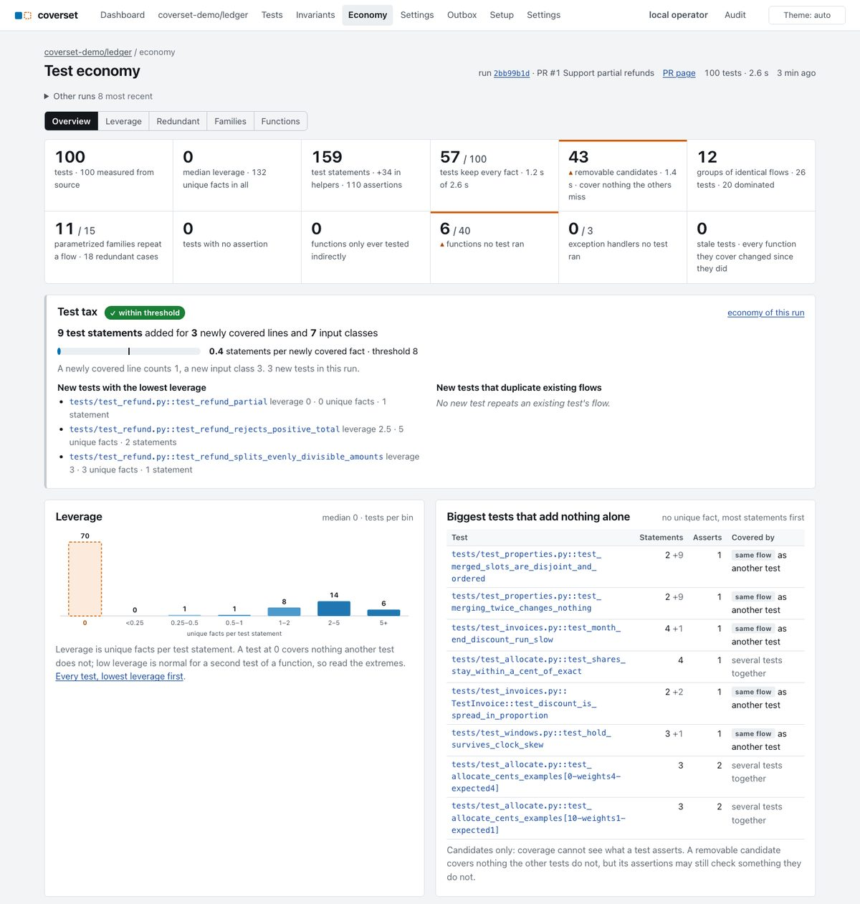
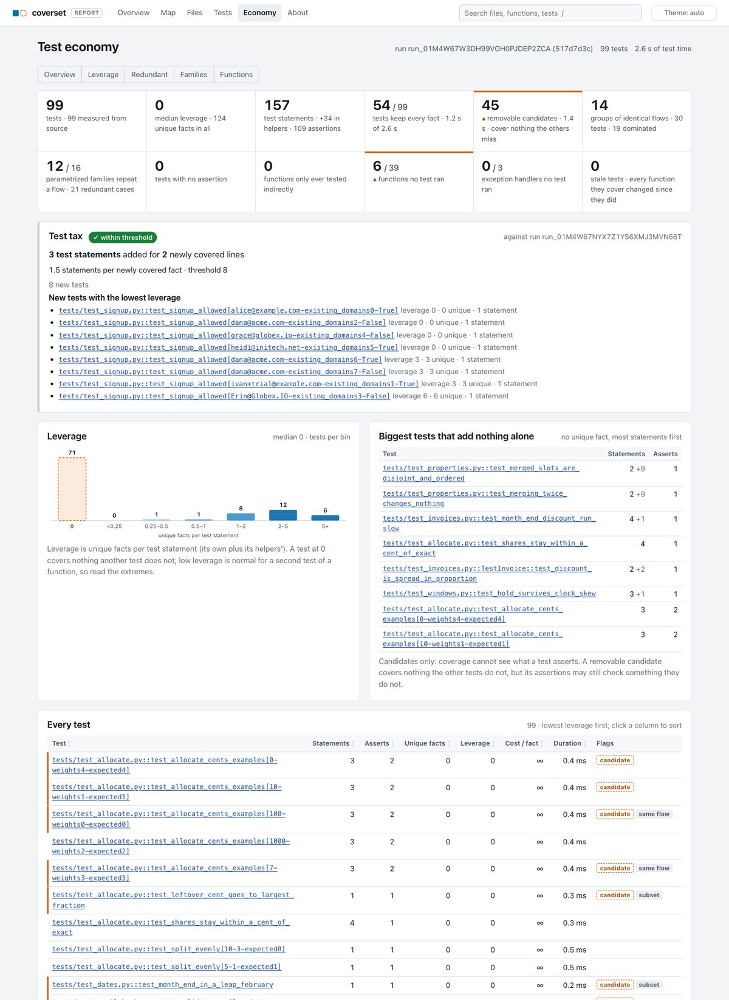

# Test economy

Coverage says what the tests ran. The test economy says what each test *costs* against what it
*alone* contributes, so a reviewer can tell a lean suite from one that tests the same thing forty
times. It exists because of a story: an agent added about 95 lines of test scripting to check that
one environment variable parses `"true"`, `"1"` and `"TRUE"`. Every line of it passed review,
because nothing measured it.

The economy is computed once per run, at `finalize_run`, and stored as four Parquet run tables. The
same code runs over a bundle for `coverset report`. This page defines every number, gives the
caveats, documents the tables, and is the API reference for the pages, the PR card, the sticky
comment line, the static report and the CLI that read it.

Status: **verified** for the analysis (`src/coverset/analysis/economy.py`), the facts tables and
readers (`src/coverset/facts/economy.py`) and the `finalize_run` hook
(`src/coverset/facts/ingest.py`), with tests in `tests/analysis/test_economy.py` and
`tests/facts/test_economy_facts.py`. **Verified** (stage 2) for the surfaces that read it: the
Economy page, the PR page's Test tax card, the sticky-comment and check-run line, the static
report's Economy page and `coverset tests` ([below](#where-you-see-it)).

- [What it measures, in one table](#what-it-measures-in-one-table)
- [Facts, uniqueness and the weights](#facts-uniqueness-and-the-weights)
- [Every metric](#every-metric)
- [How to read the numbers](#how-to-read-the-numbers-without-over-trusting-them)
- [Where it runs and what it reads](#where-it-runs-and-what-it-reads)
- [The facts tables](#the-facts-tables)
- [API for stage 2](#api-for-stage-2)
- [Performance](#performance)
- [Limits and future work](#limits-and-future-work)
- [Where you see it](#where-you-see-it): the pages, the PR card, the comment line, the report, the CLI

## What it measures, in one table

| Question | Metric | Where |
|---|---|---|
| How much test code is this test? | **weight**: statements, assertions, fixtures, helper statements, file lines | `test_economy.statements` … |
| What does it cover that no other test does? | **unique facts**: unique lines + unique arcs + 3 × unique input classes | `test_economy.unique_*` |
| Is it worth its size? | **leverage** = unique facts ÷ (own + helper statements) | `test_economy.leverage` |
| Is it worth its time? | **cost per unique fact** = milliseconds ÷ unique facts | `test_economy.cost_per_fact_ms` |
| Do two tests do exactly the same thing? | **equivalence groups** (identical signatures) | `test_economy.group_id` |
| Does another test do everything this one does, and more? | **dominance** | `test_economy.dominated_by` |
| What is the smallest suite that keeps every fact? | **minimal covering set**; everything else is a **removable candidate** | `test_economy.in_minimal_set`, `removable` |
| Do 12 parametrize cases exercise 12 behaviours? | **parametrize collapse**: cases vs distinct input-class flows | `test_families` |
| Does the test check anything? | **assertion-free** tests | `test_economy.assertion_free` |
| Is a function only ever tested by accident? | **direct vs indirect** testing | `func_testing.indirect_only`, `untested` |
| Which error paths never ran? | **unexercised exception handlers** | `func_testing.handlers_*` |
| Did this PR add a lot of test for little new coverage? | **PR test tax** | `run_economy.test_tax`, `flagged` |
| Does a test still test the code it was written for? | **stale tests** | `test_economy.stale` |

## Facts, uniqueness and the weights

A **fact** is something a test demonstrably exercised in production code (test code is never
counted as coverage value):

| Kind | Identity | Source |
|---|---|---|
| line | `(file, line)` | per-test coverage (`test_lines`, the bundle's `coverage.jsonl`) |
| arc | `(file, from, to)` | the run's executed branch arcs, attributed per test (inferred, [below](#arcs-are-inferred)) |
| shape observation | `(function, param, shape key)` | the shape tracer (`call_shapes`, `shapes.jsonl`) |
| input class | `(function, "param:class")` | each observation's classes (`coverset_model.catalogue`, without declared types) |

A fact is **unique** to a test when exactly one test in the run has it.

```
unique facts = LINE_WEIGHT × unique lines + ARC_WEIGHT × unique arcs + CLASS_WEIGHT × unique classes
             = 1 × unique lines           + 1 × unique arcs          + 3 × unique classes
```

Why these weights (`analysis/economy.py`: `LINE_WEIGHT`, `ARC_WEIGHT`, `CLASS_WEIGHT`):

- A **line** is the unit everyone already understands; it weighs 1.
- An **arc** weighs 1, not more: arcs are inferred from lines, so they cannot be worth more than
  the evidence they come from.
- An **input class** weighs 3. A class pins down a behaviour that lines cannot see (`n:zero` and
  `n:negative` run the same lines of `abs`), a function has far fewer classes than lines (a 30-line
  function might have 6), and the whole point of coverset is that input classes are where agent
  tests are thin. Three lines per class keeps a test that adds one new class and no new line from
  scoring zero, without letting classes swamp lines.

Shape observations are not weighted into unique facts (classes summarise them); they are part of
the signature, so two tests that pass different shapes are never "the same test".

### Arcs are inferred

Branch arcs are recorded for the run, not per test (`arcs.jsonl` and `run_arcs` are the union over
tests). A test is credited with an executed arc `a → b` when it executed both `a` and `b` (for an
exit arc, `b < 0`, when it executed `a`). This over-attributes: a test that took the `if` branch on
one call and the `else` on another, or that runs `a` and `b` on unrelated paths, gets both arcs. When
the bundle starts carrying per-test arcs (`coverage.jsonl` rows already may: validated, not read),
`EconomyData` is the one place to read them.

## Every metric

### Test weight (from the test file's AST at head)

The nodeid `path::Class::Inner::func[params]` is resolved in the test file at the run's head (the
parameter id is cut at the first `[` before splitting on `::`, because a parameter id may contain
`::`). The result row's `file` (repository-relative) wins over the nodeid's path (pytest-rootdir
relative).

| Column | Definition |
|---|---|
| `statements` | every statement node in the test function's body, nested ones included, docstring excluded |
| `asserts` | `assert` statements, plus calls of `pytest.raises/warns/approx/deprecated_call/fail` (or the same names imported from pytest), plus any call whose name starts with `assert` (`self.assertEqual`, `mock.assert_called_once_with`, `assert_frame_equal`) and `self.fail` |
| `raises` | the body checks an exception or warning (`pytest.raises`, `pytest.warns`, `deprecated_call`, `assertRaises*`, `assertWarns*`) |
| `helper_asserts` | `asserts` inside the helpers the test calls (not inside fixtures) |
| `fixtures` | the test's argument names minus `self`, `cls`, `request` and parametrize argument names, plus the `autouse` fixtures of its class, its file and every `conftest.py` pytest would load for it |
| `helper_statements` | body statements of every helper and fixture the test reaches, each counted once per test: functions of the same file, `self.<method>` of the class and its same-file bases, functions imported from a test-code module beside the test or from the repository root (`from helpers import build`), and the fixtures it requests or that are autouse, found in its class, file or conftests. Followed to depth 2 (the test's own calls, and theirs; a fixture's own fixtures likewise) |
| `file_lines` | lines of the test file |
| `measured` | the file was read and parsed and the function found; otherwise every weight column is null and `reason` says why: `no sources`, `not a pytest test id` (Vitest's `file > describe > name`), `not a Python test file`, `test file unavailable or unparsable`, `test function not found` |

Never zero for an unknown: a test whose file could not be read is "not measured", and every surface
must say so rather than show 0.

### Coverage value

| Column | Definition |
|---|---|
| `lines`, `arcs`, `classes`, `observations` | distinct facts of each kind the test has |
| `unique_lines`, `unique_arcs`, `unique_classes` | facts of that kind no other test of the run has |
| `unique_facts` | `1 × unique_lines + 1 × unique_arcs + 3 × unique_classes` |
| `leverage` | `unique_facts / max(1, statements + helper_statements)`; null when not measured |
| `duration_ms` | the run's duration of the test (or the p50 the caller passed in `EconomyInputs.durations`) |
| `cost_per_fact_ms` | `duration_ms / unique_facts`; null with no unique fact (infinitely expensive) or no duration |
| `cases` | size of the test's parametrize family (1 when unparametrized) |

### Redundancy

- **Signature**: sha256 over the test's sorted fact ids of the three signature kinds (lines, arcs,
  shape observations). Fact ids are dense and ordered by each kind's natural key (path and line;
  path, from, to; function, param, shape key), so two tests have the same signature exactly when
  they have the same set of facts. Ids depend on the run's universe of facts, so a signature is
  only comparable **within one run**; so is `group_id`, its first 12 hex digits.
- **Equivalence group** (`group_id`): two or more tests with the same non-empty signature.
- **Dominance** (`dominated_by`): A is dominated by B when A's facts are a strict subset of B's and
  B is at most `EconomyPolicy.dominance_slowdown` (default **2.0**) times slower than A. Among
  several dominators the fastest wins (then the largest, then the name). Candidates are found
  through A's three rarest facts, and subset checks stop after `MAX_DOMINANCE_CHECKS` (2,000,000)
  per run, with a note.
- **Minimal covering set** (`in_minimal_set`): a greedy weighted set cover of every signature fact
  of the run (`analysis/cover.py`, `greedy_cover_csr`: most newly covered facts per second first,
  ties by name, the rule wave 1 uses), then pruned (`prune_csr`) so that no single test in it can
  be dropped: the heaviest redundant picks go first. Greedy cover is within a factor `ln(n)` of
  optimal; it is a good set, not *the* smallest.
- **Removable candidate** (`removable`): not in the minimal set, has at least one fact, and was not
  skipped. Removing every candidate keeps every line, arc and shape observation of the run covered
  (a property test checks it). **Candidates only**: coverage cannot see what a test asserts, and a
  candidate's assertions may check things no other test checks. Every surface shows
  `REMOVABLE_CAVEAT` next to candidates, groups and dominance.
- **Empty test** (`empty`): no production fact at all (it runs only test code, or code outside the
  measured sources, or it was skipped). Never a removable candidate: there is nothing to compare.
- **Parametrize collapse** (`test_families`): per family (`path::func` of `path::func[...]`),
  `cases`, `distinct_flows` (distinct sets of `(function, param, input class)` among the cases;
  null when no case was observed reaching a traced function) and `distinct_signatures`.
  `redundant_cases = cases − distinct_flows` (or `− distinct_signatures` when flows are null):
  "12 cases, 3 distinct flows".

### Assertion-free tests

`assertion_free` is true when the test's own `asserts` and its `helper_asserts` are both zero and
it checks no exception or warning. A test that only checks "it did not raise" is assertion-free by
this rule, deliberately: say so in the test (`pytest.raises`, or an explicit `assert result is
None`) and it is not. Null when not measured.

### Direct and indirect testing (`func_testing`)

For every production function or method (regions under `# pragma: no cover` are left out):

| Column | Definition |
|---|---|
| `covered` | some test (not import) executed a line of its body |
| `observed` | the shape tracer recorded at least one call of it |
| `direct_tests` | tests observed calling it directly; a call from a function in test code (a test helper) counts as direct |
| `indirect_tests` | tests that reached it only through other production functions |
| `indirect_only` | observed, and never called directly: it is only ever tested as a side effect of something else |
| `untested` | neither covered nor observed |

A covered but unobserved function (`covered` and not `observed`) is "not sampled": the shape tracer
targets only some functions and caps its samples (`func_input_cov.tests_truncated`), so neither
direct nor indirect can be claimed. Private helpers and `<locals>` closures are often legitimately
indirect-only; the pages should let the user filter them.

### Unexercised exception handlers

Every `except` / `except*` clause of a production Python file read at head, placed in the innermost
function, class or module region holding it. A handler is **exercised** when its body's first
statement executed in the run (any test, or import). Handlers whose body line is excluded
(`# pragma: no cover`) or is not a statement coverage.py tracks are left out.
`func_testing.handler_lines` lists the unexercised ones as
`[{"line": <except line>, "body_line": <first body line>, "types": ["FileNotFoundError", ...]}]`
(`BaseException` for a bare `except:`). Null when the source could not be read; TypeScript files
are not parsed (Python only).

### The PR test tax

For a run with a base (a run whose `base_sha` is set, which is every PR run):

- **Base run**: the newest finalized run of the repository whose head is exactly `base_sha`
  (`base_exact = true`); else the run's scoring basis (its prior run), labelled `base_exact =
  false` with a note. No base run: no tax, and a note.
- **Added test statements**: for every Python test file and conftest of the head run, every helper
  module the weights read, and every test file of the base run, the statements of the head version
  that are not in the base version, as a multiset of formatting-insensitive keys (a compound
  statement's key is its header: `for x in y`, `def test_a(tmp_path)`, `with m() as n`). Moving a
  test adds nothing; reformatting adds nothing; a copy-pasted test adds every statement it copies;
  a file that does not parse is skipped.
- **Newly covered lines**: production lines some head test covered that either have no counterpart
  in the base commit's file (added or changed lines, matched with a line diff when both versions
  could be read, else by line number) or whose counterpart no base test covered.
- **New input classes**: `(function, "param:class")` observed in head and not in the base run.
- **Tax**: `added_statements / max(1, newly_covered_lines + 3 × new_classes)`, test statements per
  newly covered fact.
- **Flagged** when `added_statements ≥ test_tax_min_statements` (default **20**) and `tax >
  test_tax_threshold` (default **8.0**, the scoped `policy.test_tax_threshold`). The message reads
  `"95 test statements added for 3 newly covered lines and 1 input class"` (`tax_message`).
- Also stored: `removed_test_statements`, `test_files_changed`, `new_tests` (nodeids not in the base
  run) and `new_tests_unique_facts` (their unique facts in head, a quick "did the new tests add
  anything the old ones did not").

The worked example in `tests/analysis/test_economy.py` (`test_the_horror_story_is_flagged...`) is
the story itself: a 50-statement test file (sandbox class, fixture, helper, one parametrized test
and three copies of the same test) for a three-line `env_flag`: 50 statements for 3 lines and 1
class, tax 8.3, flagged.

### Stale tests

A test is **stale** when every production function it covers changed (`body_hash`) since its own
test file last changed: it was written for code that is no longer there. Computed with the
repository's history:

1. one `git log --name-only` walk from head finds the last commit of every test file and every
   production file involved (`GitHistory.last_changes`, stopped as soon as every path is found);
2. a production file last changed no later than the test file leaves all its functions unchanged
   for that test file; every other `(test file's last commit, production file)` pair is read in one
   `git cat-file --batch` and indexed;
3. each covered function's body hash then is compared with head's; a function that did not exist
   then counts as changed.

`stale` is null when there is no history (no mirror, or the file's history cannot be read), and
`false` for a test that covers no production function. Commit times decide "no later", so a
rebased branch can skew it.

## How to read the numbers without over-trusting them

- **Removable means "covered elsewhere", not "useless".** A candidate's assertions may check a
  value no other test checks; a dominated test may be the one a human reads first. Treat the list
  as the place to *look*, sorted by duration, and check the assertions.
- **Low leverage is normal for many good tests.** The second test of a function has fewer unique
  facts than the first. Leverage ranks; it does not grade. The interesting rows are the extremes: a
  95-statement test with zero unique facts, or a 3-statement test that alone covers an error path.
- **Durations are noisy.** Dominance's 2× rule and the minimal set's weights use one run's timings
  (or the p50s passed in); a test near the boundary can flip between runs.
- **Sampling caps hide observations.** The shape tracer stops sampling a hot function; a test whose
  calls were not sampled has fewer classes than it exercised, which can make it look redundant or
  make a family look collapsible. `func_input_cov.tests_truncated` says when that happened.
- **Arcs are inferred** (above) and weigh no more than a line for that reason.
- **The tax is about proportion, not volume.** Twenty statements that cover a new function's ten
  lines and four classes is a tax of 0.9. Two hundred statements that cover three lines is 66.
  The floor (`test_tax_min_statements`) keeps tiny PRs out.
- **A base that is not exact** (`base_exact = false`) compares with the prior run, not the base
  commit: newly covered lines then include whatever changed between the two.

## Where it runs and what it reads

- **Control plane**: `finalize_run(store, ctx, ..., economy=EconomyInputs(...))` calls
  `write_economy` last, under the run lock. Sources come from the repository's bare mirror, which
  `Settings` puts beside the facts directory (`<data_dir>/mirrors/<repo_id>.git`;
  `mirror_history`), read in a few batches: the test files, their conftests and the measured Python
  files at the head commit; then the helper modules those test files import (two rounds); at most
  5,000 files of at most 2 MB each. The base run's test files and the covered production files are
  read at the base run's head. Git runs with the control plane's scrubbed environment
  (`orchestrator.repos.git_env`), only full 40-hex SHAs are accepted, and paths always follow `--`.
  Source text is parsed with `ast` only: nothing is imported or executed.
- **Failures never fail the ingest**: an exception is logged and `run_economy` is written with only
  `notes_json` (`"economy failed: RuntimeError: ..."`, redacted). Runs with more than 25,000,000
  `test_lines` rows skip the economy with a note.
- **Re-ingesting a shard** drops the four tables with the other run aggregates; the next
  `finalize_run` writes them again.
- **Without a mirror** (a store on its own, tests): coverage value, uniqueness, redundancy, families
  and direct/indirect testing are still computed; weights, handlers, stale tests and the statement
  diff are not, and `notes_json` says which.
- **Static report and local mode**: `analyse(bundle, sources)` over the bundle and a source reader
  (the report's `SourceAccess`); see [the report recipe](#the-static-report-and-local-mode).

## The facts tables

All four are run tables (`<table>.parquet` in the run directory), listed in
`facts/schema.py` as `ECONOMY_TABLES` and part of `RUN_TABLES`, so `coverset facts tables|export`
and the DuckDB views see them. Test ids are dictionary ids (`RepoDictionary.nodeid`).

### `test_economy` (one row per test)

| Column | Type | Meaning |
|---|---|---|
| `test_id` | int32 | the test |
| `measured`, `reason` | bool, string | weights read from source, or why not |
| `statements`, `asserts`, `helper_asserts`, `fixtures`, `helper_statements`, `file_lines` | int32 | [weights](#test-weight-from-the-test-files-ast-at-head); null when not measured |
| `raises` | bool | checks an exception or warning |
| `cases` | int32 | parametrize family size |
| `lines`, `arcs`, `classes`, `observations` | int32 | facts it has |
| `unique_lines`, `unique_arcs`, `unique_classes`, `unique_facts` | int32 | facts only it has, and the weighted sum |
| `leverage`, `duration_ms`, `cost_per_fact_ms` | float64 | ratios (null when undefined) |
| `signature`, `group_id` | string | sha256 of its fact ids; the equivalence group (null when alone) |
| `dominated_by` | int32 | the dominating test, or null |
| `in_minimal_set`, `removable`, `empty` | bool | the covering set |
| `assertion_free`, `stale` | bool | null when not measured |

### `test_families` (one row per parametrized family)

`family` (string), `path` (string), `cases`, `distinct_flows` (null when unobserved),
`distinct_signatures`, `redundant_cases` (int32), `case_ids` (list of int32 test ids).

### `func_testing` (one row per production function, plus regions holding handlers)

`func_key`, `path`, `qualname`, `kind` (string); `covered`, `observed`, `indirect_only`,
`untested` (bool); `direct_tests`, `indirect_tests`, `handlers_total`, `handlers_unexercised`
(int32; the handler counts null when the source was not read); `handler_lines` (JSON string, the
unexercised handlers).

### `run_economy` (one row)

Every field of `RunTotals` (`tests`, `measured_tests`, `statements`, `helper_statements`,
`asserts`, `assertion_free`, `lines`, `arcs`, `classes`, `observations`, `unique_facts`,
`total_duration_ms`, `minimal_set_size`, `minimal_set_duration_ms`, `removable_candidates`,
`removable_duration_ms`, `equivalence_groups`, `tests_in_groups`, `dominated`, `empty_tests`,
`families`, `collapsible_families`, `redundant_cases`, `stale_tests`, `functions`,
`indirect_only_functions`, `untested_functions`, `handlers_total`, `handlers_unexercised`), then the
tax (`base_run_id`, `base_sha`, `base_exact`, `added_test_statements`, `removed_test_statements`,
`test_files_changed`, `newly_covered_lines`, `new_classes`, `new_tests`, `new_tests_unique_facts`,
`test_tax`, `threshold`, `min_statements`, `flagged`, `tax_message`; all null without a base run),
`weights_json` (`{"line": 1, "arc": 1, "class": 3}`), `notes_json` (a JSON list of strings: what
was not measured and why) and `computed_ms`. A failed or skipped economy writes this row with only
`notes_json` and `computed_ms` set.

## API for stage 2

### Readers (`coverset.facts.economy`)

Every reader takes `(store: FactsStore, repo_id: int, run_id: str, ...)` and returns dataclasses;
none raises for a run without economy tables (None or `[]`).

```python
run_economy(store, repo_id, run_id) -> RunEconomy | None
    # RunEconomy(run_id, totals: RunTotals | None, tax: TestTax | None,
    #            notes: tuple[str, ...], weights: Mapping[str, int], computed_ms: float | None)

tests_economy(store, repo_id, run_id, sort="leverage", limit=50, *, only=None, path=None)
    -> list[TestEconomyRow]
    # sort: "leverage" (ascending: costliest first), "cost" (ms per unique fact, descending),
    #       "statements", "duration" (descending), "unique" (ascending), "nodeid"; nulls last
    # only: "removable", "assertion_free", "stale", "dominated", "grouped", "unmeasured"
    # SORTS maps each sort name to (column, descending)

redundancy(store, repo_id, run_id) -> Redundancy | None
    # Redundancy(groups: tuple[EquivalenceGroup, ...]  (largest first; each with nodeids,
    #            duration_ms and keep: the member the minimal set kept),
    #            dominated: tuple[(test, dominated_by), ...],
    #            removable: tuple[TestEconomyRow, ...] (slowest first),
    #            minimal_set_size, tests, removable_duration_ms, caveat=REMOVABLE_CAVEAT)

families(store, repo_id, run_id, *, collapsible_only=False) -> list[FamilyEconomy]
    # most redundant cases first; FamilyEconomy.redundant_cases is a property

func_testing(store, repo_id, run_id, *, only=None, path=None) -> list[FunctionTesting]
    # only: "indirect_only", "untested", "unexercised_handlers"; sorted by path, qualname

pr_test_tax(store, repo_id, run_id, *, threshold=None, min_statements=None) -> TestTax | None
    # re-flags with the effective policy when given; None without a base run
```

`TestEconomyRow` has every `test_economy` column with ids resolved: `nodeid`, `path`, `family`,
`dominated_by` (a nodeid). `TestTax` has `base_run_id`, `base_sha`, `base_exact`,
`added_statements`, `removed_statements`, `test_files_changed`, `newly_covered_lines`,
`new_classes`, `new_tests`, `new_tests_unique_facts`, `tax`, `threshold`, `min_statements`,
`flagged` and `message`.

Policy: `policy_from_scopes(await settings_scopes.effective_policy(session, repo))` gives the
`EconomyPolicy` with the repository's `policy.test_tax_threshold`; pass its threshold to
`pr_test_tax(..., threshold=...)` on pages, and `EconomyInputs(policy=...)` to `finalize_run`.

### Writing and computing (`coverset.facts.economy`)

```python
EconomyInputs(history: RepoHistory | None = None,       # default: mirror_history(store, repo_id)
              policy: EconomyPolicy | None = None,
              durations: Mapping[str, float] | None = None,   # nodeid -> p50 seconds
              enabled: bool = True)
write_economy(store, ctx: RunContext, inputs=None) -> EconomyReport | None   # never raises
compute_economy(store, ctx, inputs=None) -> EconomyReport                    # raises
economy_data(store, repo_id, run_id, *, durations=None) -> (EconomyData, list[FunctionRegion])
base_from_facts(store, repo_id, run_id, *, sha, exact, test_sources, sources) -> BaseSnapshot
write_report(store, repo_id, run_id, report, computed_ms) -> None
GitHistory(git_dir)          # read(sha, paths), read_at(pairs), last_changes(sha, paths)
mirror_history(store, repo_id) -> GitHistory | None
git_stale_lookup(history, head_sha, notes) -> StaleLookup
```

### The analysis (`coverset.analysis.economy`, pure)

```python
analyse(bundle: NeutralBundle, sources: Mapping[str, str] | Callable[[str], str | None] | None = None,
        *, functions=None, durations=None, base: BaseSnapshot | None = None,
        stale_lookup: StaleLookup | None = None, policy: EconomyPolicy | None = None) -> EconomyReport
analyse_data(data: EconomyData, sources=None, *, functions=None, base=None,
             stale_lookup=None, policy=None) -> EconomyReport
base_snapshot(bundle, *, run_id=None, sha=None, exact=True, functions=None,
              test_sources=None, sources=None) -> BaseSnapshot
```

`EconomyReport` holds `tests: tuple[TestEconomy, ...]` (sorted by nodeid; `TestEconomy.weight` is a
`TestWeight`), `families: tuple[FamilyEconomy, ...]`, `functions: tuple[FunctionTesting, ...]`,
`totals: RunTotals`, `tax: TestTax | None`, `notes` and `weights`, with the helpers `by_nodeid()`,
`groups()` (group id → nodeids, largest first) and `removable()` (slowest first).

Smaller pieces stage 2 may want: `weigh_tests({nodeid: file}, sources)`, `statement_delta(base,
head)`, `find_handlers(path, source)`, `parse_nodeid`, `family_of`, `is_test_path`,
`conftest_paths`, `classes_of(param, shape_key)`, `observed_classes(shapes, functions)`,
`tax_message(added, lines, classes)`, the constants `LINE_WEIGHT`, `ARC_WEIGHT`, `CLASS_WEIGHT`,
`DEFAULT_TEST_TAX_THRESHOLD`, `DEFAULT_TEST_TAX_MIN_STATEMENTS`, `DEFAULT_DOMINANCE_SLOWDOWN`,
`REMOVABLE_CAVEAT`, and, in `analysis/cover.py`, `greedy_cover_csr`, `prune_csr` (numpy) and
`greedy_weighted_cover`, `prune_redundant` (any hashable sets: the "minimal set of good tests"
an agent API can offer over its own sets).

### Recipes

**The Economy page** (`/repos/<repo>/runs/<run>/economy`): `run_economy` for the tiles (tests,
minimal set size and duration, removable candidates and their duration, groups, dominated,
collapsible families, assertion-free, stale, indirect-only and untested functions, unexercised
handlers), `notes` as a "not measured" strip, `tests_economy(sort=...)` for the table (with the
`only` filter as tabs), `redundancy` for the groups and candidates (with `caveat`), `families`
and `func_testing(only=...)` for the two lower sections.

**The PR card and the sticky-comment line**: `pr_test_tax(..., threshold=policy.test_tax_threshold)`.
When `flagged`: `"Test bloat: " + tax.message + f" ({tax.tax:.1f} statements per new fact, threshold
{tax.threshold:g})"`; otherwise `tax.message`. Add `new_tests` and `new_tests_unique_facts`
("6 new tests, 4 unique facts between them"), and say "compared with run …" when not
`base_exact`.

**The CLI**: built as `coverset tests economy|redundant|minimal|tax`; see
[The CLI](#the-cli-coverset-tests).

#### The static report and local mode

The report reads bundles, not the store:

```python
from coverset.analysis.economy import analyse, base_snapshot
from coverset.facts.economy import GitHistory, git_stale_lookup

def read(path: str) -> str | None: ...           # the report's SourceAccess (git-tracked files only)
notes: list[str] = []
git_dir = Path(run("git", "-C", repo_root, "rev-parse", "--absolute-git-dir"))  # also a linked worktree
stale = git_stale_lookup(GitHistory(git_dir), head_sha, notes) if head_sha else None
base = base_snapshot(base_bundle, run_id="base", test_sources={...}, sources={...}) if base_bundle else None
report = analyse(bundle, read, base=base, stale_lookup=stale)
```

`head_sha` is the work tree's `HEAD` when the bundle was produced from it (`git rev-parse HEAD`);
without it, pass `stale_lookup=None` (stale tests are then "not measured"). For `--compare`, the
base bundle's test sources are the base checkout's, if the user has one; without them the tax's
statement diff counts every head test statement as added, so the page should show the tax only
when both sides' sources were read.

## Performance

Measured on this Mac (Apple Silicon, Python 3.13, numpy 2.3), analysis only unless stated:

| Run | Rows (`test_lines`) | Time | Peak memory |
|---|---|---|---|
| Demo PR run (100 tests, with mirror reads, base run and git history), inside `finalize_run` | 750 | 0.16-0.17 s | — |
| Demo history runs (14-97 tests, mirror, no base) | < 750 | 0.07-0.09 s | — |
| Synthetic, 2,000 tests × 2,000 lines | 4M | 1.2 s | 0.2 GB traced (0.33 GB RSS above the input) |
| `scripts/bench_facts.py` at 2,000 tests × 2,000 lines, 4 shards, inside `finalize_run` | 4.08M | 1.8 s (finalize 2.2 s; ingest 26 s) | — |
| Synthetic, 5,000 tests × 2,000 lines | 10M | 3.9 s | 0.48 GB traced (0.69 GB RSS above the input) |
| Synthetic, 10,000 tests × 2,000 lines | 20M | 5.6 s | 1.4 GB RSS above the input |

Everything per fact is numpy: lines become dense ids by one sort, the per-test fact sets are one
CSR matrix sorted once, uniqueness is a `bincount`, the covering set re-scores a test with one
gather over a boolean mask, and dominance intersects the holder lists of a test's three rarest
facts before any subset check. Python loops run per test, per function, per executed arc and per
shape observation. The finalize hook is skipped above 25M rows (about 1.3 GB and 8 s) with a note.

## Limits and future work

- Test weights are Python only; a Vitest bundle gets coverage value, redundancy, families (by
  signature) and function testing, with weights "not measured". A TypeScript weigher would parse
  with the TypeScript compiler API in `coverset-vitest` and ship the counts in the bundle.
- Assertion counting is syntactic: an assertion inside a loop counts once, a custom `expect()`
  helper is invisible unless it is a same-file or same-directory helper.
- Per-test arcs would make arcs exact (above).
- Production flows: when coverset learns which input classes production actually sees
  (OpenTelemetry spans clustered into archetypes, see `docs/production-flows.md`), the covering set
  should weight facts by production frequency, so "removable" also means "covers nothing production
  exercises that other tests do not", and the tax's denominator can count new *production-relevant*
  classes. `analyse_data` takes the facts as arrays, so a weight per fact id is a small extension.
- An agent interface can expose `redundancy` and `greedy_weighted_cover` directly: "give me a
  minimal set of tests covering these functions", "which of my new tests add nothing".

## Where you see it

Stage 2 surfaces the stored numbers in five places. They all go through one view model,
`coverset.report.economy.EconomyView` (`view_from_store` for a facts-store run,
`economy_for_input` for a local bundle), so the page, the card, the comment, the report and the CLI
cannot disagree.



### The Economy page

`/repos/<repo>/economy?run=<run>` (nav: **Economy**; key `g e`). The run defaults to the newest
default-branch baseline, like the other pages; "Other runs" lists the eight most recent completed
runs. Five sections, each a link (`?tab=`):

| Section | What it shows |
|---|---|
| **Overview** | Twelve tiles (tests, median leverage, test statements and assertions, the minimal set against all tests and their durations, removable candidates, identical-flow groups and dominated tests, collapsible families, tests with no assertion, functions tested only indirectly, untested functions, unexercised handlers, stale tests). Each tile opens the section that lists its tests; a tile that needs a look carries a ▲ and a vermilion rule. For a PR run, the [Test tax card](#the-pr-page-and-its-test-tax-card). The leverage histogram (an inline SVG: bins 0, <0.25, 0.25–0.5, 0.5–1, 1–2, 2–5, 5+ and "n/m"; the zero bin dashed) and the biggest measured tests with no unique fact, with what covers them. |
| **Leverage** | Every test: statements (+ helper statements), assertions (+ helper assertions), unique facts (the line/arc/class split in the cell's title), leverage, cost per unique fact (∞ for a test with none), duration and flags (`candidate`, `same flow`, `subset`, `no assert`, `stale`, `no facts`, `not measured`, `N cases`). Lowest leverage first; every header sorts (`?sort=leverage|cost|statements|asserts|unique|duration|nodeid`, the same header again flips it with `dir=rev`); chips narrow it (`?only=removable|grouped|dominated|assertion_free|stale|unmeasured`). 200 rows, then "Show all". |
| **Redundant** | The caveat first. The minimal set: keeps and drops (removable candidates, slowest first) and the tests with no production fact (never dropped), with **Download the drops as pytest arguments**. Identical flows (each group names the member the covering set keeps). Tests covered entirely by another test. |
| **Families** | Each parametrized family: cases, distinct flows, distinct signatures, redundant cases, the cases themselves. |
| **Functions** | Exception handlers no test ran (the `except` line opens the source view at `#L<line>`, with the exception types), functions only ever tested indirectly, untested functions, and how many covered functions had no sampled call. |

A strip under the tabs lists what could not be measured (`run_economy.notes`). A run without an
economy says so and why. Nulls are never shown as zero: "n/m" (not measured) or "–".

The column headers are plain links to the full page; with htmx they fetch only the table
(`/repos/<repo>/economy/tests?…`, swapped in place, the page URL pushed), so sorting a large suite
does not re-render the page. The download is `/repos/<repo>/economy/deselect.txt?run=…`.

Every route calls `require_repo(rid, "read")` before anything else: a repository the caller cannot
see is a 404, exactly like one that does not exist (`tests/web/test_economy_pages.py` checks a
signed-in member without access and a reader).

Speed (demo, 100 tests, on this Mac): building the view reads six small tables, 17-50 ms; the view
is cached per run in an 8-entry LRU keyed by the economy tables' files, mtimes and sizes (a
re-ingest changes the key) and the repository's threshold; a section then renders in 23-46 ms and
the table fragment in about 30 ms.

### The PR page and its Test tax card

The PR page shows a **Test tax** card above "Needs attention" for every PR run with a base run:

- the line ("**9 test statements** added for **3** newly covered lines and **7** input classes");
- a bar of statements per newly covered fact against the threshold (the mark is the threshold, the
  bar is capped at twice it), with the number in words beside it;
- "within threshold" (green, ✓) or "over threshold" (red, the card's left rule red too); "not
  measured" when the base's test files could not be read;
- the new tests with the lowest leverage, and the new tests that repeat an existing test's flow
  (`same flow as` an existing test, or `covered entirely by` one), with the caveat.

The card comes from the verdict: `orchestrator.verdict.build_report` reads the tax that
`finalize_run` stored, re-flags it against the repository's `policy.test_tax_threshold`
(`settings_scopes.effective_policy`), adds the new-test findings (`report.economy.tax_line`) and
puts the result in `runs.summary_json["test_tax"]` (a `forge.comment.TestTaxLine`). So the card, the
comment and the check run say the same thing and the page needs no extra read. A run whose summary
predates the tax gets the card from `/repos/<repo>/economy/pr-tax?run=…` (an htmx slot that
disappears when the run has no tax).

### The sticky comment and the check run

For a PR run with a base run, one line joins the comment's intro (and the check run's summary):

```
Test tax: 95 test statements for 3 newly covered lines (threshold 8) · 2 new tests duplicate existing flows
```

Bold when flagged; "and 1 input class" when new classes count; "· compared with an earlier run,
not the base commit" when the base is not exact. No line when the PR added no test statement and
duplicates no flow. The line is built from numbers only, so no text from the PR reaches it (node
ids stay on the card). Runs without a tax render byte for byte as before (the summary is a plain
`VerdictSummary`; with a tax it is the subclass `forge.comment.EconomySummary`, and
`summary_from_json` rebuilds it, so a re-posted comment keeps the line).
`tests/forge/test_comment_economy.py` asserts the line, its absence and the JSON round trip.

### The static report

`coverset report` adds `economy.html` whenever the economy can be computed: the same sections on one
page (tiles, the Test tax for a run with one, the histogram, a sortable leverage table of the 500
lowest-leverage tests, the minimal set with `economy-deselect.txt`, groups, dominated tests,
families, functions linked to the report's file and function pages). The nav gets **Economy** and
the index a tile ("Test economy: leverage median 3.5, 2 redundant candidates · minimal set 22 of
24 tests").



- A bundle is analysed in place (`analyse` over the bundle, reading test files, conftests and
  helper modules from the report's own source root under the same rules as every other source:
  plain relative paths, git-tracked files only in a work tree; never a path the bundle names).
  Stale tests use the work tree's git history (`git rev-parse --absolute-git-dir`, then the batched
  `GitHistory`), else they are "not measured".
- `--run RUN` reads the stored tables; `--compare BASE` compares the new tests with the base's.
  The tax's statement count needs the base's own test files, which `coverset report` cannot know,
  so the report says "statements not measured" (`coverset tests tax --base-ref` measures them).
- The stylesheet is `economy.css`, the `/* economy */` section of the live pages' `features.css`,
  copied at build time: one set of rules for both.
- The page never breaks a report: a failure is logged and the report is written without it; a
  bundle above 25M per-test line rows skips it, as `finalize_run` does. The output is
  deterministic (`tests/report/test_report_economy.py` builds twice and compares bytes).

### The CLI: `coverset tests`

```sh
coverset tests economy .coverset [--repo-root DIR] [--sort leverage|cost|statements|asserts|unique|duration|nodeid] [--reverse] [--only removable|grouped|dominated|assertion_free|stale|unmeasured] [--limit N] [--json]
coverset tests redundant .coverset [--json]
coverset tests minimal .coverset [--write deselect.txt] [--json]     # then: pytest @deselect.txt
coverset tests tax .coverset --compare ../base/.coverset (--base-ref origin/main | --base-root ../base) [--threshold 8] [--check] [--json]
coverset tests economy --run RUN_ID [--repo REPO]                     # the stored economy, any subcommand
```

SOURCE is anything `coverset report` reads. `--run` reads the facts store (and re-flags the tax with
the repository's policy). `--json` prints `dataclasses.asdict` of the rows. `tax --check` exits 1
when the tax is over the threshold: a CI gate. `--base-ref` resolves the ref with
`git rev-parse --verify --end-of-options` in the source root's repository and reads the base's test
and source files in one `git cat-file --batch`; `--base-root` reads them from another checkout.

The horror story, end to end (`tests/test_economy_cli.py`: the fixture project plus a test file that
checks a flag parses `"true"` with a fixture, a helper class and three copies of one test, each
calling `core.total` exactly as `test_total` already does):

```
$ coverset tests tax out --repo-root . --compare ../base/out --base-root ../base
Test tax: 38 test statements for 0 newly covered lines (threshold 8) · 3 new tests duplicate existing flows
  38.0 statements per newly covered fact (threshold 8)
  3 new tests
  lowest leverage:
        0  tests/test_env_flag.py::test_flag_is_true
        0  tests/test_env_flag.py::test_flag_is_true_again
        0  tests/test_env_flag.py::test_flag_is_true_once_more
  repeat an existing flow (candidates):
    tests/test_env_flag.py::test_flag_is_true
        same flow as tests/test_core.py::test_total
    ...
```

`minimal --write` writes one `--deselect=<nodeid>` per line, which pytest 8.2+ reads as arguments
with `pytest @file` (spaces in parameter ids included; the file has no comment line, because pytest
would read it as a path). Node ids with a control character are left out, so a line is always one
argument. The test runs pytest with the written file and checks the deselected count.

### Code map

| Piece | Where |
|---|---|
| View model, sorting, redundancy, minimal split, deselect file, histogram SVG, PR findings, tax line, report page | `src/coverset/report/economy.py` |
| Pages and fragments | `src/coverset/web/economy.py`, `templates/economy/*.html`, `templates/_nav_repo_economy.html`, `static/features.css` (`/* economy */`) |
| PR card | `templates/economy/_pr_tax_slot.html` (included by `pr.html`), `_tax_card.html` |
| Comment line | `forge/comment.py`: `TestTaxLine`, `TaxTest`, `EconomySummary`, `with_test_tax`, `test_tax_line` |
| Verdict wiring | `orchestrator/verdict.py`: `RunReport.test_tax`, `_test_tax`, `build_summary`, `summary_from_json` |
| Static report | `report/templates/economy.html`, `economy_tile.html`; `report/build.py` registers the page |
| CLI | `src/coverset/commands/economy.py` (`coverset tests`) |
| Screenshots | `scripts/screenshots.py --only economy,report-economy` |
