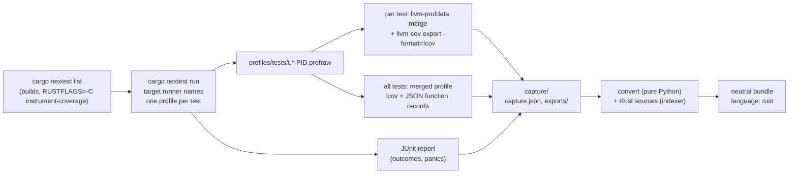

# Rust: per-test coverage with cargo-nextest and LLVM

`coverset rust run` gives a Rust crate the same per-test coverage a Python suite gets from
`pytest-coverset`. It records which lines each test executed, which tests passed, failed or were
ignored, and where the functions are, and writes them as a [neutral bundle](neutral-bundle.md)
with `language: rust`. Everything downstream reads that bundle the way it reads one from Python or
TypeScript: `coverset bundle validate`, `coverset report`, the facts store, patch coverage, tests per
line and per function, and upload mode.

Status, in the words of [ARCHITECTURE.md](../ARCHITECTURE.md):

| Part | Status |
|---|---|
| per-test line coverage, test outcomes and failure messages, function regions, declared types | **verified**: `src/coverset/lang/rust_llvm.py`, `src/coverset/lang/rust.py`, tests in `tests/lang/` and `tests/e2e/test_rust_adapter.py` |
| `RustAdapter` (detect, source-based function index and `changed_functions`, reading bundles and raw captures) | **verified** |
| ingest of a Rust bundle (regions, tests per function, patch coverage) | **verified** (`tests/lang/test_rust_ingest.py`) |
| per-test branch arcs, MC/DC | not built: stable rustc has no branch coverage (below) |
| argument shapes (`#[coverset::trace]`) | **designed, not built** ([below](#argument-shapes-the-coversettrace-design)) |
| managed runs (coverset building the Rust environment and running the suite in its workers) | not built: `RustAdapter.env_spec` raises; use a local run or upload mode |

## Quick start

```sh
rustup component add llvm-tools-preview     # llvm-profdata and llvm-cov, matching rustc's LLVM
cargo install --locked cargo-nextest        # optional: without it, --runner libtest is used
uv run coverset rust run --crate examples/rust-app
```

The command builds the crate's test binaries with `-C instrument-coverage` (into
`target/coverset`, so the normal build cache is untouched), runs every test in its own process,
exports each test's profile, and writes the bundle to `examples/rust-app/.coverset/neutral`. It
ends by printing the command that renders it:

```text
wrote /…/examples/rust-app/.coverset/neutral
view it with: coverset report /…/examples/rust-app/.coverset/neutral --trusted --repo-root /…/<git top>
```

| Option | Default | Meaning |
|---|---|---|
| `--crate PATH` | `.` | the crate or workspace directory (where `Cargo.toml` is) |
| `--out DIR` | `CRATE/.coverset/neutral` | where the bundle goes (rows as `.jsonl.gz`, which `coverset-ci upload` reads) |
| `-j, --jobs N` | CPU count | tests run, and profiles exported, at a time |
| `--runner nextest\|libtest` | nextest when `cargo nextest` is installed | see [Two runners](#two-runners-one-result) |
| `--root DIR` | the git work tree's top, else CRATE | bundle paths are relative to it; an upload needs the repository root |
| `--archive FILE` | none | also pack the bundle as a reproducible `tar.gz` |
| `--keep-profiles` | off | keep the `.profraw`/`.profdata` files (about 50 KB per test) |

`coverset rust convert CAPTURE --out DIR [--root DIR]` reruns only the last stage, from a capture
directory to a bundle, with no Rust toolchain. The committed fixture is rebuilt this way.

`examples/rust-app` is a small ledger library, the Rust counterpart of the Python demo app:
`allocate_cents`, `format_cents`, `Ledger::{new, post, balance, transfer}`, `parse_duration`,
`merge_intervals`, the generic `largest<T>`, `validate_email` and a `Display` impl. It has 12 unit
tests (one `#[ignore]`d) and 4 integration tests in `tests/ledger_flow.rs`.

## Why one process per test, and why nextest

LLVM source-based coverage (`-C instrument-coverage`) compiles counters into the binary. The
profiling runtime writes them to a `.profraw` file **once per process, at exit**. libtest, the
default harness behind `cargo test`, runs a binary's tests as threads of one process, so all of
them add to the same counters and the profile cannot be split by test afterwards. Per-test
coverage therefore needs one process per test. That is exactly how
[cargo-nextest](https://nexte.st) runs tests: it lists each test binary's tests, then starts
`<binary> --exact <name>` once per test, `-j` at a time.

The second problem is naming each profile after its test. `LLVM_PROFILE_FILE` expands only `%p`
(pid), `%h` (host), `%m` (binary signature), `%c` and `%t`; none of them identifies a test. coverset
names the profiles through nextest itself, without modifying the crate:

1. nextest sets `NEXTEST_BINARY_ID`, `NEXTEST_TEST_NAME` and `NEXTEST_ATTEMPT` in every test
   process's environment.
2. nextest honours Cargo's *target runner* (`CARGO_TARGET_<TRIPLE>_RUNNER`): a command placed in
   front of every test process. coverset sets it, for this run only, to a five-line `sh` script:

   ```sh
   if [ -n "${NEXTEST_TEST_NAME:-}" ]; then
     base=$(mktemp "$COVERSET_PROFILE_DIR/t.XXXXXXXXXX") || exit 70
     printf '%s\n%s\n%s\n' "$NEXTEST_BINARY_ID" "$NEXTEST_TEST_NAME" "${NEXTEST_ATTEMPT:-1}" > "$base"
     LLVM_PROFILE_FILE="$base-%p.profraw"; export LLVM_PROFILE_FILE
   fi
   exec "$@"
   ```

   Each attempt of each test gets a unique id file and its own profile name. `%p` keeps the profiles
   of processes the test spawns apart from the test's own. A CLI test that runs the crate's binary
   (`Command::new(env!("CARGO_BIN_EXE_greet"))`) leaves a second profile, which is merged into the
   test's export together with the binary's coverage mapping. A retried test keeps its last
   attempt.
3. `--tool-config-file coverset:<work>/nextest.toml` adds a `coverset` profile with a JUnit report
   and a store directory under coverset's work directory. The crate's own `.config/nextest.toml`
   still applies: retries, slow-test timeouts, test groups and the default filter all work as they
   do in the crate's CI. Outcomes, durations and panic messages come from that JUnit report.

The alternatives that were measured or read and rejected:

| Alternative | Why not |
|---|---|
| `cargo llvm-cov nextest` | merges every test into one profile; cargo-llvm-cov 0.9.1 has no per-test mode (only `show-env` and `--no-report`, which give you the environment and leave the rest to you, as here) |
| one `cargo nextest run -E 'test(=<id>)'` per test | every invocation runs `cargo metadata` and lists every test binary again (`<binary> --list`), so the listing cost is paid N times: quadratic in practice |
| nextest wrapper scripts | still experimental in nextest 0.9.148 and enabled only from the repository's own `.config/nextest.toml` (`experimental = ["wrapper-scripts"]`), so the crate would need editing |
| `%p` alone, mapping pids to tests afterwards | nextest reports no pids |

### Two runners, one result

Without nextest, `--runner libtest` does the same work itself. `cargo test --no-run
--message-format json` builds the binaries and names them; `<binary> --list --format terse` (and
`--ignored`) lists the tests; each test runs as `<binary> --exact NAME --test-threads 1`, with
`LLVM_PROFILE_FILE=<key>-%p.profraw`, in a thread pool of `--jobs` workers. Outcome comes from the
exit status, the message from libtest's `---- NAME stdout ----` section. Test ids use nextest's
binary-id scheme in both runners: `ledger` for the library, `ledger::ledger_flow` for an
integration test, `greet::bin/greet` for a binary's unit tests. On the example crate, a failing
copy of it and a binary crate with a CLI test, both runners produce identical statements, per-test
line sets, regions, failure messages and failure signatures (`tests/e2e/test_rust_adapter.py`
asserts it). Prefer nextest when it is installed: the crate's nextest configuration then applies.

## The pipeline



1. **Run**: described above. The work directory is `CRATE/.coverset/rust`.
2. **Export**: for each test, `llvm-profdata merge -sparse` turns its `.profraw` files into an
   indexed profile, and `llvm-cov export -format=lcov -skip-functions` against the test's own
   binary gives the lines it executed. These are LLVM's own line semantics: a line counts exactly
   when `llvm-cov show` would show it as executed. Only the executed `DA` lines are kept, which
   makes the stored export about ten times smaller. One merged profile over all tests then gives
   the measurable lines (every `DA` line, executed or not). Per binary, the JSON export gives LLVM's
   function records, kept as a small digest: file, start line and column, end line, how many
   binaries contain the function, how many instantiations one binary has, and whether it is a
   closure. The standard library and dependencies are filtered out
   (`--ignore-filename-regex`). Once exported, the profiles are deleted.
3. **Convert** (`convert_capture`, no toolchain needed): the capture plus the Rust sources become
   the bundle (next section).

A **capture** is the boundary between stages 2 and 3, and it is all the converter reads:

| File | What it holds |
|---|---|
| `capture.json` | `format: coverset-rust-capture`, version 1; the repository `root`; runner and rustc versions; jobs and per-stage timings; every test binary (binary id, kind, root source file, package root); every test (binary id, name, ignored, outcome, duration, message, failure signature, start/stop, its export) |
| `exports/tests/<key>.lcov` | the executed lines of one test (`key` = `blake2b(binary_id \0 name, 8)`) |
| `exports/merged.lcov` | every instrumented line of every binary (the statements) |
| `exports/llvm-functions.json` | LLVM's function records, digested |

## What LLVM gives and what reaches the bundle

| LLVM / nextest | Neutral bundle |
|---|---|
| test binaries and tests (nextest list, JUnit) | `tests.jsonl`: id `<binary-id> <test name>` (what nextest prints, so an id pastes into `-E 'test(=...)'` after the space), `file` and `line` of the test function (resolved through the module tree: `money::tests::refuses_to_overdraw` is `src/money.rs:115`), `outcome` (`passed`, `failed`, `skipped` for `#[ignore]`, `null` for a test that never ran), `message` (the panic, thread id removed so it is stable), `fail_sig` (hash of the panic location `file:line`, never of the message), marker `ignore` |
| merged `DA` lines | `files.jsonl` `statements`, minus test-only code |
| instrumented lines inside `#[cfg(test)]` items and `#[test]`-like functions | `files.jsonl` `excluded` (test code never counts towards coverage) |
| a test's executed `DA` lines | `coverage.jsonl`, one row per (test, file) |
| function records | `functions.jsonl`, through the source indexer (below). LLVM's records are the cross-check: the manifest's `meta.llvm_functions` lists the regions LLVM never instrumented, records no region explains, monomorphised functions (`largest`: 2) and how many binaries each function is in |
| regions (column-precise counters) | not shipped: the bundle is line-based |
| branch counters (`-Z coverage-options=branch`, nightly) | not shipped: `files.jsonl` `branches` and `arcs.jsonl` stay empty (below) |
| MC/DC records (`mcdc_records` in the JSON export) | not shipped; nightly-only and unstable upstream |
| code that ran outside any test | nothing: Rust has no import-time execution. A `static` initialised lazily (`LazyLock`) runs inside the first test that touches it, and with one process per test that is every test that touches it, which is the honest attribution |

Function regions come from `src/coverset/lang/rust.py`, a light indexer. It is not a parser: it
tokenizes (comments, nested block comments, strings, raw strings, byte strings, char literals and
lifetimes are told apart, so a brace inside any of them never counts) and walks items by brace
matching. Each `fn` with a body becomes a region named by its in-file path: `allocate_cents`,
`Ledger::post`, `<LedgerError as fmt::Display>::fmt`, `outer::inner` for a nested function.
`def_line` is the first attribute's line, `body_start` the first token inside the braces and
`end_line` the closing brace. `body_hash` and `sig_hash` are BLAKE2b over the token texts rather
than over the raw slice, so `rustfmt`, moved comments and blank lines change neither hash, while an
attribute such as `#[inline]` changes only `sig_hash`. The parameters and the return type become
type descriptors: `i64` is `int`; `&str`, `String` and `char` are `str`; `Option<T>` is a union with
`none`; `Result<T, E>` is a union of T and E; `Vec<T>`, `&[T]` and `[T; N]` are lists (of `u8`,
`bytes`); maps and sets are `dict` and `set`; tuples are fixed tuples; `Box`, `Rc`, `Arc` and `Cow`
are their target; an enum declared in the crate is an `enum` with its variants; `Self` is the impl's
type; a type parameter or `impl Trait` is `any`. On the example crate every one of the 12 regions
matches an LLVM function record, and no record is unexplained.

Because the adapter reads Rust, `RustAdapter.changed_functions` classifies a diff per function
from the two sides' sources (added, deleted, modified, trivial) without either side's bundle, the
same way the Python adapter does.

## Cost model

For N tests, B binaries and j jobs:

```text
T ≈ T_build(instrumented)                      once per lockfile/source change (cargo caches it)
  + N · (t_test + t_process) / j               what nextest costs anyway, plus the instrumentation
  + N · (t_profdata + t_llvm-cov(binary)) / j  the per-test export: dominated by llvm-cov reading
                                               the test binary's coverage mapping
  + B · t_llvm-cov(binary)                     the merged export and the function records
  + T_convert                                  Python, linear in coverage cells
```

Measured on a 16-core Apple Silicon Mac (rustc 1.98.1, cargo-nextest 0.9.148), warm build cache:

| Suite | Plain `cargo nextest run` | `coverset rust run` (stages) | Total |
|---|---|---|---|
| `examples/rust-app`, 16 tests, -j16 | 0.02 s of tests | run 0.15 s, export 0.05 s, merged export 0.05 s, convert 0.02 s | 0.3 s warm; 1.1–1.9 s with a cold instrumented build |
| synthetic, 300 tests in 20 modules, -j16 | 0.27–0.31 s wall | run 0.42–0.47 s, export 1.30–1.41 s, merged 0.06 s, convert 0.33 s | 2.3–2.4 s |
| same, -j4 | | run 1.00 s, export 2.33 s | 3.9 s |
| same, -j1 | | run 3.54 s (12 ms/test), export 8.34 s (28 ms/test) | 12.4 s |
| same, `--runner libtest`, -j16 | | run 0.79–0.97 s, export 1.95–2.04 s | 3.3–3.6 s |

The profiles of the 300-test run take 15 MB (about 50 KB per test) and are deleted after export.
The exports take 1.3 MB and the gzipped bundle 28 KB. The run stage costs about twice plain
nextest: the instrumentation itself, plus a `sh` and a `mktemp` per test. The export stage is the
part that grows with binary size. `llvm-cov` decodes the whole coverage mapping of the test binary
for every test, so on a large workspace, whose integration-test binaries reach tens of megabytes,
expect tenths of a second per test rather than 28 ms. That is an estimate; no large workspace was
measured. The fix is a counters-only exporter: decode each binary's mapping once, then read each
`.profraw`'s counter array directly, which costs microseconds per test. It is the first item under
[What would come next](#what-would-come-next).

Matching profiles to tests is one directory listing grouped by file-name prefix, not one glob per
test: per-test globbing re-reads the whole profiles directory N times, which measured 1.1 s for
1,000 tests, 9.5 s for 3,000 and 56 s for 6,000. The single listing takes 0.02 s for 1,000,
0.12 s for 6,000 and 0.45 s for 20,000 (same Mac; `tests/lang/test_rust_pipeline.py` asserts the
6,000 case stays under 5 s, generation included). The libtest runner lists once after the pool.

Parallelism: both the run and the export use `-j` workers and scale close to linearly (the 300-test
export is 8.3 s at -j1 and 1.35 s at -j16). The export runs after the whole suite. Pipelining it
behind the runner (export a test as soon as its process exits) would hide most of it behind the
run on a large suite.

## Limitations (v1)

- **No per-test branches or arcs.** Stable rustc emits only code regions. Branch coverage
  (`-Z coverage-options=branch`) needs nightly; when it stabilises, its branch regions map onto
  `files.jsonl` `branches` and per-test `arcs` without a format change. Until then a Rust bundle
  reports branch coverage as `n/a`, and no partial branches.
- **Generics and monomorphisation.** Each instantiation of a generic function is a separate LLVM
  function; `llvm-cov` merges their line counts, which is what the bundle needs. The manifest names
  the functions that had several instantiations. A function nothing calls, generic or not, still
  has instrumented lines: rustc emits a zero-count coverage record for every unused function of
  the crate it is defined in, so its lines are uncovered statements and lower the coverage
  percentage, as they should. Checked on rustc 1.98.1 with an unused
  `pub fn never_used_generic<T: Debug>(v: T) -> String`: its lines were statements, none
  executed, and its digest record had `instances: 1` (the unused stub, counted like one
  instantiation), `binaries: 1` (only the defining crate's own test binary carries the stub; an
  integration-test binary that links the library does not) and `count: 0`. It is therefore not in
  `meta.llvm_functions.not_instrumented`, which lists only indexed regions that no LLVM record
  matches at all (none, on the example crate and this experiment).
- **Inlining.** The counters are inserted on MIR, before LLVM inlines, so an inlined function
  still counts its own lines. Generic and `#[inline]` code from dependencies is filtered out by
  path, like the rest of the dependencies.
- **Doctests** are not run: nextest does not run them, and instrumenting them needs nightly
  (`-Z unstable-options --persist-doctests`). Code exercised only by a doctest shows as not run.
- **Proc-macro crates.** A procedural macro runs inside the compiler, not inside a test, so its
  coverage while expanding is not recorded. Its own unit tests are recorded normally. Code a macro
  generates is attributed to the lines of the macro call. Functions defined inside `macro_rules!`
  bodies are invisible to the indexer (their lines still count).
- **Workspaces.** `--crate` at the workspace root runs every member: when `cargo metadata` says
  the crate directory is the workspace root, `cargo nextest list/run` (or `cargo test --no-run`)
  get `--workspace`. Without it Cargo would build only the default members, which for a root that
  is itself a package (ripgrep, clap, nushell) is the root package alone: the members' tests would
  never run while the member code linked into the root's tests would still be measured.
  `--crate` pointing at a member runs that member only (Cargo's own choice). Binary ids are per
  package. A file belongs to the most specific package root that contains it, and it is measured
  when it is outside that package's `tests/`, `benches/`, `examples/` and `build.rs`, so a
  member's `crates/x/tests/flow.rs` is never product code even though the root package's root
  (`.`) contains it too. A path dependency outside `--root` is dropped.
- **Module layout.** The 2018 layout (`a.rs` + `a/b.rs`, or `a/mod.rs`) is followed. A
  `#[path = "..."]` attribute is not, and a test whose function cannot be found is reported with
  its crate root file and no line.
- **Processes that never exit normally.** The profile is written at exit. A test that ends in
  `std::process::abort` or is killed by a timeout leaves no profile and therefore no lines,
  although its outcome is still reported.
- **Host only.** `--target` cross-compilation is not supported. A target runner the crate already
  configures for the host (such as a sandbox wrapper) is replaced for the run. Cargo splits a
  target-runner value on whitespace with no quoting, so when the crate path contains a space the
  runner script is written to a fresh temporary directory instead (and removed after the run);
  only if that directory also has whitespace does the run stop and suggest `--runner libtest`. A `build.rustflags`
  in `.cargo/config.toml` is overridden, which is Cargo's rule whenever `RUSTFLAGS` is set.
- **The driver lives in the `coverset` package.** It needs coverset's Python environment, not only
  the stdlib-only `coverset-ci`.

## Argument shapes: the `#[coverset::trace]` design

Python gets argument shapes for free: the tracer sees every frame's locals. Rust erases types at
runtime, so shapes need instrumentation at compile time. This section is a design; nothing here is
built.

### The API

Two small crates. `coverset` holds the recorder, the `Shape` trait and the JSONL spool writer.
`coverset-macros` holds the attribute.

```rust
#[cfg_attr(coverset, coverset::trace)]
pub fn allocate_cents(total_cents: i64, weights: &[u32]) -> Result<Vec<i64>, LedgerError> { … }

#[cfg_attr(coverset, coverset::trace)]          // every method of the impl
impl Ledger { … }

#[derive(coverset::Shape)]                       // user types: an enum's variant, a struct's name
pub enum Currency { Usd, Eur, Jpy }
```

A `coverset rust run --shapes` flag (not built) would add `--cfg coverset` to `RUSTFLAGS`, so
normal and release builds never see the attribute and pay nothing. The macro rewrites the function into:

```rust
pub fn allocate_cents(total_cents: i64, weights: &[u32]) -> Result<Vec<i64>, LedgerError> {
    static SITE: ::coverset::Site = ::coverset::Site::new(file!(), "allocate_cents", line!());
    let __cs = ::coverset::enter(&SITE);                  // one relaxed atomic increment
    if __cs.sampled() {                                   // the adaptive cap says yes
        __cs.param("total_cents", &total_cents);
        __cs.param("weights", &weights);
    }
    let __ret = (move || -> Result<Vec<i64>, LedgerError> { /* the original body */ })();
    __cs.ret(&__ret);                                     // and pops the caller stack
    __ret
}
```

The body is wrapped in a closure (an `async move` block for an `async fn`), as
`tracing::instrument(ret)` does, so `return` and `?` keep their meaning. `__cs` is a guard: it
records `return` even when the body panics (no return shape then) and keeps a thread-local stack of
traced frames. The stack gives the in-repo caller (`caller: [path, qualname, line]`) when the
caller is traced too, and `{"test": id}` otherwise. `#[track_caller]` is not used, because it would
change where panics point.

### Shape keys for Rust values

The keys are the vocabulary of [docs/neutral-bundle.md](neutral-bundle.md#shape-keys), so the
catalogue, the pages and the comment need no change:

| Rust value | Shape key |
|---|---|
| `i8` … `i128`, `u8` … `usize` | `int\|neg`, `int\|zero`, `int\|pos`, plus `big` beyond ±2³¹ |
| `f32`, `f64` | `float\|nan`, `inf`, `inf-neg`, `neg`, `zero`, `pos`, `integral` |
| `bool` | `bool\|true`, `bool\|false` |
| `char` | `str\|len:1\|ascii` or `unicode` |
| `&str`, `String`, `Cow<str>` | `str\|len:<bucket>\|ascii…` plus the same `kind:` classifiers as Python (`email/plus-tag`, `iso-date`, `numeric`, `quantity/…`), ported to Rust and held to the Python output by the conformance tests in `tests/plugin_conformance/` |
| `Option<T>` | `None` is `NoneType`; `Some(x)` is x's key (a union with `none`, as the descriptor says) |
| `Result<T, E>` | `Ok(x)` is x's key, `Err(e)` is e's key |
| `Vec<T>`, `&[T]`, `[T; N]`, `VecDeque<T>` | `list\|elem:<t>\|len:<b>\|order:<…>`, `dups`, `any_zero`/`any_neg`/`all_zero`/`sum_zero` for numbers |
| `HashMap`, `BTreeMap` | `dict\|key:<t>\|len:<b>` |
| `HashSet`, `BTreeSet` | `set\|elem:<t>\|len:<b>` |
| `(A, B)` | `tuple\|len:2`, `pair:lt\|eq\|gt` for two numbers |
| an enum with `#[derive(Shape)]` | `obj:<crate>.<Enum>`, example `Currency.Eur` |
| a struct with `#[derive(Shape)]` | `obj:<crate>.<module>.<Name>` |
| anything else | `obj:<std::any::type_name::<T>()>` |

The last row needs no trait implementation. A blanket fallback picks the type name by autoref
specialisation, a stable-Rust technique that selects a `Shape` implementation when one exists and
the fallback otherwise. A type that implements neither still gets a key.

**Enum variants map onto input classes directly.** The indexer already ships an enum parameter's
declared type as `{"kind": "enum", "name": "Currency", "members": ["Usd", "Eur", "Jpy"]}`, so the
catalogue expects one class per variant. The tracer writes the example of an enum value as
`Currency.Eur`, the neutral `Name.member` form readers match as a whole token. A variant no test
passes is then a hollow square, exactly like a Python `Enum` member. `Result` returns map the same
way: `LedgerError.Overdrawn` is a class of `allocate_cents`'s `return`.

Examples are redacted at the source with the same rules as `pytest-coverset` (emails, tokens, long
digit runs), and a string longer than 1,000 bytes is classified from its first 1,000.

### Sampling and output

The adaptive cap is Python's: every call of a function is shaped until it has K samples per test,
then one call in M, and the cap that stopped it is recorded (`cap: "sample"`). Each test process
appends to `$COVERSET_SHAPES_DIR/<the runner's base>.jsonl`. The target runner already names one
base per test attempt, so attribution to tests comes from process-per-test with no bookkeeping. The
converter aggregates the spools into `shapes.jsonl` `obs` and `sampling` rows.

**Cost.** A call that is not sampled pays one relaxed atomic increment and a thread-local push and
pop, a few nanoseconds. A sampled call pays the shape computation, which is linear in the value for
strings (classification, capped) and for collections (element scan, capped at 1,000 elements). For
scale: on the Python demo, where the tracer sees every call, shapes add under 1% on top of coverage
(`docs/numbers.json`: 2.554 s plain, 2.895 s with coverage, 2.918 s with coverage and shapes). The
Rust tracer touches only annotated functions.

**Alternative, for code that already uses `tracing`.** A `coverset::TracingLayer` for
`tracing-subscriber` can read the fields of `#[tracing::instrument]` spans with no new attribute.
The cost is fidelity: `tracing` hands a visitor only `i64`, `u64`, `f64`, `bool`, `&str` and
`Debug` text, so collection lengths and element types are lost. It is a cheap way to adopt, not a
replacement.

The same keys are what a production integration would compute from OpenTelemetry span attributes:
shape keys carry no values, so they can leave a production process without the data itself. Mapping
production traffic onto the input classes the tests exercise is the bridge to the data-flow work
planned for later.

## Upload mode

A Rust bundle uploads like a Python one. `coverset rust run` writes `CRATE/.coverset/neutral`
with gzipped rows. `coverset-ci upload` finds a `neutral/` directory under `--dir` and, with
`--with-sources`, reads the files table from it. The server reads the manifest's
`language: rust`. `rust` is registered as a neutral language, so the upload path keeps that
language, the ingest serves it with the `RustAdapter`, and the function regions and declared types
come from the bundle. Run the upload from the **repository top**: the bundle's paths are
relative to it (the `--root` default), and `coverset-ci upload --with-sources` resolves them
against the current directory, because `coverset rust run` writes no `.coverset/meta.json` with a
`repo_root` for it to read. When the crate is the repository top:

```sh
coverset rust run --crate .
coverset-ci upload --server https://coverset.example.com --dir .coverset --with-sources
```

When the crate is in a subdirectory (`rust/` here), stay at the top and point both at it:

```sh
coverset rust run --crate rust
coverset-ci upload --server https://coverset.example.com --dir rust/.coverset --with-sources
```

Uploading from inside `rust/` would look for `rust/rust/src/...`, skip every file as untracked and
send no sources.

In GitHub Actions:

```yaml
- uses: dtolnay/rust-toolchain@stable
  with: { components: llvm-tools-preview }
- uses: taiki-e/install-action@nextest
- run: pip install coverset pytest-coverset   # the driver, and coverset-ci (from wherever you host them)
- run: coverset rust run --crate .            # from the repository top; --crate rust for a subdirectory
- run: coverset-ci upload --server ${{ vars.COVERSET_URL }} --with-sources   # --dir rust/.coverset likewise
```

The run's identity (repository, head and base SHA, pull request) comes from the Actions
environment, and authentication is the job's OIDC token or a `cst_` upload token, as for Python
([docs/github.md](github.md)). What is verified: `tests/lang/test_rust_ingest.py` ingests the
fixture through the orchestrator's ingest (`ingest_one` with `language="rust"`) and checks tests per
function, tests per line and patch coverage on Rust files. What is not: the upload route itself was
not exercised with a Rust bundle, and its diff classification (`_diff_for` in
`orchestrator/upload.py`) still calls the Python adapter, so a Rust pull request's changed functions
are not classified there yet. Using `adapter_for_language(language)` there would give it
`RustAdapter.changed_functions`.

## What would come next

1. **A counters-only exporter**: decode each binary's coverage mapping once, then read the counter
   array of every `.profraw` directly. This removes the per-test `llvm-cov` process, the dominant
   cost on large binaries.
2. **Pipelined export**: export each profile as soon as its test exits.
3. **Managed runs**: an `EnvSpec` for Rust (toolchain from `rust-toolchain.toml`, `env_hash` over
   `Cargo.lock` and the toolchain, the instrumented `target/` cached in the worker image or a
   volume) and a `test_command` that turns the planner's test ids into a nextest filterset. Risk
   ordering would come from a generated tool config whose per-test overrides set nextest's
   `priority`.
4. **Branches** as soon as `-Z coverage-options=branch` is stable.
5. **`#[coverset::trace]`** as designed above.

## Files

| Path | What it is |
|---|---|
| `src/coverset/lang/rust.py` | the tokenizer, the item indexer, module resolution, type descriptors, `RustAdapter` |
| `src/coverset/lang/rust_llvm.py` | the toolchain lookup, the two runners, the export, the converter, `run_rust` |
| `src/coverset/commands/rust.py` | `coverset rust run` and `coverset rust convert` |
| `examples/rust-app/` | the example crate (with `Cargo.lock`) |
| `fixtures/bundles/neutral-rust/` | a real capture of the example, its sources and the bundle; `scripts/make_rust_fixture.py` rewrites it, `--check` compares |
| `tests/lang/` | indexer, converter, CLI and report, and ingest tests over the fixture; `test_rust_pipeline.py` covers toolchain probing, workspace scope, the runner placement and profile matching with fake `cargo`/`rustc` (no cargo needed) |
| `tests/e2e/test_rust_adapter.py` | the real pipeline, both runners, a failing test, a CLI test, a workspace whose root is a package, a crate path with a space; skipped (with the reason) without a usable Rust toolchain |
