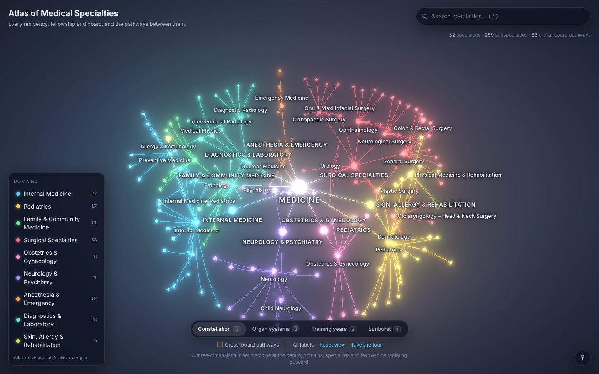

# Atlas of Medical Specialties

An interactive, three-dimensional map of the major medical specialties and
subspecialties: every residency, fellowship and certifying board in the United
States system, and the pathways between them. Built with [three.js](https://threejs.org),
TypeScript and Vite.



## What it shows

The atlas is a graph of **197 nodes**: Medicine at the centre, nine broad
domains, 32 specialties with their own residency and primary board certificate,
and 156 subspecialties reached by fellowship. Subspecialties that can be entered
from more than one specialty (Sleep Medicine, Hospice & Palliative Medicine,
Pain Medicine, Critical Care, Hand Surgery…) are drawn once, under their home
board, with dashed **cross-board pathways** to every other board that certifies
them. There are 83 of those pathways.

Every node carries a short description, its certifying board, the kind of
credential (ABMS primary or subspecialty certificate, UCNS certificate,
accredited fellowship, focused practice), typical training length, and the
organ system or kind of work it serves.

### Four layouts

| Layout | What it answers |
| --- | --- |
| **Constellation** | How is medicine organised? A spherical tree: domains, specialties and fellowships radiate outward from the centre. |
| **Organ systems** | Which disciplines share a body system? A ring of twenty clusters (heart & vessels, brain, children, cancer…) with arches linking each fellowship back to its home specialty. |
| **Training years** | How long does each path take? Left to right by cumulative years of residency and fellowship after medical school, one lane per domain. |
| **Sunburst** | The same hierarchy as a flat radial chart, viewed from above. |

Layouts animate into one another; the camera follows.

### Interaction

- **Hover** a node to see its name and its connections; **click** to select it,
  fly the camera to it and open the detail panel with its training pathway,
  board, subspecialties, other boards that reach it and related disciplines.
- **Search** (`/`) by name, abbreviation or alias.
- **Legend**: click a domain to isolate it, shift-click to toggle it.
- **Cross-board pathways** (`C`) draws every multi-board route at once.
- **All labels** (`L`) overrides the level-of-detail labelling.
- Arrow keys walk the tree (siblings, parent, first child); `1`–`4` switch
  layouts; `R` resets the view; `Esc` clears; `?` opens help.
- Deep links: `#/cardiovascular-disease` opens the atlas on that node.

## Development

```sh
pnpm install
pnpm dev        # http://localhost:5173
pnpm check      # typecheck + tests + production build
```

The dataset lives in `src/data/nodes/*.ts`, one file per domain, and is
validated by `src/data/graph.ts` and `tests/data.test.ts` (unique ids, known
parents, no cycles, sensible training totals). Layout algorithms are in
`src/graph/layouts.ts`; the WebGL scene in `src/scene/`; the HTML chrome in
`src/ui/`.

### How it is drawn

- Nodes are two instanced meshes (a core sphere and an additive halo) coloured
  per instance by domain and emphasis, so the whole graph is a handful of draw
  calls.
- Edges are quadratic Bézier curves rendered as screen-space fat lines
  (`LineSegments2`); cross-board routes are dashed and arch away from the tree.
- An Unreal bloom pass gives the glow; its strength and the halo size ease off
  as the camera approaches so close-ups stay legible.
- Labels are HTML (`CSS2DRenderer`) with a per-frame greedy collision pass:
  trunk labels claim space first, subspecialty labels appear as the camera
  nears and try four placements around their node before yielding.

## Sources and caveats

The structure follows the member boards of the American Board of Medical
Specialties (ABMS) and the subspecialties they certify, plus certificates of
the United Council for Neurologic Subspecialties and widely recognised
ACGME-accredited or society-recognised fellowships that carry no separate
certificate. Training lengths are typical United States pathways and vary by
programme and route; the detail panel notes the common alternatives. The
dataset was compiled by hand for this visualisation and is not an official
publication of any board.
