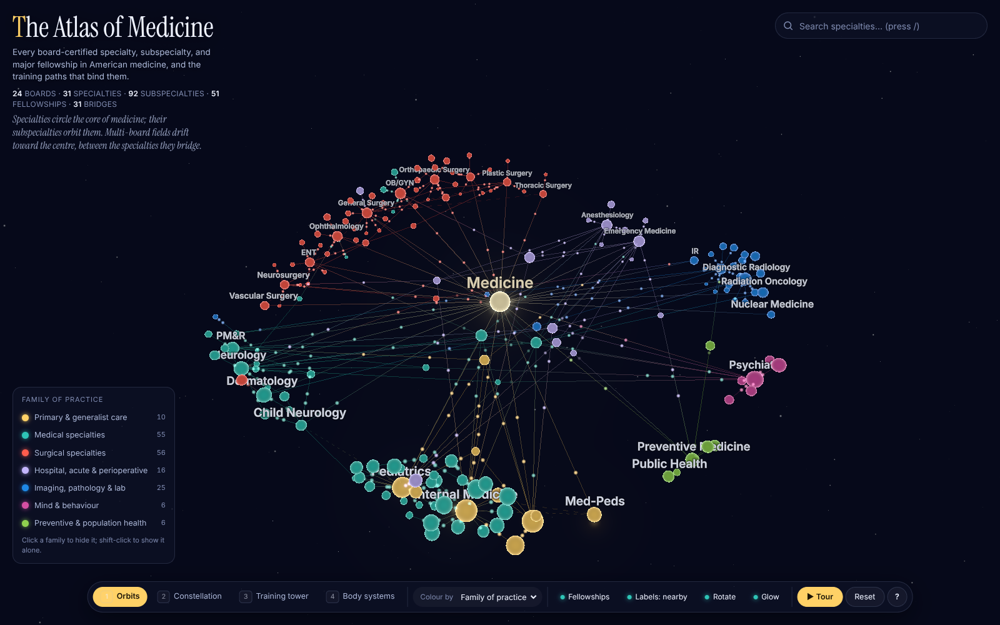

# The Atlas of Medicine

An interactive, three-dimensional atlas of the major medical specialties, their
subspecialties, and the fellowships that connect them, rendered with
[three.js](https://threejs.org).



## What it shows

- **24 ABMS boards, 31 primary specialties, 92 subspecialties, 51 fellowships.**
  Every node is a field of practice; every edge is a training path.
- **Bridges.** Fields certified by more than one board (hospice & palliative
  medicine is shared by ten) sit between the specialties they connect and are
  marked ⟡.
- **Four layouts.** *Orbits* (specialties circle the core, subspecialties
  orbit them), *Constellation* (a d3-force-3d physics simulation),
  *Training tower* (height = years after medical school) and *Body systems*
  (regrouped by organ system).
- **Five colour lenses.** Family of practice, body system, years of training,
  workforce size, and credential type. Node size always follows workforce.
- **Search, filtering, deep links.** Fuzzy search (`/`), per-family filters in
  the legend, a fellowships toggle, and a URL hash that captures layout, lens
  and selected node (`#layout=tower&node=electrophysiology`).
- **A guided tour** (`T`) through ten stops, and a detail panel for every node
  with its description, boards, shortest training path, and related fields.

## Running it

```bash
pnpm install
pnpm dev          # http://localhost:5173
pnpm build        # typecheck + production build into dist/
pnpm preview      # serve dist/ on http://localhost:4173
pnpm test         # vitest: data integrity + layout sanity checks
pnpm screenshot   # headless Chromium captures of every view into screenshots/
```

`pnpm screenshot` expects a preview server on `:4173` and a Chromium binary at
`/opt/pw-browsers/chromium-1194/chrome-linux/chrome` (override with
`CHROMIUM_PATH`).

## Controls

| Key | Action |
| --- | --- |
| drag / scroll / click | orbit · zoom · select |
| `/` | focus search |
| `1` `2` `3` `4` | Orbits · Constellation · Training tower · Body systems |
| `C` | cycle colour lens |
| `F` `L` `G` `Space` | fellowships · label density · glow & flow · auto-rotate |
| `T` `R` `?` `Esc` | tour · reset view · help · clear |
| `←` `→` | step through siblings of the selected node |

## How it is built

```
src/
  data/specialties.ts   the dataset: ~190 nodes with descriptions, boards, years, workforce
  data/schema.ts        types, category / domain / credential metadata and colours
  graph.ts              builds the graph: depth, bridges, training years, node radii
  layouts/              orbits, tower, systems (deterministic) and constellation (d3-force-3d)
  scene/                three.js: instanced node spheres with a fresnel shader, additive
                        halos, gradient edges with a dashed "via" style, particle flow along
                        edges, troika SDF labels with screen-space overlap culling, star
                        field, tower guide rings, bloom post-processing, camera flights
  ui/                   detail panel, fuzzy search, legend, guided tour
  state.ts              a tiny observable store
  main.ts               wires everything together; keyboard shortcuts; URL hash state
```

Layouts are computed synchronously from a seeded PRNG so every visit renders the
same picture, and transitions between them are tweened per node with a small
stagger. Nodes are a single `InstancedMesh`; edges a single `LineSegments`;
flow particles a single `Points` whose positions are computed in the vertex
shader from edge endpoints. The whole scene is a handful of draw calls plus the
labels.

## About the data

The taxonomy follows the 24 member boards of the American Board of Medical
Specialties and their certificates (including focused-practice designations),
with ACGME-accredited or widely recognised society fellowships added where they
shape practice. Training lengths are typical minimums after medical school.
Workforce figures are approximate counts of active US physicians, rounded from
public AAMC and ABMS reports, and are used only for relative sizing.
Osteopathic (AOA) boards, non-US systems, and combined residencies other than
Med-Peds are not represented. Corrections welcome: edit
`src/data/specialties.ts`; `pnpm test` checks referential integrity.

## Fonts

Inter and Instrument Serif are bundled under the SIL Open Font License; see
`public/fonts/*-OFL.txt`.
